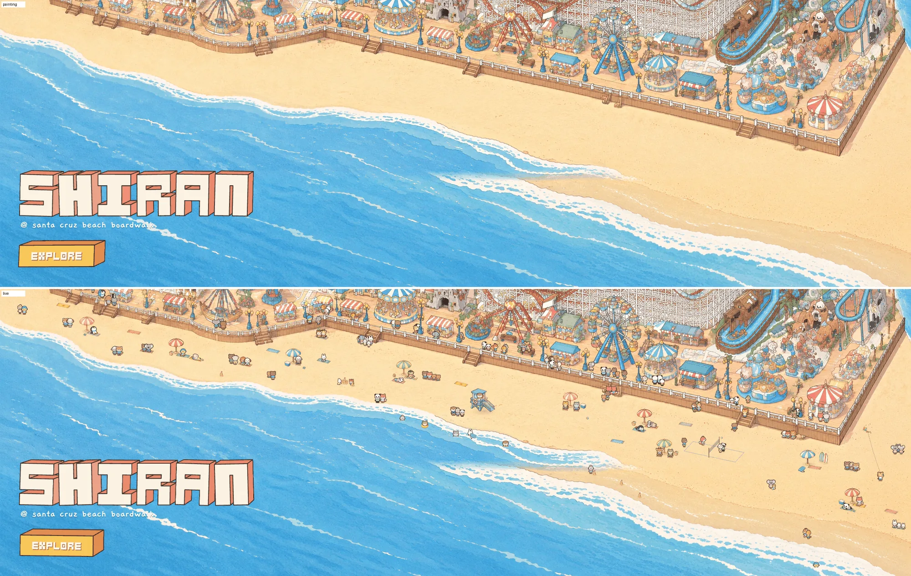

# The beach: a relaxed summer day on the sand

View: **http://ran:5178/?layers=sea,beach** (with the crowd), `&crowd=0` for the beach's own people only, `&t=400`
for a frozen frame. Not in the page's `RIDES` list yet.

`shots/monitor_2560_mid_x2.webp` and `shots/monitor_2560_east_x2.webp`: painting | live at monitor size, enlarged.
`shots/park_1to1_east_x2.webp`: 1 CSS px per park px, enlarged 2x. Motion strips: `shots/strip_volleyball.webp`,
`strip_waders_castle.webp`, `strip_camp_m2.webp` (a sunbather turning over, sitting up, going for a swim),
`strip_boarder.webp`, `strip_dog.webp`. Title clearance: `shots/window_3440x1440_half.webp`, `window_1512x982_half.webp`.

## What it does

A resident population that has set up camp for the day (34 figures and a dog), calm and spread out, on top of the
crowd's own beach visitors (who now sit on real towels):

- **Nine camps** (umbrellas in four stripes, towels, beach chairs, coolers, bags, a basket, a hat, flip-flops,
  surfboards and a bodyboard). Sunbathers lie on their back with sunglasses, turn over (a little hop), nap on their
  tummy or read a book, sit up leaning back to the sun, rub on sun cream; chair sitters sit under the umbrellas and
  now and then wave. Two of them get up, walk down to the water, wade in (sinking and clipped at the surface), swim
  a while, wade out and walk back to their towel.
- **Beach volleyball, 2 v 2** on a roped court with a net (east beach, (3010, 1836)). A rally simulation
  precomputed from a seed: serve (toss, hit), dig, set, jump-spike over the net, digs while the rally lasts; the
  ball flies on real arcs in ground space with its shadow on the sand. A point ends with the ball landing in or
  out, bouncing and rolling; now and then it rolls far and the nearest player runs after it, picks it up, walks
  back or lobs it to the next server. Players run, walk, hop, face the net. 16 points per loop (about 2.5 min),
  servers rotating, so the loop is seamless.
- **Lifeguard tower** with the otter (life vest) in it behind the railing, looking along the beach, waving.
- **Sandcastle kids**: one kneels and pats the big castle; the other walks to the water with the bucket, kneels to
  fill it (splash), carries it back, pours it, cheers.
- **In the water** (the mid beach, visible on every window shape and clear of the title): a seal, a hippo, an
  otter and a frog in a duck ring, bobbing as each wave passes them (the sea's own wave phase), paddling (the walk
  frames' arms) and waving now and then; a body-boarder who rides a wave in every fourth wave, timed so the ride
  ends as that wave's uprush starts at the shore, stands, walks back out with the board and waits lying on it.
- **Waders** at the waterline who run up the sand from each wave's uprush (sometimes cheering) and follow the
  backwash back down, ankle-deep when the foam passes their feet. Timing is the sea's own closed form.
- **A dog playing fetch** (koala and corgi), **a kite** on a sagging string (tiger, holding it up), **two walkers**
  strolling the wet sand there and back, stopping to look at the sea.
- **The crowd's beach spots** (`tests/park-crowd/walk.json`) are regenerated: 30 spots (15 towel, 10 stand, 5
  castle) placed by what the crowd does there, clear of the set-up; the layer lays a towel under every towel spot and
  a little castle beside every castle spot, so crowd visitors sit on towels instead of bare sand.

Every pose is a closed-form function of the master clock: a frozen `&t=` gives the same frame. Drawn at most 30
times a second (`&beachFps=`), `prefers-reduced-motion` holds one frame.

## The day (base/sky.js)

The layer reads the page's one clock, `ctx.sky ?? getSky({ params })` (`hour`, `sun.rise/set`, `dark`; `&hour=`
fixes it), ticks it once a frame, and redraws when the clock or the hour moves. Every system has its hours, each with
a ramp of 6-12 minutes, so the beach fills and empties one thing at a time:

| When | What |
|---|---|
| Sunrise to 09:40 | a jogger on the wet sand, the walkers, the dog walker (fetch), the body-boarder (dawn to dusk); two early camps (w1, e3) arrive around sunrise |
| 08:36-11:12 | the other camps arrive one by one (towels and props fade in, the umbrella opens) |
| 09:30-sunset | swimmers (each its own hours; nobody swims after sunset), lifeguard 09:54-19:00, kids at the castle 10:12 to an hour before sunset, waders 10:30 to sunset - 0:36, the kite 11:30 to sunset - 1:12, crowd towels 08:18 to sunset + 0:24 |
| 09:48 to sunset - 0:36 | the volleyball game (the court, net and ropes stay) |
| sunset - 1:18 to sunset + 0:12 | camps pack up one by one: residents stand, the umbrella closes (narrows round its pole), then the camp fades; the dog walker is back from 17:00 |
| sunset - 0:54 to sunset + 0:36 | a couple sitting at the water's edge watching the sunset |
| sunset + 0:42 to 23:36 | a small bonfire with four friends; its flames, sparks and warm pool on the sand are a small `plus-lighter` canvas in the page's `lights` slot (above the night grade), the logs and friends are in the graded canvas |
| night | the two walkers stroll the waterline until 00:42; the castles, the tower and the court stay |

Occluders are a function now (`occluders: () => [...]`): only the props standing at this hour, the same objects every
frame. Checks: `shots/day_0730_1300_1830_2200.webp` (the default page at `&hour=7.5`, `13`, `18.5`, `22`),
`shots/golden_1736_packing.webp`, `shots/night_2200_bonfire_x3.webp`; the console is clean at all four.

## What I studied

- **Our painting** (`gen/park/world_v2_hd.png`, `tools/lines.py`, `tools/plan.py` over gridded crops): a narrow west
  beach (150-200 px between the wall's foot and the foam), a 200-300 px mid beach, a very wide east beach with a 170
  px wet band below the dry sand and a cut-off lagoon at x 2200-2550. Sand (253, 222, 172) with fine grain and
  orange specks; soft, small contact shadows; outlines tinted darker than each object.
- **Our style frame** (`gen/style_frame/v1_1.png`): its beach is the target: striped umbrellas, towels as
  parallelograms on the ground, a blue lifeguard tower, a sandcastle, a float ring, swimmers as heads and raised arms
  with ripple rings.
- **The sea** (`rides/sea/layer.js`, RESULTS.md): the swash formulas are ported to JS (`wavePhase`, `swash`,
  `uprushTime`, positions measured from the sea canvas's top at y 1187, as the shader does).
- **The title** (`site/title/title.js`), measured in park px at 2560 x 1440, 1920 x 1080, 1512 x 982, 3440 x 1440 and
  1440 x 900: its canvas covers x 0-1478, y 1630 and below at most. Nothing of this layer is inside it; the swimmers
  are at x 1690-2120.
- The house recipes (carousel, pirate): sprites keyed on magenta, the crowd's atlas look, canvases at 1.5 px or more
  per park px.

## The approach, and what I rejected

- **Chosen: a resident population with its own atlas.** Beach poses (lying, sitting, sport, waving) are new 4 x 3
  sheets for 12 species, made with each species' own crowd sheet as the only reference, so the look is the cast's
  exactly; the residents' walking and standing frames are cut from the cast's own sheets by the crowd's own build
  code (imported from `tests/characters/tools/build_atlas.py`), so a resident who gets up looks like the crowd.
  Props are one sheet on magenta; towels a second sheet drawn from straight above and laid on the ground plane as
  affine quads in the layer (any size and turn, no extra frames).
- **Swimming by clipping**, as the riders are clipped by seats: a standing or walking frame sunk into the water and
  cut at the surface, with a ripple ring. Wading is the same with the sink growing with the distance past the
  shoreline. No swim sheets were needed.
- **Rejected:** painting the props into the plate (they could not be placed, tuned or occlude the crowd), crowd
  animals boarding beach activities through `riders` (the crowd's ride queues are deck-level places linked to
  promenade lanes; sand-level queues need a crowd change, below), and my own gulls (rides/wildlife is doing the
  birds; the gull frames are cut but not shipped).
- **Finishing:** props get a warm paper tint, 10% less saturation, whites no brighter than the painting's, the
  painting's own paper grain (a high-pass of its flat sand), a soft outer ring in a darkened copy of the local colour,
  and an edge despill. Characters are built exactly as the crowd's so the two match side by side.

## How to rebuild it

1. `python3 -I rides/beach/tools/make_batch.py rides/beach/prompts/sheets_v1.jsonl bunny panda ...` writes each
   species' prompt from `prompts/beach_sheet.txt` (its character line from the cast's prompt); run with
   `python3 -I tools/shyfai_image.py --batch <file> --jobs 3`. Props: `prompts/props_v1.jsonl` (`props_v1.txt`,
   n = 2, and `smalls_v1.txt`), refs the style frame and `gen/ref_painting_east.png` (a crop of our painting).
2. `uv run -q --no-project --with pillow --with numpy --with scipy python -I rides/beach/tools/build.py --debug`:
   `atlas.webp` + `atlas.json` (and `gen/atlas_check.png`). About 5 minutes.
3. `uv run -q --no-project --with pillow --with numpy python -I rides/beach/tools/lines.py --write`: `lines.json`
   (the painted shoreline, dry edge and wall foot from `rides/sea/masks.png` and make_walk's lines).
4. Place things in `scene.json` (park px, measured with `tools/plan.py X0 Y0 X1 Y1 out.png`, which also draws the
   crowd's spots), then `node tests/park-crowd/tools/make_walk.mjs` so the crowd's spots keep clear of them.
5. Check motion with `tools/strip.py` (frames at a row of clock times, `--anim` for an animated WebP) and
   painting | live with `tools/compare.py`.

## Measurements

| What | Value |
|---|---|
| Download | atlas.webp 544 KB (2048 x 1024, lossy q78, lossless alpha), atlas.json 28 KB, layer.js 50 KB, scene/lines 9 KB |
| Canvas | one WebGL2 canvas over x 0-3840, y 1180-2350, at the screen's density kept within 1.5-2.5 px per park px (5760 x 1755 on a 2560 window) |
| Cost (headless, software GL) | JS 0.1-0.3 ms a frame, about 194 quads in one draw call; 5-8 ms with SwiftShader filling the canvas (a GPU does this in well under a millisecond); drawn at 30 fps |
| Frozen frame | every system is closed form on the clock; `&t=` frames repeat |
| Console | clean with sea, beach and the crowd |
| Occluders | 18 upright props returned (umbrellas, chairs, surfboards, tower, big castle) with atlas-crop masks; the crowd's probe hides walkers behind them (`__crowd.probe`) |

## Prompts and images

| Prompt | Images | Result |
|---|---|---|
| `beach_sheet.txt` (bear, as a test) | 1 | All 12 poses as asked; drew a ball in the two volleyball cells (dropped by the build: smaller components) |
| `beach_sheet.txt` + "draw no ball", 11 species | 11 | All usable first time; kneeling cells still have a little sand heap (kept) |
| `props_v1.txt` | 2 | Both good; **v1_1 used** (v1_0's tower had a dog in the window) |
| `smalls_v1.txt` | 1 | Towels from above, gulls, kite, crab, basket, hat: all clean |

**15 images**, all gpt-image-2.5 at 3840 x 2560, quality high.

## Changes needed in files I don't own

- `tests/characters/sim.js`: respect a beach place's `mode` from walk.json when it has one (`p.mode ??= ...`); today
  the modes come from the order, which make_walk now matches (towel, towel, stand, castle, towel, stand).
- `tests/park-crowd/crowd.js` `rideQueues`: allow a riders block's queue at sand level (`h: -40`, linked to the
  nearest `w*` beach-path node) so crowd animals could board beach activities (the volleyball's spare places, a
  swim, the chairs).
- `index.html`: add `beach` to `RIDES` after review (I did not).

## Open

- Crowd animals don't join the resident activities (needs the sand-level queues above).
- The volleyball court lines and net are drawn by code (rope lines, a mesh texture): clean, a little thin.
- Lying figures are side-on sprites turned with their towel; turning over is a swap with a hop.
- Swimmers are heads and arms only; no splashing swim strokes; ripple rings are faint at monitor size.
- No footprints, no wet-sand trails, no time-of-day look; no shadows cast by the umbrellas beyond a soft pool.
- The east camp e4 and the walkers' far end are below the 3440 x 1440 window's bottom edge (by design: wide
  screens trim the beach).
- The build takes about 5 minutes (full-resolution keying of 20 sheets); it could cache the cut frames.

## What transfers

1. A resident population owned by a layer: scenes measured on the painting in a JSON, every behaviour a closed form
   of the clock (looped seeded timelines; a precomputed game for anything interactive).
2. New poses for the cast from each species' own sheet as the only reference, cut by the crowd's own build code.
3. Swimming and wading by clipping a frame at the water's surface, sunk by the depth past the painted shoreline.
4. Syncing with the sea by porting its closed form, not by reading its pixels.
5. Flat things (towels, court ropes) as ground-plane quads through the camera's projection instead of new art.
