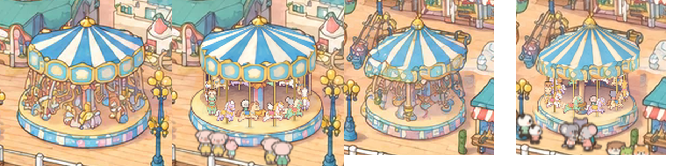

# The two carousels: the painting's own carousels, turning

View: **http://ran:5178/?layers=carousel** (with the crowd), `&crowd=0` for the rides alone, `&t=30` for a frozen
frame. One layer drives both: the west carousel by the entrance (hub about (1673, 1244) park px) and the east one
beside the Dream Wheel (about (2783, 1487)). Not in the page's default ride list yet.

`shots/monitor_2560_painting_vs_live_x3.png`: a 2560 × 1440 window, enlarged 3×: painting | live, west then east.
`shots/park_1to1_x3_t30.png`: both at 1 CSS px per park px, enlarged 3×. `shots/west_cycle_strip.png` and
`shots/east_cycle_strip.png`: six moments of a cycle each.

## What it does

- **One 64 s cycle per carousel:** loading 12 s (stopped), start-up 4 s, ride 40 s at a turn every 14 s, slow-down
  8 s. The east carousel runs half a cycle after the west one, so one is always turning.
- **What turns:** the striped roof, the valance (the panel band round the roof's edge), the platform's painted side
  band, and the horses with their poles, all counter-clockwise seen from above (front moving right), as US
  carousels turn.
- **Horses:** 12 (west) and 10 (east), four colours, on a ring at 0.74 of the platform's radius, on brass poles from
  the floor up into the roof. They bob three times a turn, neighbours in opposite phase, only while turning (the bob
  is driven by the turn angle, as a crank would). Each shows the view that matches its heading on screen: side,
  three-quarter towards or away, front, back, mirrored for the other direction, with a 0.1 s cross-fade at a switch.
- **Riders:** the crowd's own animal sprites seated on the horses. At each loading stop, last cycle's riders fade
  out (at 1.4–2 s), the horses stand empty, and new riders fade in (at 7–7.6 s); about 62% of horses carry one,
  sometimes a cub. When the crowd runs and implements `ctx.riders` (rides/RIDERS.md), the riders are the animals
  that queued.
- **Depth order:** back horses pass behind the centre column, front horses in front of it; the valance covers the
  back horses' heads and the tops of every pole; the back half of the roof shows as a thin sliver behind the apex.

## What I studied

**The painted carousels** (`gen/park/world_v2_hd.png`; gridded HD views with `tools/grid_view.py`):
- Both are open carousels: a blue-and-white striped conical roof with a gold finial, a panel band round its edge,
  a single centre column, a round platform with a painted side band, and a jumble of horses and figures under the
  roof. West: 20 roof gores, hexagonal sky-blue panels in gold frames. East: 13 gores, an irregular band of gold
  scrolls and blue panels, a roof drawn drooping a little to the left.
- Nothing painted stands in front of either: the rail, lamps and stalls are outside their outlines.
- **Each has its own camera**, as the teacups found: the floor ellipses are 0.41 (west) and 0.39 (east) as tall as
  wide, the roof rims 0.31 and 0.24. The roof is narrower than the platform (80 against 91 px half-width, west):
  painter's licence, so I matched every surface to the painting, not to a projection.
- **The surfaces are measured, not guessed** (`geom.json`, `tools/fit_view.py`): apex, roof-rim ellipse, valance
  bottom, platform top and bottom ellipses, fitted by eye over the HD painting until the apex rays run down the
  painted gores and the ellipses sit on the painted edges (`shots/surface_fit_west.png`, `_east.png`). The floor's
  back edge only became visible once the plates had erased the horses, which confirmed the platform ellipses.

**The proven rides:** the teacups' write-up (three.js lathes, measured ellipses, crowd riders, "keep a good painted
canopy"), the wheel's (plates with `--match`, sprites keyed on flat magenta, closed-form motion), the coaster's
(clock handling).

## The approach, and what I rejected

**Chosen: turn the painting's own surfaces, and add sprite horses.**
- **Roof, valance and platform band are the painting's own pixels, re-wrapped.** Each surface is a parametric patch
  over the painting (a cone from the apex to the roof rim; a band between two ellipses), with an angle φ round the
  carousel and a height v. `tools/surfaces.py` unwraps the painting along (φ, v) over the front half, divides out
  the light (a smooth curve over φ), measures the pattern's period by autocorrelation (west roof 40.9°, valance
  26.1°; east roof 27.5°, valance 40.2°), cuts a window of whole periods centred on the front, stretches it to 360/m
  degrees (stretch 0.98–1.01) and cross-fades its end into its start so it loops. The layer draws the same patches
  as WebGL meshes and samples the tile at φ + turn angle, then multiplies the light back in, fixed in place. At turn
  angle 0 the front of the carousel is the painting itself; turning, the stripes and panels slide round while the
  light stays put.
- **Horses are sprites** (a generated 5 × 4 sheet: five views of four horses, all facing right), placed on a ring in
  the floor ellipse with screen-vertical poles, view chosen by heading. Riders are the crowd's sprites.
- **Static parts stay painted:** the floor, the inside of the roof and the centre column come from the plate; the
  column is cut out of the plate a second time so back horses can pass behind it.

**Why not the teacups' 3D lathe scene:** a three.js carousel (canopy, valance, platform, horses) would have to
reproduce a painted roof and an ornate panel band from scratch; the teacups' cups still read a little cleaner than
the painting, and a canopy is far larger and more visible than a cup. Rotating the painting's own surfaces keeps
every pixel of the roof and valance in the painting's hand, which the bakeoff named as the main weakness of live
layers. It works because these surfaces are rotationally symmetric patterns on a surface of revolution: a turn is a
pure shift in φ. Horses are not (they need many views), so they are sprites.

**Why not the wheel's suggestion alone (upright sprites on an ellipse, a canopy kept static):** a static canopy over
turning horses reads as a broken carousel; on a real one the roof and valance turn with the horses, and at real size
the roof stripes are the biggest moving thing. The sprite horses on a ground ellipse are exactly the wheel's idea,
with the painting's per-ride ellipse instead of `camera.planeAffine` (which doesn't match these painted ellipses).

**Why not Rive:** vector art, flatter than the painting; and views would pop the same way.

## The steps (the recipe)

1. **Fit the surfaces.** `tools/fit_view.py NAME OUT.png` draws `geom.json`'s apex rays and ellipses over the HD
   painting (or over a plate with `--src`). Adjust apex, rim, valance-bottom, platform top and bottom until the rays
   follow the painted gores and the ellipses the painted edges. A `rot` (degrees) tilts an ellipse.
2. **Plates (erase the horses).**
   - `tools/park_patch.py crop` a 3:2 region round each carousel (west 1518 1105 1826 1310, east 2643 1355 2928 1545).
   - Edit with `prompts/plate_v1.txt` (n = 2 each, batch `prompts/plates_v1.jsonl`): remove every horse, rider,
     seat and pole; show the empty floor and the shadowy inside of the roof; keep the roof, panel band, centre
     column, platform and surroundings.
   - `tools/plate_poly.py` builds the allowed area from `geom.json`: under the valance (its bottom raised 6 px, so
     it tucks under the turning valance) down to the platform's front rim (lowered 3 px, under the turning band).
   - `park_patch.py paste ... --poly gen/plate_<name>_poly.json --feather 3 --match`. No `--changed` was needed: the
     polygon follows the ride's own geometry and its top and bottom edges are covered by the turning surfaces.
   - Pick the take whose floor and column fit (`shots/plate_takes_*.png`, the mask outlined); copy it to
     `plate_<name>.webp`, record it in `plates.json`.
3. **The column.** `tools/build_columns.py`: the column's outline, measured on a gridded zoom of the plate, cut from
   the plate as `column_<name>.webp`, drawn sorted at the floor's centre among the horses.
4. **The surfaces.** `tools/surfaces.py [--debug DIR]` → `surfaces.webp` (every tile, padded with 8 wrapped columns
   and repeated edge rows so mipmaps never bleed) and `surfaces.json` (per tile: `m` tiles round the circle, `a0` the
   window's start angle, the measured period, the stretch, the light curve over φ 0–180°). A platform band with no
   regular pattern takes a fixed 90° window (`"fixed_m": {"band": 4}` in `geom.json`). Check
   `DIR/*_tile2.png` (the tile twice side by side: no seam) and `DIR/*_strip.png` (the unwrapped surface).
5. **Horses.** `prompts/horses_v1.txt` (refs: the west carousel crop and `gen/style_frame/v1_1.png`): a 5 × 4 sheet
   on flat magenta, rows = four horses, columns = side, three-quarter towards, front, three-quarter away, back, all
   facing right, seen from slightly above. `tools/build_sprites.py` keys the magenta (un-mixing the soft edge),
   finds the 20 cells, scales each row so its side view is 30 park px tall, finds the pole point (through the
   withers, in front of the rider) and the seat (just behind, a little below the back's top), and packs
   `horses.webp` + `horses.json`.
6. **The layer** (`layer.js`): one WebGL2 canvas over both carousels (1340 × 470 park px). Per carousel and frame:
   one sprite draw (shadows, riders, poles, horses and the column, sorted by floor y; the crowd atlas, horse atlas,
   columns and a white texel packed into one texture at mount) and four surface draws (band, valance, back roof,
   front roof). Motion: the turn angle is the closed-form integral of a cosine-eased speed envelope, so `&t=` is
   exact and every cycle continues the last.

## Measurements

| What | Value |
|---|---|
| Motion | largest step 0.43°/frame at 60 fps (a turn in 14 s); outer horses move 0.5 park px a frame; no backward jump across 200 s of cycles |
| Frozen frame | two captures of `&t=41.37`: identical pixels over both carousels |
| Cost | 0.23–0.29 ms a frame of JS and GL submission (headless, software WebGL; 2560 × 1440 and 1512 × 945 windows); 0.25 ms with every ride layer and the crowd running |
| Download | 0.73 MB: horses 362 KB, plates 99 + 75 KB, surfaces 111 KB, columns 16 KB, layer 22 KB, JSON 11 KB; the crowd atlas is shared |
| Sharpness at 2560 × 1440 (Laplacian variance over the west roof) | painting 4826; live with the canvas at screen density (0.67 px per park px) 2127; live at 1.5 px per park px 5457 (`shots/density_painting_vs_0.67_vs_1.5_x3.png`) |
| Plates | shift 0 HD px on all four takes; colour offsets removed (+12, +1, −1) west and (+18, +1, +2) east: the edits come back cooler than the painting |

## How the plates held up

- All four takes erased the horses completely and rebuilt a believable empty interior (`shots/plate_takes_*.png`):
  the floor, a dark panelled inner wall under the roof's back half, a column with a gold base.
- **West v1_0 used** (its column has the painted pink-and-blue stripes and a gold capital); v1_1 is as clean, with a
  plainer column. **East v1_1 used** (cleaner floor, panelled back wall); v1_0 has a darker smudge behind.
- `--match` and a geometric polygon were enough: no seam at native resolution, and the patch's top and bottom edges
  are under the turning valance and band. Nothing outside the polygon changed.
- The edits came back noticeably cooler (red −12 to −18 levels); the ring colour match took it out.

## Prompts and images

| Prompt | Images | Result |
|---|---|---|
| `plate_v1.txt` × 2 carousels (`plates_v1.jsonl`) | 4 | All four usable on the first try; west v1_0 and east v1_1 used. |
| `horses_v1.txt` | 2 | Both laid out exactly as asked: four horses × five views, consistent colours across views. **v1_1 used** (gold trims like the painted carousels). The three-quarter views are close to the side views, which is fine at this size. |

**6 images**, all gpt-image-2.5 at 3840 × 2560, quality high. No iterations were needed on prompts; the work went
into fitting the surfaces and the sharpness.

## What failed, and the fixes

| Problem | Fix |
|---|---|
| The east platform band's period came out as 0.3° (its painted pattern is irregular, the autocorrelation found pixel noise) | A fixed 90° window, 4 tiles round, for surfaces with no regular pattern (`fixed_m`) |
| A tile wrapping at its edge would bleed into the next tile in the atlas under bilinear and mipmap sampling | 8 wrapped columns either side, repeated edge rows above and below; `textureGrad` with the unwrapped coordinate's derivatives, so the wrap doesn't spike the mip level |
| **The live carousels were half as sharp as the painting at monitor size** | The canvas renders at least 1.5 px per park px and the browser shrinks it. A canvas matched 1:1 to the screen sits at a fractional offset inside the scaled world and gets resampled by the compositor, on top of trilinear mip blur. Plus a small LOD bias (sprites −0.4, surfaces ×0.75 derivatives). |
| Riders at 0.6 × the crowd's size, seated deep, showed only the tops of their heads; horses at 24 px were smaller than the painted ones | Horses 30 px (side view), riders 0.55 ×, seat 0.15 of the horse's height below its back |
| A 0.24-wide cross-fade between views left a ghostly half-horse for ~0.5 s | A 0.08-wide cross-fade (about 0.1 s at full speed) |

## Riders (rides/RIDERS.md)

The layer returns `riders` with both carousels in one block:
- **East** in the top level: `gate` (2738, 1548) = `queue[0]`, a 10-slot `queue` running west from the gate along the
  rail (9 px apart, 13 px inside the rail, in front of the lamp at 2690), `exit` (2832, 1537) at the carousel's
  front right, and `keys` east:horse0–9.
- **West** in `more: [{ gate, queue, exit, keys }]`: gate (1594, 1299), 10 slots west along the rail (11 px inside
  it, in front of the stall and lamp at 1433–1548), exit (1756, 1290), keys west:horse0–11.
- `loads(t0, t1)`: per carousel, every horse loads at `offset + n·64 + 7` with `seats: 1`, `until` at the next
  cycle's `+ 2` (the unload). West loads at 7, 71, 135...; east at 39, 103, 167... Checked: 78 events in 0–200 s,
  and splitting the window into three gives the same events.
- **Drawing:** for each horse, `ctx.riders("carousel", key, t)`; an array of look names is drawn (the first one: a
  horse seats one; pets are drawn too if the crowd sends them), `[]` leaves the horse empty, `null` (no crowd, or no
  `ctx.riders`) falls back to the layer's own riders, seeded per cycle. Fades follow the cycle's unload and board
  times either way.
- **For the crowd side:** a `more` array is my extension of the contract (one block per layer, two gates here). Each
  entry has its own `keys`, so the crowd knows which queue boards which keys. If the crowd prefers one gate per
  layer, splitting this layer in two (`carousel_west`, `carousel_east`) is mechanical.

## Open problems

- **The east valance is the weakest surface.** Its painted band is irregular (scrolls and panels of different
  shapes), so the 40° window repeated 9 times reads as a smudgy, regular band, paler than the painting's
  (`shots/monitor_2560_painting_vs_live_x3.png`, right). A cleaner window, a generated band in the painting's style,
  or the west's panel tile would fix it; I kept the painting's own.
- **The east roof is drawn as a regular cone.** The painting droops its left side a little lower; the turning roof
  doesn't, so the roof's left edge is a few px higher than the painted silhouette (the painted edge stays visible
  outside the mesh).
- **The light is fixed per carousel, not per time of day.** The page doesn't pass a time look yet.
- **Horse views switch in eight steps,** with a 0.1 s cross-fade. At full speed a horse changes view every 1.75 s;
  at monitor size it reads as turning, up close it's a pop. The three-quarter views are only a little turned.
- **Riders are standing sprites hidden to the waist by the horse,** as on the teacups; a seated "riding" pose per
  species would read better.
- **No music-box details:** no rounding-board lights, no mirrors on the column, no brass ring.
- **The ready flag:** `mount` awaits every image and the plates' decode, so the page's ready covers this layer.

## Proposed changes to the layer contract (`index.html`)

- **Canvas density.** `ctx.canvas()` sizes the backing store to the screen (capped at `maxDensity / scale`), which is
  what made this layer soft at first. Small ride canvases should render at **at least 1.5 px per park px** and let
  the browser shrink them. The crowd's canvas likely has the same softness: next to the carousels its sprites look
  blurrier at 2560 × 1440.
- `ctx.canvas(slot, { rect })` for small canvases (as the coaster and wheel proposed); this layer makes its own.
- `ctx.time` (the time-of-day look) for ride lights and to re-light the turning surfaces.
- One shared WebGL context for all GL rides (as the teacups proposed). This layer is one context for two carousels.

## Tools (all in `rides/carousel/tools/`; no shared tool was changed)

| Tool | What it does |
|---|---|
| `fit_view.py` | Draws `geom.json`'s surface models (apex rays, roof rim, valance bottom, platform top and bottom, column box) over the HD painting or any image of the region, for fitting by eye |
| `surfaces.py` | Unwrap a surface of revolution from the painting, divide out its light, measure its period, cut a seamless tile; writes `surfaces.webp/.json` |
| `plate_poly.py` | The plate's allowed polygon from the surface model |
| `build_columns.py` | Cuts each column from its plate |
| `build_sprites.py` | Horse sheet (5 views × 4 horses on magenta) → keyed, scaled, anchored atlas |
| `grid_view.py` | A copy of `rides/wheel/tools/grid_view.py` (gridded HD views with a plate laid over), unchanged |

`tools/park_patch.py` (shared) was used as is for `crop` and `paste --match`.

## What transfers to the remaining spinning and swinging rides

1. **Turn the painting's own surfaces wherever a part is a pattern on a surface of revolution:** roofs, canopies,
   drums, platform bands, the swing rides' tops and the Wave Swinger's crown. Fit a parametric patch over the
   painting (`geom.json` + `fit_view.py`), unwrap, divide out the light, tile by the measured period, and sample at
   φ + angle in a shader with the light multiplied back. Any surface whose pattern repeats round the circle keeps the
   painting's hand exactly; irregular ones need a fixed window or new art.
2. **Separate what turns (pattern) from what doesn't (light, silhouette outlines).** Keep the light as a fixed curve
   over φ, and inset the meshes a few degrees from the silhouette so the painted outlines stay put.
3. **Plates with a geometric polygon:** under the turning parts, bounded by edges the turning surfaces will cover.
   `--match` only.
4. **Things that hang or sit on the ride (horses, swing chairs, gondolas) are sprites with views by heading,** on
   the ride's own measured ellipse, sorted by floor y, with static parts (columns) cut from the plate and sorted
   among them. A swing ride adds the chairs' outward swing: chair radius and height from the speed.
5. **Render small canvases at ≥ 1.5 px per park px** and compare against the painting at monitor size, not only at
   1:1. That is where softness shows.
6. **Closed-form motion from the clock** (integral of a cosine-eased speed envelope), as the wheel and teacups did;
   load events in `riders.loads` come straight from the same cycle constants.
