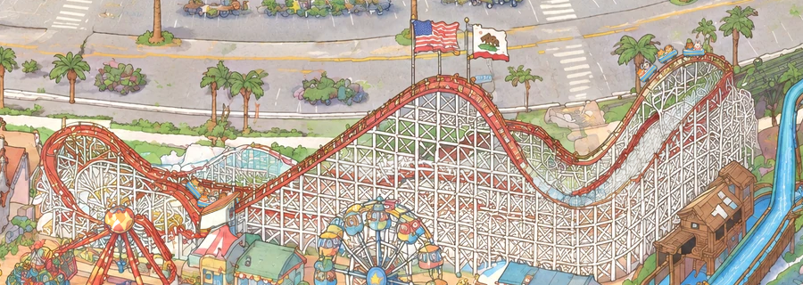

# The Giant Dipper's trains: the first moving ride

View: **http://ran:5178/?layers=coaster** (with the crowd), or `&crowd=0` for the coaster alone. A frozen frame:
`&t=19.3`. One cycle is 30.9 s; two trains run half a cycle apart.

`shots/page_2560_t19_coaster.png`, a 2560 × 1440 window: one train cresting the east hill, the other waiting in the
station with the riders' heads above the station roof. `shots/cycle_follow_train.png` follows one train through a
whole cycle, one frame per second.

## What I studied

**The painted coaster** (`gen/park/world_v2_hd.png`, through gridded crops and a mask of the red track):

- The circuit, in travel order:
  1. out from behind the Fireball's hub and up the west turnaround (a loop seen from the front);
  2. down to the station shed at the foot of the lift;
  3. the long straight chain lift to the crest by the flags (2700, 988);
  4. the first drop into the upper branch and its valley (2930, 1118);
  5. up the steep east hill to the east crest (3120, 941), which the painting draws higher than the lift crest;
  6. the east turnaround, coming down towards the viewer;
  7. down the east descent and through the lower dip (2935, 1189), both behind the lattice;
  8. west along the return run at y ≈ 1145, seen through the lattice;
  9. out of sight under the lift and the station, back to the Fireball.
- A second painted branch leaves the crest as a steep drop into the lower dip. It doesn't fit one coherent circuit,
  and the image model drew it that way. The trains don't use it.
- **There is no train painted on the track.** The yellow marks on it are ties. So nothing needed erasing.
- **What stands in front of the track:**
  - the Fireball's hub ball;
  - the station shed's sloped roof and wall, which the track runs behind;
  - the lattice, over the east descent, the lower dip and the return run.
  The lift, the crest, the upper branch, the east hill and both turnarounds are in front of everything.

**The bakeoff** (`tests/*/RESULTS.md`): live layers looked flatter and more computer-made than the painting. 3D won
for parts seen from many angles, but needed a finishing pass to match. Rive suits flat motion and stutters when it
swaps pre-drawn angles.

**Research:**
- The usual animated-map technique is a vehicle sprite following a path, auto-oriented to its tangent (After Effects'
  Auto-Orient). It covers placement and turning, not occlusion.
- Nothing I found covers vehicles passing behind parts of an illustration. The answer here comes from the painting:
  lay its own pixels back over the train.
- Real ride: about 70 ft, 55 mph, a half-mile of track, about 2 minutes, a chain lift
  ([Wikipedia](https://en.wikipedia.org/wiki/Giant_Dipper_(Santa_Cruz_Beach_Boardwalk))). The animation is
  compressed to a 31 s cycle and runs about 2.5× the real speed for the park's scale.

## The approach, and what I rejected

**Chosen: 2D sprites on the painting's own track, plus cut-outs of the painting laid back over them.**
- The track is the painted red band, traced and snapped to its centre (`track.json`).
- The cars are a sprite sheet generated in the painting's style: side, back and front views of each car.
- Each car is placed by its front and rear wheel points on the track, so it bends round curves and pitches on hills.
- On the near-vertical turnaround legs (where the track runs into or out of the picture) the side view dissolves
  into the back or front view.
- Where the painting has something in front, its own pixels are laid back over the cars. Because they are the
  painting's pixels, the cut-outs are invisible whenever no car is under them.

**Rejected:**
- **three.js on a 3D spline.** The layout test showed the painting isn't a projection of anything. A 3D curve fitted
  to this track would miss the painted rails by more than a car's width in places. It would also need 3D cars, and
  the bakeoff found 3D reads as computer-made without a finishing pass. 3D stays right for rides that spin in place
  (swings, teacups), not for a train on a painted track.
- **Rive.** Path-following, occlusion and view switches are clumsy there, and the swings test showed the
  pre-drawn-angle stutter.
- **Repainting the track live, or a video loop.** Either fights the painting instead of using it.

## The steps (the recipe)

1. **Look.** `tools/grid_crops.py` style crops at native HD resolution with a 10 px grid. A red mask of the track
   (`make_track.red_mask`) shows the circuit's topology where colours blur.
2. **Trace** waypoints in travel order, in runs, each marked `front`, `gaps` (behind the lattice, seen through it)
   or `hidden` (`tools/make_track.py`, `RUNS`).
3. **Make the track** (`make_track.py`):
   - a centripetal Catmull-Rom spline through the waypoints;
   - each point snapped along its normal to the centre of the nearest painted red band, offsets smoothed;
   - resampled every 1 px;
   - per-point fades into and out of the hidden run.
   It also measures the fit and draws `gen/track_check.png` (`shots/track_check.png`).
4. **Draw the cars** (`prompts/train_v2.txt`, `tools/shyfai_image.py` defaults): a 3 × 3 sheet with the views as
   rows and front, middle and rear car as columns. `tools/build_sprites.py` keys the white, scales every view by one
   factor (a side-view car is 40 px long), adds the 1 px ink outline and packs `sprites.png`/`.json`.
5. **Cut-outs** (`tools/make_occluders.py`, via the new `tools/park_patch.py cut`):
   - Fireball hub: a circle;
   - station shed: a polygon;
   - lattice: a corridor along the `gaps` run, limited per pixel to near-white members and their outlines.
6. **The layer** (`layer.js`):
   - **Motion:** a timetable for one cycle, integrated at mount:
     - dwell 5.5 s;
     - chain lift at 52 px/s;
     - after the crest, speed from the height lost since the crest, less friction, never below a 58 px/s crawl;
     - brakes into the station.
     Any clock time maps to a position, so `&t=` frames are exact.
   - **Draw order, bottom to top:**
     1. back canvas (cars on the `gaps` run);
     2. lattice cut-out at 0.88 opacity;
     3. front canvas;
     4. station roof cut-out;
     5. Fireball cut-out.
   - **Transitions:** a car going behind dissolves between the two canvases over 24 px of track. A view change is an
     opaque dissolve: the dominant view at full strength underneath, the other over it.
7. **Verify:**
   - frames through the whole cycle;
   - crops of the steep stretches;
   - real window sizes;
   - a frame-step check, the draw cost, and a frozen-frame repeat (numbers below).

## Prompts and iterations

| Prompt | Images | Result |
|---|---|---|
| `train_v1.txt` | 2 | Red cars, as on the real ride, in the painting's style; v1_1 used first. **At real screen size they vanished into the red track**: only the riders' heads showed. Riders were also much smaller than the walking animals. |
| `train_v2.txt` | 2 | Cornflower-blue cars with cream trim and a butter stripe ("must stand out against the red track"), bigger riders. **v2_0 used.** v2_1 rejected: its front car faces left. |

All four images are gpt-image-2.5, 3840 × 2560, quality high, with references `gen/ref_coaster.png` (an HD crop of the
coaster), the style frame `v1_1` and `tests/characters/gen/ref_chars.png`. No other images were generated.

## Measurements

| What | Value |
|---|---|
| Track | 2763 px of arc: 1713 front, 669 seen through the lattice, 381 hidden |
| Fit to the painted band (front runs, where the band is detectable: 90% of them) | **median 1.0 px, p95 3.9 px, worst 5.4 px** from the band's centre (red-weighted centre within ±6 px). A car is 40 px long; the band is about 8–10 px wide. |
| Motion | largest frame-to-frame step at 60 fps: 4.3 px = top speed (256 px/s) / 60, including the cycle's wrap: no jumps |
| Cycle | 30.9 s: dwell 5.5, lift about 8, the rest about 17 |
| Cost | 0.015–0.05 ms per frame to draw 6 cars (headless, software canvas); 2 small canvases (1250 × 362 park px) |
| Download | sprites 240 KB, cut-outs 394 KB, track 66 KB (about 0.7 MB) |
| Frozen frame | the same `&t=` gives the same coaster pixels |

## What failed, and the fixes

| Problem | Fix |
|---|---|
| Red cars invisible on the red track at real size (`train_v1`) | Blue cars, 40 px instead of 30 (`train_v2`) |
| Out of the Fireball the cars ran level while the painted leg climbs at about 40° (bad waypoints) | Re-traced on a 6× red-mask crop (`shots/fireball_leg_before_fix.png`) |
| The lattice cut-out kept 84% of its corridor: the train vanished on the return run | Members and outlines only (46%), at 0.88 opacity: seen through the gaps (`shots/return_run_through_lattice.png`) |
| The lattice corridor reached over the east-hill climb and washed out trains there | Two canvases: only cars on the `gaps` run go under the lattice |
| The train waited on top of the station roof (`shots/station_before_fix.png`) | Station shed cut-out; stop point moved into the shed |
| Side and end-on views cross-faded into a see-through ghost | Opaque dissolve |
| On the 60–70° east-hill climb the cars flickered towards end-on views | End-on only above 68–80° screen slope: the turnaround legs (`shots/steep_views.png` vs `steep_views_before.png`) |

## Open problems

- **Out of sight for 13% of the circuit.** The painting shows no track between the return run and the Fireball, so
  the train fades out under the lift and back in behind the Fireball's hub.
- **The painted circuit isn't a real one.** The second branch from the crest carries no train. The east crest is
  higher than the lift crest, so the physics adds a 58 px/s crawl to get over it.
- **The return run is faint by design.** It's the honest read of a train behind a dense lattice, but at laptop size
  it's mostly seen as moving colour.
- **Rotated side views on the steep east climb** read as a toy climbing a steep hill. True foreshortening would need
  more views or 3D.
- **Fixed riders.** The same six animals in the same seats. Cars overlap briefly at the tight turnarounds.
- **The cut-outs are HD pixels**, slightly sharper than the 1920 or 2560 painting files under them. At a 1:1 look
  this is invisible; it could matter if the painting files get a heavier compression later.
- **`tools/park_patch.py paste` is tested only on a synthetic edit.** A shifted (+12, −8 HD px), colour-offset edit came
  back exact (`shots/park_patch_synthetic_test.png`). This ride needed no erase, so it hasn't met a real generated
  edit yet. The next ride will.
- **The page's ready flag** waits for the painting but not for ride assets. A capture can fire before the cut-outs
  load. Two frozen captures matched over the coaster but differed in a bottom-left screen area outside this layer.

## Proposed changes to the layer contract (`index.html`)

- `ctx.canvas(slot, { rect })`: a canvas over a rectangle, not the whole 3840 × 2560 park. This layer makes its own
  two canvases over the coaster's box and interleaves them with cut-out images inside `slots.rides`.
- `mount` may return `{ ready }`, a promise the page waits for before setting `data-ready`.
- The `rides` slot's children are stacked in append order. Layers that interleave canvases and cut-outs rely on that.

## Tools

- `tools/park_patch.py` (shared):
  - `paste`: the colour match is now the median over a ring outside the feather, and the feather straddles the mask
    edge;
  - new `cut` command: the painting's own pixels inside polygons, optionally limited by a per-pixel class mask;
  - JSON paths are stored relative to the repo.
- `rides/coaster/tools/` are ride-specific for now: `make_track.py`, `build_sprites.py`, `make_occluders.py`. Their
  core (spline, snap to a painted band, fit measure, sprite sheet → atlas, polygon/class-mask cut-outs) is what the
  next path ride should lift into `tools/`.

## For the next rides

- **Spinning rides (the Dream Wheel, teacups, swings).**
  1. Erase the moving parts with `park_patch.py crop` → an edit prompt ("remove the wheel's rim, spokes and cabins;
     keep the A-frame and the platform") → `paste`. This is the first real test of `paste`.
  2. Draw the rotating parts as a sprite sheet in the same style, with cabins as separate sprites that stay upright.
  3. Place them with `camera.planeAffine` for the wheel's plane.
  4. Cut out the A-frame legs that stand in front.
  Teacups and swings may still prefer the bakeoff's 3D, with the finishing pass.
- **Small cars (traffic, bumper cars).** Reuse the track pipeline: waypoints, then snap. Snapping needs a road-centre
  detector (grey asphalt between kerbs) instead of the red-band one. Cars turn through every heading, so they need
  more than side, back and front views: 8 headings. That's where rendering a 3D car (Meshy) to sprites could pay
  off; ask the user before using Meshy.
- **Lessons:**
  - Check every moving thing at real screen size early. Colour contrast against its surroundings matters more than
    detail.
  - Make every occluder from the painting's own pixels, and check that the occluder can't reach parts that should
    stay in front.
