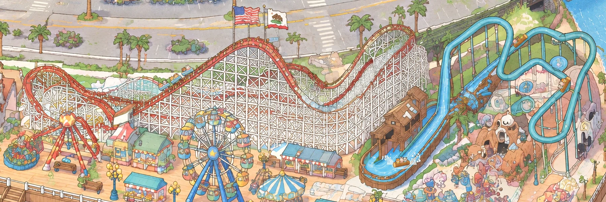

# Logger's Revenge: log boats on the painted flume

View: **http://ran:5178/?layers=flume** (with the crowd), `&crowd=0` for the flume alone, `&layers=coaster,flume` with
the coaster. A frozen frame: `&t=40.8` (a log hitting the pool). `&riders=demo` fills the logs from the crowd's atlas
on the ride's own load schedule, without the crowd. One cycle is 42.4 s; four logs run a quarter of a cycle apart.

`shots/cycle_a_t2-28.webp` and `shots/cycle_b_t32-42.webp` show 16 frames through one cycle. `shots/splash.png` is the
splash, `shots/lift_under_s_tube.png` a log passing behind the S tube, and `shots/page_2560.webp` the whole page in a
2560 × 1440 window.

## What I studied

**The painted flume** is at the park's east end, park px x 3010–3740, y 890–1400. I traced it on gridded HD crops
(`tools/grid.py`) and a skeleton of a water mask. In travel order:

1. **The station.** A U-shaped wooden channel in front of the brown mill house (3040–3170, 1290–1385). A painted log
   with riders sat in it.
2. **Into the mill house** under its porch, out of sight behind the house and the drop chute, to a wooden housing
   (a box with blue panels) at the foot of the lift (3280–3350, 1135–1195).
3. **The lift.** The straight diagonal chute up to the north-east (3300, 1160) → (3562, 950). On the way it passes
   **behind** the S-shaped tube (3440–3470, 1010–1035).
4. **The elevated flume.** Teal tubes on stilts:
   - east along the top to (3690, 965);
   - down the right side;
   - round the big loop at the bottom (3530–3640, 1180–1280);
   - back up and west **behind the round blue disc** (3610, 1050);
   - up the S **in front of** the lift;
   - over its top (3420, 915) and west along the arch.
5. **The drop.** Down the tall straight tube (3285, 997) → (3263, 1157), then the wide light-blue chute that curves
   into the pool beside the mill house, then back round to the station.

Two branches don't fit this circuit and carry no log: a short spur above the lift (3460–3520, 1110) and a little
tube looping round a small disc (3490, 1150). I left them painted. The painting is an image model's idea of a flume,
like the coaster.

**Things in front of the water:**
- the S tube, over the lift;
- the disc, over the flume where it passes behind it;
- the mill house's porch roof, pillar and doorway, over the U's left arm;
- the box at the lift's foot.

Everything else (the arch, the tall tube, the drop chute, the loop) is in front of everything.

**The painted log** in the U had riders and would have doubled up with the live logs, so I erased it (below).

**Water motion that sells it**, from the painting itself:
- short white dash ripples on the water (the painting draws them on every chute);
- a white wake at a moving log's waterline;
- at the drop's foot, white foam with a thin light-blue edge, as the painting draws surf.

## Approach: what transferred from the coaster, and what had to change

The coaster's method carried over almost whole: a path on the painting's own channel, sprites from a generated
sheet, the painting's own pixels laid back over the vehicle, and a timetable integrated once so `&t=` is exact.

| Coaster part | Here |
|---|---|
| `tools/park_patch.py cut` (shared) | **Unchanged.** Used for all four cut-outs (`tools/make_occluders.py`). |
| `tools/park_patch.py crop` / `paste` (shared) | **Unchanged**, first real use for a ride. `paste --match --changed` erased the painted log (below). |
| `make_track.py`: centripetal Catmull-Rom, snap to a painted band's centre, resample at 1 px, fades, check picture | **Copied, then changed** (`tools/make_track.py`): |
| | a water mask instead of the red-track mask; |
| | a snap reach per run (tubes are about 18–25 px wide, the drop chute about 45), with no snap in the pool and the U, where the channel is wider than the log's line; |
| | a band cut off by the reach's end no longer counts (it biased the centre at junctions); |
| | each resampled point's attributes now come from the input point it was resampled from, by arc length, not the nearest position. The circuit passes within a few px of itself (the hidden run beside the drop chute), and nearest-position gave the drop's points the hidden run's mode, which blanked part of the drop; |
| | new per-point `kind` (pool / lift / flume / drop) for motion and effects, and `tilt` for how far a side-view log turns with the path. |
| `build_sprites.py` | **Copied, then changed** (`tools/build_sprites.py`): |
| | rows and columns found from the sheet's empty bands, not fixed thirds (the model spaced the rows unevenly, and a rider's head from one row leaked into the next); |
| | scaled by the log's length; |
| | records each frame's hull height, so the layer can sink the log into the water; |
| | can write a second atlas (the empty logs). |
| `make_occluders.py` | **Adapted** (`tools/make_occluders.py`): the class masks keep "not water" instead of "lattice members", so the water stays open and wood, outlines and shadow cover the log; the crossing cut-out is the S tube's own band, built from the track. |
| `layer.js`: timetable, two canvases interleaved with cut-outs, wheel-point placement, end-on views on steep stretches | **Same structure**, changed: |
| | the motion model (below); |
| | the back/front switch is **hard**, not a dissolve. The coaster's dissolve left a see-through log straddling the tube (`shots/s_crossing_before_fix.png`). The S-tube cut-out is exactly the tube's band, so a hard switch never shows; |
| | the end-on view is chosen along the track with hysteresis (on above 70°, off below 60°) and dissolves over 10 px of track. The coaster's per-frame 68–80° blend left logs on the steep right side and in the loop stuck in a half-and-half ghost; |
| | logs float: sunk by 32% of the hull, turned only 45% with the path in the flat pool; |
| | water effects: flow streaks, wakes and the splash. |

**Rejected:**
- A shader for the water flow. The painted water is already there. White dashes carried along the path read the same
  and cost nothing, and a full-water shader would fight the painting.
- Re-generating the chutes. Same reason as on the coaster: use the painting.

## The steps (the recipe for a water ride)

1. **Look:** `tools/grid.py OUT x0,y0,x1,y1 ZOOM` (10 px grid on the HD painting), plus a water-mask skeleton for the
   circuit's topology.
2. **Erase** anything painted that the layer will animate. Here, the log in the U:
   1. `park_patch.py crop 2990 1240 3230 1400` (a 240 × 160 region, so the edit is 16 output px per park px);
   2. edit with `prompts/erase_log.txt` (two takes; take 0 kept the U's inner divider wall);
   3. `paste --poly gen/pool_poly.json --match --changed 10 --grow 4`.
   The paste measured no shift, a colour offset of (+3, +0.5, −1) levels, blur 0.8 HD px and contrast gains 0.83–0.94.
   The patch is 144 × 90 park px (`shots/plate_pool_check.png`). At full resolution it can't be told from the
   painting.
3. **Trace** waypoints in travel order, in runs: `(mode, kind, snap reach, tilt, points)` (`tools/make_track.py`).
4. **Make the track:** `uv run ... python -I rides/flume/tools/make_track.py` writes `track.json` and
   `gen/track_check.png` (coloured by kind, dashed where hidden or behind).
5. **Draw the logs** (`prompts/logs_v1.txt`, `tools/shyfai_image.py` defaults, references: an HD crop of the flume,
   style frame `v1_1`, `tests/characters/gen/ref_chars.png`). The layout is the coaster's 3 × 3 sheet: rows side,
   back and front; columns three logs.
   Then make the empty logs as an **edit of the chosen sheet** (`prompts/logs_empty_v1.txt`), so the two sets match
   exactly.
   Run `tools/build_sprites.py` and `tools/build_sprites.py gen/logs_empty_v1_0.png sprites_empty`.
6. **Cut-outs:** `tools/make_occluders.py` makes `s_tube`, `disc`, `porch` and `box` (`shots/occ_check.webp`).
7. **The layer** (`layer.js`), stacked bottom to top:
   1. plate patch (the erased pool, in the page's `plate` slot);
   2. back canvas (logs on the lift behind the S tube);
   3. S tube;
   4. front canvas (streaks, logs, wakes, splash);
   5. porch;
   6. box;
   7. disc.
8. **Verify:** frame sheets through a cycle, crops at every cut-out and every view change, the drop and splash frame
   by frame, the fit measure, a frame-step check, a frozen-frame repeat, and the page with the coaster and the crowd.

## Motion

A timetable for one cycle, integrated at 240 Hz at mount; any clock time maps to a position.

| Stretch | Speed |
|---|---|
| Station | dwell 4.5 s, then 34 px/s round the U into the mill house |
| Inside, out of sight | 70 px/s |
| Lift | 36 px/s, about 9 s |
| Elevated flume | water speed 84 px/s; speeds up on downhill screen slopes and is dragged back to the water's speed, never below 56 |
| Drop | gravity from the top of the tall tube, about 230 px/s at the foot |
| Splash | brakes at 1500 px/s² to 40 px/s; burst, spray and a foam ring for 1.5 s |
| Back to the station | glides in, braking at 70 px/s² |

The splash is drawn in three passes:
1. churned foam and a spreading foam ring under the log;
2. two plumes rising either side of the impact, behind the log;
3. 46 ballistic droplets in front of it.

All of it is white with a thin light-blue edge, like the painting's surf. The first version, an opaque white dome,
covered the whole log (`shots/drop_old_splash.webp`). The splash belongs to the cycle it started in, so it carries
across the cycle's wrap.

## Riders: the park's animals take the ride (rides/RIDERS.md)

The layer returns `riders`:

- **gate** `[3100, 1430]`: on the deck south of the flume's base, between the tall lamp (3065) and the teacups'
  platform (3150), on open planks. The flume's own entrance in the painting is the mill house's porch, which stands
  off the promenade behind the base, so the queue waits on the nearest open deck in front of it.
- **queue**: 10 slots from the gate southwards, `[3100, 1430] … [3091, 1574]`, 16 px apart, in the open strip
  between the lamp and the teacups, ending by the promenade lanes (y about 1610).
- **exit** `[3040, 1428]`: the pale stone path west of the base.
- **loads(t0, t1)**: closed form. Log k reaches the station at `n·CYCLE − offset_k`. Its riders get off then, and the
  next three board 0.8 s later (`key: "logk"`, `seats: 3`), staying until its next arrival. Logs already out on the
  circuit at t = 0 get one load at 0. Checked: 15 events in 3 cycles, each `until` equal to the next arrival.

**Drawing:**
- `ctx.riders(ctx.name, key, t)` returning looks: the empty log (`sprites_empty`) with those animals from
  `tests/park-crowd/atlas.png` in its seats (side view in a row, end-on views stacked front to back), at 0.72 of the
  crowd's size, clipped at the log's near rim.
- Returning `[]`: an empty log.
- Returning `null`, or no `ctx.riders`: the log's own painted riders.

`&riders=demo` tests this without the crowd (`shots/riders_demo.webp`).

## Prompts and images

| Prompt | Images | Result |
|---|---|---|
| `erase_log.txt` (edit of `gen/pool_in.png`) | 2 | Both erased the log and riders cleanly. Take 0 used: it kept the U's inner divider wall. |
| `logs_v1.txt` | 2 | Honey-brown hollow logs with three riders each, in the painting's style. Take 1 used: its back views are cleaner and its front views show the riders in a stacked row. Take 0 is good too. |
| `logs_empty_v1.txt` (edit of `logs_v1_1`) | 2 | The same nine logs with the riders removed and the carved interior shown. Take 0 used. |

**Six images**, all gpt-image-2.5, 3840 × 2560, quality high.

## Measurements

| What | Value |
|---|---|
| Circuit | 2528 px of arc: 2225 front, 60 behind the S tube, 243 hidden (mill house to lift foot) |
| Fit to the painted water's centre (snapped front chutes, band found on 88%) | **median 0.3 px, p95 3.4 px, worst 16.8 px.** Away from the two places where a chute widens into another (the drop chute into the pool, the tall tube into the wide chute): p95 3.2, p99 5.0, **worst 8.1 px**. A log is 50 px long; tubes are about 18–25 px wide. |
| Motion | largest frame-to-frame step at 60 fps: 6.1 px, the drop's top speed / 60, at the splash. No jumps, including the cycle's wrap. |
| Cycle | 42.4 s |
| Cost | 0.08 ms per frame to draw 4 logs, about 60 streaks and the splash (headless, software canvas); 2 canvases of 730 × 510 park px |
| Download | about 0.83 MB: sprites 340 KB + empty logs 250 KB, cut-outs 84 KB, plate 67 KB, track 76 KB |
| Frozen frame | two captures of `&t=40.8`: identical pixels over the flume |

## Layering with the coaster

**No rule needed.**
- The coaster's canvases cover x 1990–3240 and the flume's x 3010–3740, so they overlap at x 3010–3240. But the
  coaster draws nothing there except its cars on the east hill and turn, which are 106 px or more from any flume
  water.
- The coaster's lattice cut-out (x 2506–3127) covers no part of the flume's circuit, or of the 40 px above it where a
  log's riders reach.
- The flume's cut-outs are all east of x 3045, below the coaster's track.

With `?layers=coaster,flume`, either order gives the same picture (`shots/coaster_and_flume.webp`). If a later ride
puts something between them, the rule stays the coaster's: a ride's cut-outs only cover its own vehicles' canvases.

## What failed, and the fixes

| Problem | Fix |
|---|---|
| Fixed-thirds cells grabbed a rider's head from the row below into the back views | Rows and columns from the sheet's empty bands |
| Hull height measured the riders too in the side view | "Mostly wood across" means 86% of the width in side views |
| Part of the drop chute blank: its points took the hidden run's mode | Attributes by arc length, not nearest position |
| A log straddling the S tube was half see-through (`shots/s_crossing_before_fix.png`) | Hard back/front switch over the whole log's length |
| The log at the lift's foot came out of the box sideways, at the wrong angle (`shots/lift_foot_before_fix.png`) | The housing's blue panels pulled the snap: no snap inside the housing, the waypoint re-placed |
| The log's nose stayed visible in the mill-house doorway after the fade | Porch cut-out extended over the dark doorway (wood and shadow only) and a longer fade |
| Logs on the right side and in the loop flickered half side, half end-on | Hysteresis on the view change |
| The splash: an opaque dome over the whole log | Foam under, plumes behind, droplets in front |
| The flume path rode off-centre by the disc and on the arch (10 px) | Waypoints re-traced, wider snap reach |

## Open problems

- **Out of sight for 10% of the circuit** (mill house to the lift's foot). The painting shows no channel there.
- **The painted circuit isn't a real one.** Two short branches carry no log. The "lift" is a downhill-looking
  diagonal on screen; it reads as a slow climb only because the logs crawl.
- **Rotated side views on the steep turns**, and end-on views that are stacked rows, not true foreshortening: the
  coaster's limit too.
- **Crowd riders are standing sprites clipped at the rim**, not seated poses, so their arms don't wave. The crowd's
  atlas has no back view of a sitting animal; front and side views are the standing frames.
- **The two merges** (drop chute into the pool, tall tube into the wide chute) measure up to 17 px off the "band
  centre", because the band there is the union of two chutes. The path follows the painted water by eye.
- **The page's ready flag** doesn't wait for ride assets (as the coaster found). Captures here use a 2 s wait.

## Changes to propose (not made: shared files)

- `tools/park_patch.py`: none needed.
- Lift into `tools/`:
  - a shared `track.py` with the arc-length attribute fix, per-run snap reach and the end-of-reach rule (it matters
    for any path ride);
  - the band-based cell finder in `build_sprites.py`.
- Layer contract: as the coaster proposed, `ctx.canvas(slot, { rect })` and a `ready` promise from `mount`.
- `index.html`: add `"flume"` to `RIDES`.

## Tools (all under `rides/flume/tools/`)

- `grid.py`: gridded HD crops for tracing.
- `make_track.py`: the circuit and the fit measure.
- `build_sprites.py`: sheets to sprites (two atlases).
- `make_occluders.py`: the four cut-outs, via the shared `park_patch.py cut`.
