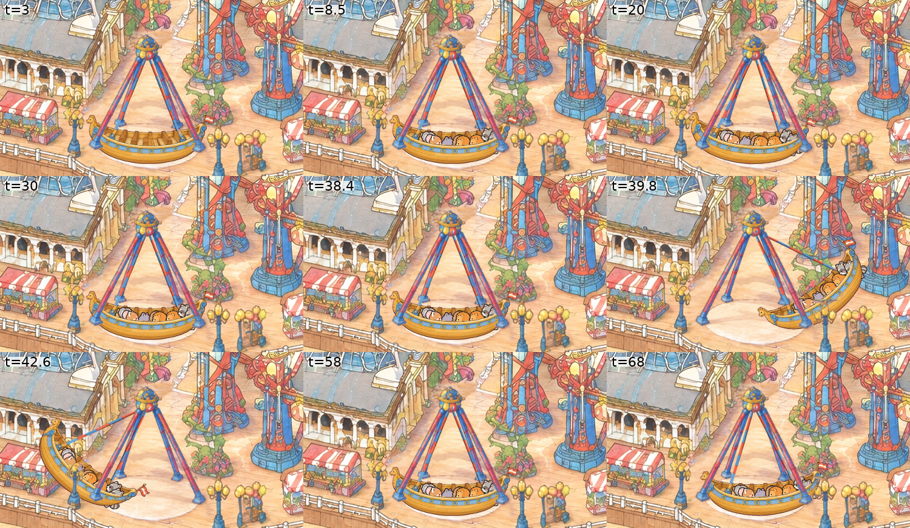

# The Pirate Ship: the first swinging ride, and the recipe for swinging rides

View: **http://ran:5178/?layers=pirate** (with the crowd), `&crowd=0` for the ship alone. The ride is not in the page's
default ride list yet (`RIDES` in `index.html`). Frozen frames:
- `&t=3`: stopped, empty;
- `&t=8.5`: loaded;
- `&t=39.8` and `&t=42.6`: the top of the swing, right and left;
- `&t=68`: easing to a stop.

One cycle is 72 s.



`shots/strip_cycle.png` shows nine frames of one cycle at 1 CSS px per park px. The other shots:
- `shots/painting_rest_right_left_x2.png`: the painting, then rest, right and left, at 2×;
- `shots/monitor_2560_x2.png`: a 2560 × 1440 window, enlarged 2×;
- `shots/laptop_1512_x3.png`: a 1512 × 945 window, enlarged 3×;
- `shots/riders_x3.png`: the riders, enlarged 3×.

## What it does

The cycle follows the real HUSS Pirate:
- **Stop (16 s).** Row by row, the riders get out from 1.5 s and new ones get in from 6 s. Each row takes 0.3–0.4 s
  after the one before, and each rider fades over 0.6 s.
- **Build-up.** The ship is pushed into a growing swing over 4 swings of 5.6 s. The first push is to the right.
- **Hold.** 3 swings at ±42°.
- **Ease down.** 3 swings down to a stop.

Other details:
- **The swing.** The amplitude envelope is a cosine ramp up and down, so the angle and its speed are continuous at
  every phase change and at the cycle's wrap.
- **Riders.** Up to 3 per row in 6 rows. They sit between the benches, behind the near hull side, so only their
  heads and shoulders show. Each faces the middle of the ship, and they tilt with it.
- **Shadow.** A soft shadow on the platform follows the hull and fades as the ship rises.
- **What covers the ship:** the front A-frame legs, the hub and three lamps are drawn over it. The ship covers the
  back legs and everything behind the ride (the arcade, the stall, the planter, the Double Shot tower).

## What I studied

**The painted ride** (`gen/park/world_v2_hd.png`, gridded HD views `gen/view_*.png`):
- **The ship.** A wooden hull about 184 park px long, from (843, 1210) to (1027, 1293). It hung from a fan of thin
  red and blue bars under a hub with a crown, the hub at about (933, 1110). The hull, its figures and its bars are
  one painted tangle.
- **The A-frame.** Two leg pairs:
  - front feet at (848, 1258) and (1019, 1263);
  - back feet at (889, 1223) and (982, 1227);
  - they meet under the hub ball (lower ball centre about (933, 1110); the crown band is at y 1091–1103).
- **The platform.** A pale disc, centre (935, 1261), radii 83 × 36.
- **Neighbours:**
  - the Casino arcade behind, to the left;
  - a stall at x 687–793;
  - lamps at x 800–822, 1040–1068 and 1078–1129, standing in front of the ride;
  - a planter and the Double Shot tower behind, to the right;
  - the rail at y 1297–1330.

**The geometry.** The ship swings in the A-frame's plane. The painting draws that plane face-on: its legs spread
straight left and right. Under the park camera (yaw 24.1°, pitch 28.7°), the horizontal direction that projects to the
screen's horizontal keeps its length, and the vertical shrinks to cos 28.7° = 0.877. So a swing by θ in that plane is
`S · R(θ) · S⁻¹` about the hub on screen, with `S = diag(1, 0.877)`. It's honest projection, and cheap: three
canvas transforms. Unlike the Dream Wheel, nothing about this ride contradicts the camera.

## The approach, and what I rejected

**Chosen:** a generated ship sprite in the painting's style. It swings on a 2D canvas over a plate that erases the
painted ship. The riders come from the crowd's atlas and sit between the sprite's back and front halves. The front
legs, the hub and the lamps are laid back over the ship from the plate's and the painting's own pixels.

**Rejected:**
- **Swinging the painting's own ship pixels.** The painted hull is tangled up with its fan of bars, and the bars cross
  the A-frame legs and the deck. It can't be lifted out clean, and the riders couldn't sit inside it. A rotation of
  that region would also turn the legs.
- **three.js.** A swing in one plane is exactly a 2D affine. 3D would add a model, a renderer and the computer-made
  look for nothing.
- **Rive.** It's vector art, so it would read cleaner than the painting (the bakeoff's verdict). The plate and the
  leg cut-outs would be needed anyway.

## The steps (the recipe)

1. **Look.** `rides/wheel/tools/grid_view.py X0 Y0 X1 Y1 OUT --zoom --step [--patch rides/pirate/plate]`.
2. **The plate (erase what moves).**
   1. `tools/park_patch.py crop 720 1020 1150 1307 gen/plate_in.png`.
   2. Edit with `prompts/plate_v1.txt` (`tools/shyfai_image.py`, defaults, `--ref gen/plate_in.png --n 2`). The prompt
      removes the hull, the figures, the mast and the hanging bars. It keeps the A-frame with every leg continued
      down to its foot, and the hub and crown where they are. Nothing new.
   3. Paste:
      ```
      park_patch.py paste gen/plate_v1_0.png 720 1020 1150 1307 plate --poly gen/plate_allow.json \
        --changed 28 --grow 7 --feather 6 --match
      ```
      The hard allowed area (`gen/plate_allow.json`) covers the ship's reach. It hugs the right front leg, so the
      planter's apron stays the painting's own.
   4. Check `shots/plate_check.png` and a full-resolution view of every edge (`shots/plate_left_edge_x4.png`).
3. **The ship art.** `prompts/ship_v2.txt`: only the swinging ship and its two arms, side view, long axis horizontal,
   seen a little from above so the rows of benches show, on flat pure magenta. It uses the plate's input crop and
   style frame v1_1 as references.
4. **Build** (`tools/build_ship.py`):
   - Key the sprite (`tools/key_view.py`: alpha from the distance to the border's median colour, colours un-mixed).
   - Find the hub and the two arm pins by their yellow dots.
   - **Lengthen the arms.** Even when asked for long arms, the sprite's are a third too short for the painted
     A-frame. So the arms above the far gunwale are cut out, resampled as straight strips, and re-laid from a higher
     hub. That way the keel hangs 180 px under the painted hub, just over the platform. The stubs inside the hull
     stay as drawn; the kink where they join is about 6° on a 4 px bar.
   - Split along the near gunwale, traced by eye on `gen/ship_grid_hull.png`, into `ship_back.webp` (the whole
     ship) and `ship_front.webp` (the near hull side).
   - Write both at 2.5 px per park px (the painting's HD density), with the pivot and the six seats in `ship.json`.
   - **The front:** `front.webp`. Polygons around the front legs, the hub and three lamps over the painting with the
     plate on it, keyed against a k-means model of the deck's colours so only the objects are kept. The deck samples
     must stay clear of every leg: a first set that touched the back legs keyed the blue legs away.
5. **The layer** (`layer.js`):
   - **Motion:** in closed form from the master clock (`angleAt(tau)`): θ = A(τ) · sin(2πτ/T), with the envelope A
     ramping up and down by cosines.
   - **Riders:** looked up per row from the time since that row's last boarding. Own riders are decided by a hash of
     the cycle and the row.
   - **Drawing:** one canvas over the ship's whole reach (690–1180 × 1035–1305) gets, in order:
     1. the shadow;
     2. then, under the transform `translate(hub) · scale(1, 0.877) · rotate(θ) · scale(1, 1/0.877)`: the back
        sprite, the riders and the front sprite.

     The `front.webp` `` goes over it, in the rides slot in append order.
6. **Verify.** Frames at 1 CSS px per park px (a 3840 × 2560 window at `--scale 1`), the nine-frame strip, 2560 and
   1512 windows, a frozen frame captured twice, and `window.__pirate` checks (numbers below).

## Measurements

| What | Value |
|---|---|
| Motion | ≤ 0.785°/frame at 60 fps (47°/s at the bottom of the biggest swing), about 3 px/frame at the hull's ends; no jump at phase changes or at the cycle's wrap |
| Pivot | fixed by construction: the hub and the arms' top end are one transform's origin, under the static hub cut-out |
| Frozen frame | two captures of `&t=40.5`: 0 differing pixels over the ride |
| Cost | draw 0.10 ms/frame headless (software canvas); no work at mount beyond loading |
| Download | 0.41 MB: plate 209 KB, front 127 KB, ship 50 + 22 KB, JSON. The riders use the crowd's atlas, already loaded. |
| Plate | shift (4, 0) HD px, colour offset (14.7, 9.9, 7.0) removed, look match σ 1.1 HD px, gains 0.91 / 0.98 / 0.92 |

## How the plate held up

| Try | Result | Fix |
|---|---|---|
| Allowed area to x 990, then a box to 1031 | Erased the ship and rebuilt the legs, deck and platform cleanly. But the box took in the planter's sandy apron right of the leg, which the edit repainted as plain deck. | The allowed polygon's right edge follows the right front leg (`gen/plate_allow.json`). |
| Final | At full resolution: no ghost of the old ship, no seam in the planks. The legs and feet line up with the painting's. Everything outside the polygon is the painting's own pixels. | |

- `--changed` kept 99% of the allowed area: the edit repaints the deck's grain everywhere, so the polygon does the
  limiting here, not the threshold.
- A small green weed on the deck at (835, 1250) was painted out with the ship.

## Prompts and images

| Prompt | Images | Result |
|---|---|---|
| `plate_v1.txt` | 2 | Both clean. **v1_0 used**: straighter legs, a rounder hub. v1_1 added a taller crown. |
| `ship_v1.txt` | 2 | Clean ships on magenta, but the arms are short (the hub only about 0.7 ship lengths above the keel). Not used. |
| `ship_v2.txt` | 2 | v1 plus "the distance from the hub to the keel equals the ship's length; the arms meet the hull near its middle". The arms grew a little but not enough, hence the stretch in the build. **v2_0 used.** v2_1's arms land near the ends. |

**6 images in total**, all gpt-image-2.5 at 3840 × 2560, quality high.

## The crowd's side (rides/RIDERS.md)

The layer returns `riders`:
- **gate** `[995, 1298]`: the head of the queue on the deck in front of the platform's right side, between the
  platform rim and the rail, clear of the lamp at x 1040.
- **queue**: 8 slots from the gate westwards, 17 px apart, along the platform's front rim (rim + 12 px, never closer
  than 9 px to the rail): x 995, 978, 961, 944, 927, 910, 893 and 876.
- **exit** `[850, 1290]`: the front-left, between the left front leg's foot and the left lamp.
- **loads(t0, t1)**: six events per cycle at the stop, keys `row0` … `row5`, 3 seats each:
  - `t = n·72 + 6 + 0.4·r`;
  - `until = (n+1)·72 + 1.5 + 0.3·r`, when that row steps out at the next stop.

  It's closed form and answers any window from 0.
- **Drawing:** the layer draws whoever `ctx.riders("pirate", "row<r>", t)` returns, from
  `tests/park-crowd/atlas.png`, side view facing the middle of the ship. If that returns `null`, or `ctx.riders` is
  missing (as now), it picks its own riders.

The queue stands in the promenade's lane strip in front of the ride. Walkers pass through it, as they do everywhere.

## Open problems

- **The wide A of arms.** The sprite's arms meet the hull at 22% and 80% of its length. At the top of a swing the
  trailing arm lies at about 64° from vertical, nearly a sideways bar, which is why the swing is capped at 42° (the
  real ride goes further). Arms that meet the hull near its middle (a narrow A, as on the real ride) would allow 60°+.
  That needs a sprite with narrower arms, or the arms re-laid to inner pins, with the old stubs painted over inside
  the hull.
- **The crowd draws over the ship.** The crowd's canvas is above the rides slot, so an animal standing behind the
  ride (on the deck by the arcade) is drawn over the ship when it swings up there. This is the shared-depth problem
  every ride has.
- **The ship is a clean six-row design**, not the painted tangle of bars. It reads as the same ride, smaller in
  detail.
- **No lights or night look**, as with the wheel.
- **The page's ready flag doesn't wait for ride layers**, so captures need `--wait 2500`.
- **`gen/` is 75 MB** of raw 4K inputs and outputs, as with the other rides. The full-frame captures were deleted.

## Tools

All in `rides/pirate/tools/`; no shared tool was changed.
- `key_view.py`: keys a sprite drawn on a flat colour and writes a gridded view of it for measuring. It's general:
  any ride with generated sprites can use it.
- `build_ship.py`: ride-specific. Its yellow-dot finder, arm stretch, gunwale split and deck-keyed front cut-out are
  the parts other rides can lift.

## For the other swinging rides

- **The swing is `S · R(θ) · S⁻¹` about the pivot**, with `S = diag(1, cos pitch)` for a plane the painting draws
  face-on. Check first that the painting draws the plane face-on: the legs spread straight left and right.
- **Fireball** (a giant pendulum with a ring of seats, beside the coaster at about (914, 640) on the official map).
  The same pendulum, longer and bigger (it goes past horizontal), plus the ring turning about the arm's axis. The ring
  is a disc seen edge-on, so it needs a few views or an ellipse squash by the arm's angle. Its painted hub is half
  hidden by the coaster: cut the coaster's lattice over it, as the coaster's occluders do.
- **Sea Swings** (chairs on chains under a turning canopy): the teacups and carousel method for the turning top. Each
  chair is a pendulum that swings outward with speed (tilt from ω²r/g) and around with the canopy, drawn in front or
  behind by its side.
- **Lessons:**
  1. Ask the image model for the swinging part alone on flat magenta. Expect its proportions to be off, and fix them
     in the build: arms can be stretched, hulls can't.
  2. Split a passenger vehicle into back and front halves so riders sit inside it.
  3. Keep deck-colour samples away from anything the cut-out must keep.
  4. Use one cosine-ramped amplitude envelope times a sine: it's continuous everywhere and closed form for the
     riders' timetable.
