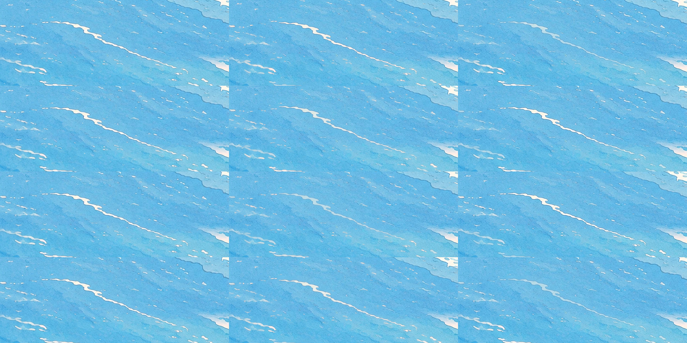
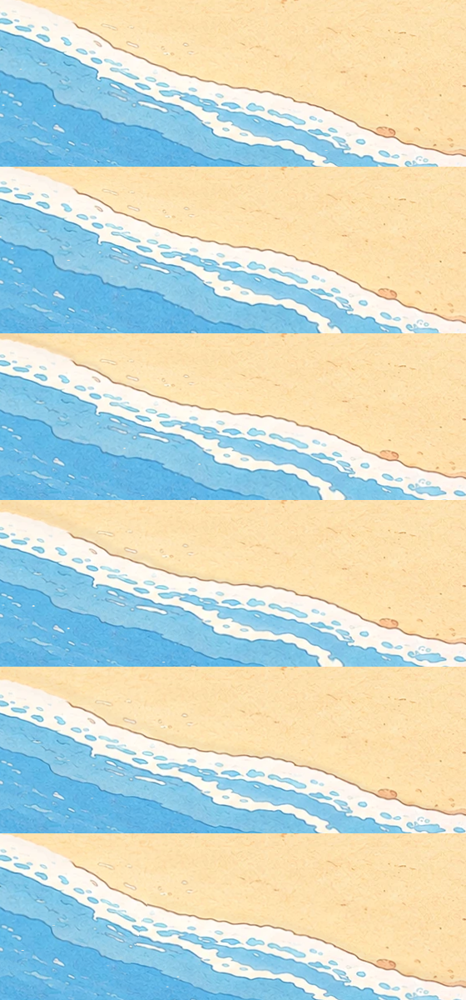
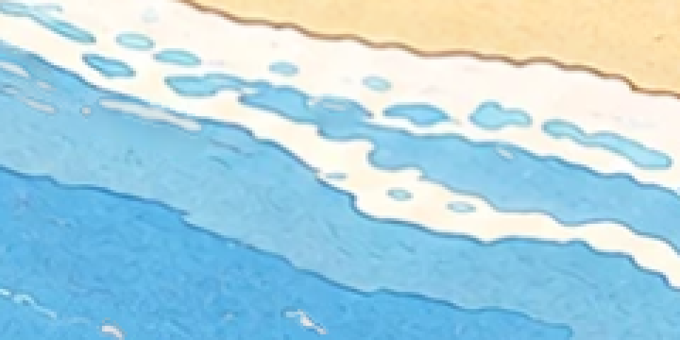

# The sea, moving gently in the painting's own style

View: `http://ran:5178/?layers=sea&sea=a` (or `sea=b`, `sea=c`); add `&crowd=0` for the sea alone, `&t=20` to freeze a
frame, `&calm=0` to stop all motion (it then equals the still painting), `&fps=8` to draw on threes, `&swash=13` to
change how far the foam runs up. Not in the page's default ride list.

Animated previews (8 s at 8 fps, 1200 x 480 park px near the shore): `shots/anim_a.webp`, `shots/anim_b.webp`,
`shots/anim_c.webp`.

## What I studied

| Source | What it teaches here |
|---|---|
| `tests/water/RESULTS.md` (our bakeoff) | A procedural sea shader can match the style frame's colours and get a good swash rhythm, but every pixel was drawn by code: breakers read as "smooth blades", and the whole layer looked flatter and more computer-made than the painting next to it. Lesson: keep the painting's pixels; only move them. Also: compositing a full-size canvas costs more than the shader. |
| Vlachos, [Water Flow in Portal 2](https://www.advances.realtimerendering.com/s2010/Vlachos-Waterflow(SIGGRAPH%202010%20Advanced%20RealTime%20Rendering%20Course).pdf) (SIGGRAPH 2010); Catlike Coding, [Texture Distortion](https://catlikecoding.com/unity/tutorials/flow/texture-distortion/) | Flow maps: distort a painted colour texture along a low-resolution vector field, two phases cross-faded so the distortion never piles up. Portal 2 flowed colour maps, not normal maps, so it keeps an art-directed look. The ingredient I use: move the painting's own pixels along a field, by small amounts. |
| [Color cycling](https://en.wikipedia.org/wiki/Color_cycling) and Mark Ferrari's Living Worlds ([notes](https://tinkerdifferent.com/threads/f256k-living-worlds.2757/)) | One flat painted image, and the ripples and surf animate by cycling which painted strokes are lit. Water stays exactly the artist's strokes; only their brightness travels. Mode c is this idea. |
| Limited animation ([on twos and threes](https://garagefarm.net/blog/limited-animation-what-is-it); [line boil](https://tvtropes.org/pmwiki/pmwiki.php/Main/LineBoil)) | Hand-drawn water is held on twos or threes; a held drawing reads calmer and more "drawn" than 60 fps easing. `&fps=8` holds each frame for about 7 screen frames (and cuts the cost by the same factor). |
| Stylised shore shaders ([GameDev.net 37: stylized water](https://gamedev.net/shaderlab/37-stylized-water-surface/), [Wind Waker-style water thread](https://discussions.unity.com/t/the-legend-of-zelda-wind-waker-styled-water/567867)) | Shore foam keyed to a shore mask or distance (a band at a threshold), a darker wet strip on the sand behind the water's reach. Here the distance comes from the painting itself (a signed distance to the painted waterline), not from scene depth. |

Rejected after study:
- **Cross-fading several generated versions of the sea.** Every edit repaints the whole canvas: dashes, foam lace and
  texture all change at once, so a cross-fade shows double images ("ghosting") wherever strokes differ. It also
  costs 3–5 images per variant set, and the night plates showed edits drift 1–2 px. Fine for the time of day (slow
  fades), wrong for waves.
- **A procedural sea drawn over the painting** (the bakeoff's shader): it replaces the painted water, which is
  exactly what made it look computer-made.
- **Sprite foam and glints drawn from scratch:** new art to match; the painting already has foam and dashes to move.

## What I built

`rides/sea/layer.js`: one WebGL2 canvas over the sea and the swash zone (park px 0–3840 × 1187–2560), in the `plate`
slot, so rides and the crowd draw above it. Its base is the page's own `#painting`, cropped to the canvas at the
canvas's resolution: no second copy of the painting is downloaded, and a still frame is the painting.

`rides/sea/tools/make_masks.py` derives everything from `gen/park/world_v2_hd.png` (no generated images; 0 credits):

| File | What it is |
|---|---|
| `masks.png` (235 KB) | 0.5 px per park px: R = signed distance to the painted waterline (park px, + on the sand), G = open water, B = the shore normal's angle |
| `sea.json` (29 KB) | the canvas rect, the shore direction, and the 328 ripple strokes (box, centre, shore normal) |
| `clean.webp` (411 KB) | the water with the ripple dashes painted out (a normalised blur of the water around each dash) |
| `dashpaint.webp` (287 KB), `hole.png`, `strokes.png` | the dashes split from the water under them (coverage plus each dash's own unmixed colour, so dash over clean is the painting again), where the clean water replaces the painting, and which stroke each pixel belongs to |
| `shots/masks_check.png` | the masks over the painting: waterline black, shore foam red, ripple dashes yellow, wet-sand band green |

The masks cover the cut-off lagoon at the spit too, and leave the teacups' drum and the flume's water alone (they are
blue too).

### Shared by every mode: the swash

The painted foam band slides up the sand along the shore normal and back: a quick uprush (28% of the wave), a slow
backwash, an 8.5 s wave. The phase runs along the beach, so each wave sweeps obliquely down the shore, and each wave's
reach varies along it (0.65–1.35 × `&swash`, default 13 park px). Sand a wave has just left stays a little darker
for about 2.5 s, then dries. It moves the painted pixels only (foam lace, wet band, outline), so the shore keeps its
drawing.

### The open water

| Mode | What moves | How it looks |
|---|---|---|
| **a: warp** | the painted water sways up to 1.6 px in a slow drifting noise field; rare specks of light twinkle | the painting breathing. At real size the sway is barely visible and the glints are tiny (the swash carries the motion) |
| **b: drift** | each painted ripple stroke (dashes closer than 6 px move as one) is lifted off the water, slides up to 6 px toward the shore and back on its own 9–14 s loop, and dims to 55% at the far end | ripples rolling in. The most "sea-like"; strokes stay the painter's strokes. A dimmed stroke shows the clean water under it, a little softer than the painted texture |
| **c: cycle** | the strokes stay where they are painted; bands of light roll through them toward the shore (each stroke dims to 50% and back) | colour cycling: calm and very painterly, but it reads as "twinkling" more than "moving" |

## Checks

- **At rest it is the painting.** `&calm=0` compared with the page without the layer, over the sea (3840 × 2560 window, park px 1190–2560):

  | Mode | Mean difference | 99.9th percentile | Pixels off by more than 8 levels |
  |---|---|---|---|
  | a, c | 0.05 levels | 1 | 0 |
  | b | 0.31 levels | 22 | water texture only, in the faded ring around each dash (`shots/rest_painting_vs_calm0_b.png`: no visible difference) |

  The first versions of b were not exact: lifted dashes lost their thin dark outline, and each sprite also copied any
  neighbouring dash inside its box (ladder-like duplicates). Fixed by keeping each dash's 2 px outline in the sprite,
  splitting dash from water with a colour-difference matte, and giving every pixel a stroke id that the sprite must
  match.
- **Calm.** Over 1/8 s steps, 1.0–1.1% of the pixels in a 1200 × 480 shore crop change by more than 24 levels
  (mean 5,700–6,300 px).
- **Deterministic.** Every pose is a function of the master clock; a frozen `&t=` gives the same frame.
- `prefers-reduced-motion` stops it (the painting shows); the console is clean with the coaster, wheel, teacups and
  crowd on the page.

## Cost

Headless Chrome renders WebGL in software (SwiftShader), so these are **software numbers**, not GPU numbers.
`window.__sea.cost(20)`: one draw plus a sync.

| | 4K monitor (canvas 3840 × 1373) | MacBook Retina 1512 × 982 at 2× (canvas 3024 × 1081) |
|---|---|---|
| `&sea=copy` (just redraws the painting: the floor) | 55.5 ms | 31.5 ms |
| a | 66.2 ms (+19%) | 33.8 ms (+7%) |
| b | 74.6 ms (+34%) | 46.7 ms (+48%) |
| c | 63.3 ms (+14%) | 37.7 ms (+20%) |

Almost all of it is pixel count, not the motion. On a GPU this is one 4–5 MP pass with a few texture reads (plus 328
small quads in b), which should be well under a millisecond on an M-series MacBook or a desktop card; it still needs
measuring on your real screens. Downloads: a 264 KB, c 0.7 MB, b 1.1 MB.

## Recommendation

**Mode b's drifting strokes plus the shared swash.** It moves the painter's own ripple strokes and foam, so the sea
reads as the same painting at rest and in motion, and it is the only mode where you see waves coming in rather than
the surface shimmering. Keep a's sparse glints in it (they are free), drop a's sway (invisible at real size), keep c
as an alternative if b ever feels too busy. Run it at full frame rate on desktops, and consider `&fps=12` as the
default if the whole park later needs the headroom: held frames suit the hand-drawn look.

## What finishing it takes

1. **Make b the default and add the glints** (a few lines), then add `sea` to the page's ride list.
2. **Only redraw what moves.** Bake the painting-with-dashes-removed into a static image under the canvas, and redraw
   only the swash band (about 15% of the rect) and the stroke quads each frame: about 5× less fill.
3. **The river.** The same masks approach on the San Lorenzo (it is excluded now): a flow map along the river under the
   trestles, with the painted ripple marks scrolling downstream slowly, two-phase as in Portal 2.
4. **Night and the other times of day.** The masks are registered to the painting, so they work on the painted time
   plates unchanged; the base becomes the current plate. At night, the glints become moon glitter in the `lights` slot.
5. **The beach crowd in the wash.** Export the swash as a JS twin (`ctx.sea.reach(x, t)`, the same closed form) so
   animals at the waterline step back from the uprush and leave wet footprints, and so beach spots stay on dry sand.
6. **Measure on real GPUs** (MacBook and your 4K monitor) with `__sea.cost()` and the page's frame rate.

## Files

All inside `rides/sea/`: `layer.js`, `RESULTS.md`, `sea.json`, `masks.png`, `clean.webp`, `dashpaint.webp`,
`hole.png`, `strokes.png`, `tools/make_masks.py`, `shots/`. No images were generated (no `prompts/`). No shared
file was edited.
