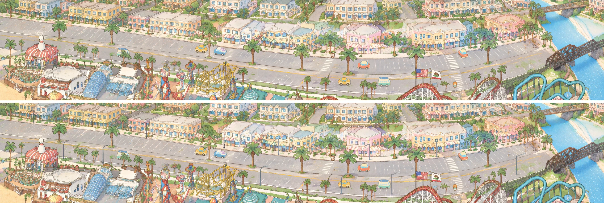

# Street lights: 13 slim LED poles on Beach Street

View: **http://ran:5178/?layers=traffic,streetlights** (`&t=30` for a frozen frame, `&crowd=0` for the street
alone). The layer isn't in `RIDES` yet; that is left for review.



## What it is

- **13 street lights** (the user asked for 12-16):
  - 7 on the north sidewalk (shop side), at the kerb, with arms reaching out over the stalls toward the viewer;
  - 6 on the park side, at the south kerb, with arms reaching out over the eastbound lane.
  - They are slim, light galvanised grey, with a square base plate and a flat LED head. They are painted unlit, for
    the day view.
- **Painted in our style at full detail.** I sketched rough grey poles onto 3840 x 2560 crops of the page's own
  street. gpt-image-2.5 (3840 x 2560, quality high) repainted only the sketches. Of each edit, only the new pole and
  its shadow are kept; everywhere else, the original pixels stay.
- **Plate patches.** They are laid with `ctx.addPatch`, so `gen/park/world_v2_hd.png` and `site/park/world_*.webp`
  are untouched. Each pole is one small WebP at 2.5 px per park px (the painting's own density):
  - 13 plates, plus 6 front cut-outs for the south poles;
  - 148 KB for all 19 files;
  - about 0.8 megapixels decoded.
- **Depth with the cars:**
  - North poles stand behind every lane, so cars pass in front of them. The plate alone does this, because the
    traffic canvas is above the plate slot.
  - South poles stand in front of the eastbound lane, so cars pass behind them. Each one is drawn a second time in
    the `front` slot, cut to the pole itself (shaft, arm and head; not its shadow), so no halo of the edit's asphalt
    lands on a passing car.
  - The crowd never reaches the street: its deck starts at park y 1115, and the lowest pole foot is at 1023. So
    nothing walks in front of a south pole, and the layer returns no occluders.
- **Night:** `tests/night-lights/lights_streetlights.json` holds one record per pole. `rides/streetlights/lights.json`
  is an identical copy, because `rides/lights/layer.js` already loads `../streetlights/lights.json`. Format below.

## Positions (park px, on our painting)

`positions.json` holds the planned positions (`tools/make_positions.py`). `streetlights.json` holds them as painted:
the shaft top and the LED head are measured on the edit by `tools/build.py`.

| Pole | Side | Foot | Shaft top | LED head (painted) | Why here |
|---|---|---|---|---|---|
| n1 | north | 215, 586 | 215, 483 | 186.5, 501.0 | between stalls 0 and 1 (x 140 / 300) |
| n2 | north | 585, 612 | 585, 507 | 559.6, 524.5 | east of stall 2 (x 470), clear of the median palm at 710 |
| n3 | north | 930, 662 | 930, 560 | 904.7, 581.6 | between the median palms; 150 px from stall 3 |
| n4 | north | 1425, 730 | 1425, 625 | 1398.3, 642.2 | moved from 1385, out of the median palm's crown; 75 px from crosswalk cw_1460 |
| n5 | north | 1770, 770 | 1770, 670 | 1742.8, 683.4 | between the median palms at 1600 and 1900 |
| n6 | north | 2350, 805 | 2350, 701 | 2324.1, 716.8 | in front of the pink corner shop, clear of the palm at 2215 |
| n7 | north | 2775, 787 | 2775, 683 | 2751.3, 696.6 | 140 px west of crosswalk cw_2870 |
| s1 | south | 405, 798 | 405, 694 | 435.8, 683.2 | between the bowling-pin building and the kerb palms |
| s2 | south | 655, 827 | 655, 722 | 686.1, 712.1 | moved from 830, which stood in a palm cluster |
| s3 | south | 1655, 969 | 1655, 861 | 1701.7, 846.4 | east of the kiddie coaster, clear of the palm at 1540 |
| s4 | south | 2170, 1022 | 2170, 914 | 2216.4, 890.5 | moved from 2105, out of a kerb palm's crown |
| s5 | south | 2490, 1023 | 2490, 894 | 2542.4, 881.6 | parking apron west of the coaster (no kerb line here) |
| s6 | south | 3285, 900 | 3285, 761 | 3342.4, 761.8 | south edge of the street before the U-turn |

Spacing is about 350-580 px along each row, and the two rows are staggered. The rules I followed:
- **Clearances:** at least 75 px from a crosswalk's end, and 80 px or more from a stall centre. The poles also stay
  out of palm crowns, which were checked on gridded crops.
- **Lanes:** the south feet are 30 px or more south of the eastbound wheel line, so no car body reaches a foot.
- **The gap from x 700 to 1650 on the park side is on purpose.** The kiddie rides' towers and the gold coaster
  stand right at the kerb there, and a pole would be half hidden behind them.
- **No pole on the median.** Westbound cars would pass behind such a pole and eastbound cars in front of it, which
  needs a sort with the cars inside the traffic layer.
- **None east of n7 on the north side.** That sidewalk is a row of palms.

`work/plan1_{west,mid,east}.png` (made by `tools/plan.py`) show the lanes, stalls, crosswalks and traffic cut-outs
with the poles drawn over them.

## How they were painted (the recipe)

1. **The base** (`tools/base.py`): the HD painting with traffic's car-erase patches composited (`patch_R1..R3`).
   Edits and pastes work on what the page really shows, so no painted car comes back inside a pole's patch, whatever
   order the plate patches load in.
2. **Sketches** (`tools/sketch.py`): grey poles with ink outlines, drawn on 1200-1500 px wide 3:2 crops of the base
   at HD. The height is 112 ground units (about 7 m, with a car of 4.5 m = 74 units), or about 98 px on screen.
   - North arms run 54 units toward the viewer, rising 16 units: (-22, +8) on screen.
   - South arms run up and to the right: (+30, -16).
3. **The edit** (`prompts/poles.txt`, `poles_v2.txt`): "repaint only the sketched street lights ... change nothing
   else". The arms are named by side in v2 ("on the shop side they reach to the LEFT").
4. **Paste** (`tools/build.py`). This is `tools/park_patch.py paste` with its `hd_crop` swapped for the base:
   - a hard polygon per pole (shaft, arm box, foot);
   - `--changed 14 --grow 2 --feather 1 --match`, so only what the edit really changed inside the polygon is kept;
   - edit E's two poles stand on bare asphalt, and their pale heads differ little from it, so they use
     `--changed 6`.
   - The front cut-out of a south pole is the same patch, limited to pixels more than 30 levels (E's poles: 18) from
     the painting, closed and filled, keeping only the parts that touch the shaft.
5. `tools/check_occ.py` checks the traffic cut-outs (see Open). Paste checks: `shots/paste_checks.webp` (each pole:
   painting | painting with the pole, mask outlined in red).

| Edit | Region (park px) | Poles kept from it |
|---|---|---|
| v1 `poles_W` | 0, 380 - 1200, 1180 | none (the arms came out as stubby hooks) |
| v1 `poles_M` | 1250, 520 - 2450, 1320 | s3, s4 |
| v1 `poles_E` | 2250, 450 - 3450, 1250 | s5, s6 |
| v2 `poles_W2` | 0, 380 - 1500, 1380 | n1-n4, s1, s2 |
| v2 `poles_N2` | 1700, 380 - 2860, 1153 | n5, n6, n7 |

v1 flipped the north poles' arms in M and E so they pointed up and right, over the shops. v2's prompt named the
direction, and every north arm came out right.

**Generations: 5** (budget about 6), all gpt-image-2.5, 3840 x 2560, quality high. Raw outputs and their request
records are in `gen/`.

## Checks

- **Painting vs live, monitor size** (2560 x 1440 window, 0.67 px per park px). These are crops of the Beach Street
  band from real-window screenshots:
  - `shots/monitor_2560_before_after.webp`: traffic only, then traffic with streetlights;
  - `shots/monitor_2560_all_layers.webp`: every reviewed layer at 13:00, with streetlights.
  - The poles read as thin grey street furniture, about two thirds the height of the median palms, with their heads
    visible.
- **Enlarged** (5120 x 2880 window, 1.33 px per park px). `shots/enlarged_probe_before_after.webp`: traffic alone |
  with streetlights, with probe cars parked next to the poles
  (`&probe=830:van,1845:pickup,2364:beetle,577:hatchback,5446:van,5799:beetle,4869:pickup,2679:hatchback`).
  - The hatchback behind s1, the van behind s2, the pickup behind s3, the beetle behind s4 and the hatchback behind
    s5 all show the pole drawn over the car, which is correct.
  - The westbound cars pass in front of the north poles.
  - `shots/zoom_n5_s3.webp` and `shots/zoom_s1_s2.webp` are 2x enlargements of the live page.
- **Night** (`?layers=sky,lights,traffic,streetlights&hour=22`): `shots/monitor_2560_night_22h.webp` and
  `shots/night_22h_zoom.webp`. The lights module already picks up `lights.json`, and its glows sit on the painted LED
  heads.
- Console clean in every capture.

## The night records (`tests/night-lights/lights_streetlights.json`)

The records use lights.json's fields: id, kind, group, slot, z, src, ground, colour, halo, pool, seed.

```json
{"id": "street_n1", "kind": "streetlight", "group": "photocell", "slot": "over", "z": 586,
 "src": [186.5, 501.0], "ground": [186.5, 617.8], "colour": "#fff3e2",
 "lens": [190.0, 499.8, 183.0, 503.8], "halo": 20.0,
 "pool": {"c": [186.5, 617.8], "r": 84, "colour": "#ffe9c8"},
 "pole": {"side": "north", "foot": [215, 586], "top": [215, 483.2], "front": false}, "seed": 0.56692}
```

- **kind `streetlight`** is new. It has no globe mask: `src` is the LED head's centre as painted, and `lens` is the
  head's underside as a segment, to light as a short bright bar.
- **`ground`** is the point under the head: the head's screen point plus the pole's height and a 14 px rise. It is
  the pool's centre. North pools fall on the stalls in front of the sidewalk; south pools fall at the kerb's edge of
  the eastbound lane. r is 84 (the promenade lamps use 64), because LED cobra heads throw a wide, even pool.
- **Colour:** neutral-warm white (`#fff3e2`, pool `#ffe9c8`), as the city's LED retrofit is, rather than the
  promenade's amber.
- **group `photocell`.** `slot` is "over": the heads are above everything near them. `pole.front` marks the south
  poles, which stand in front of the cars.
- **Only use these records when the streetlights layer is mounted.** Without the poles, the lights module draws them
  in the air (it does so now on the default page, because it loads the file unconditionally). Gate it on
  `window.__streetlights`, or on `streetlights` being in the page's layers.

## Open

- **Traffic change needed (I did not touch rides/traffic).** `rides/traffic/occ.webp`'s cut-outs are the painting
  without the poles. A piece is drawn whenever a car's box overlaps it, so for that moment it covers the pole's
  pixels under it.
  - `tools/check_occ.py` lists 14 overlaps.
  - On the south poles they don't show, because the front cut-out lies above the traffic canvas. The pole's shadow
    still blinks.
  - On 4 north poles, small parts blink while a car passes:
    - n1: about 11 park px² of the lower shaft (piece 104);
    - n3: the base, about 41 px² (piece 67);
    - n4: base and shadow, about 87 px² (piece 10);
    - n5: about 12 px² (piece 30).
  - Fix: rebuild traffic's cut-outs (`tools/make_occluders.py` with `tools/occluders.py`) on the painting with
    `rides/streetlights/poles/plate_*.webp` composited (their rects are in `streetlights.json`). Or traffic can skip
    piece pixels under a pole's plate alpha. Until then, the blink is a few pixels at the kerb, mostly under the
    passing car.
- **s5 and s6 (edit E) came out about 25% taller than the others** (about 128 px against 102-108). The difference
  is visible only when you compare them side by side. One generation of `in_E` with the v2 prompt would even them
  out.
- **s4's head touches the median palm's planter, and s2's arm reaches toward one.** This is correct depth (the poles
  are in front), but busy at 2x.
- **Like the cars, the poles are a little cleaner than the painting** up close. This belongs to the shared finishing
  pass.
- The poles lie 4-15 px off the planned positions' tops, because the model kept the feet but varied the heights.
  `streetlights.json` and the lights records use the painted values.
- **The lights agent's renderer** has no `streetlight` kind yet, or draws it as a generic source. The pools are
  faint in the 22:00 shot.
- The page's ready flag doesn't wait for the front cut-outs. They are 4 KB each and decode within the layer's
  `mount`.
- **Add `"streetlights"` to `RIDES` after review.** It needs no `BOXES` entry; it is at most 19 small images.
- **Don't add `gen/` (105 MB) or `work/` (35 MB, scratch) to git.**

## Files

| File | What |
|---|---|
| `layer.js` | mount: plates via `ctx.addPatch`, south front cut-outs in the front slot, `window.__streetlights` |
| `streetlights.json` | plates, fronts (file, rect in park px), poles (foot, painted top and head) |
| `poles/plate_<id>.webp`, `poles/front_<id>.webp` | 13 + 6 RGBA WebP at 2.5 px per park px, 148 KB in all |
| `lights.json` | night records (same as `tests/night-lights/lights_streetlights.json`) |
| `positions.json` | planned positions |
| `tools/` | `base.py` (page base), `make_positions.py`, `plan.py`, `gridcrop.py`, `sketch.py`, `build.py`, `check_occ.py`, `py` (uv wrapper) |
| `prompts/` | `poles.txt` (v1), `poles_v2.txt`, batch files |
| `gen/` | edit inputs `in_*.png`, raw edits `poles_*_0.png` and request records, `regions.json`, `own.json` (which edit each pole comes from) |
| `shots/` | the pictures above |
| `work/` | scratch: plan boards, paste checks per pole (`work/patch/`) |

Rebuild: `tools/py tools/make_positions.py && tools/py tools/sketch.py W2 N2` (inputs; only before new edits), then
`tools/py tools/build.py` (about 2 minutes) and `tools/py tools/check_occ.py`.
