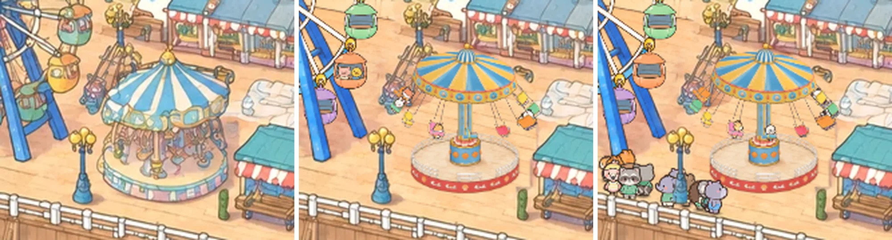

# The Sea Swings: a wave swinger where the second carousel stood

View: **http://ran:5178/?layers=wheel,carousel,swings** (with the crowd), `&crowd=0` for the ride with its own
riders, `&t=40` for a frozen frame at full swing, `&t=11` for riders boarding. Not in the page's `RIDES` yet (mount it
after `wheel`, so chairs on the left draw over the wheel's canvas, which is behind them).

`shots/monitor_2560_painting_vs_live_vs_crowd_x3.webp`: a 2560 x 1440 window enlarged 3x: the painting (the old east
carousel) | live, `&crowd=0`, t 40 | live with the crowd (the queue in front of the lamp). `shots/cycle_strip.webp`:
t 5, 10, 16.5, 22 / 40, 52, 63, 70. `shots/full_speed_1to1_x4.webp`, `shots/boarding_1to1_x5.webp`: 1 CSS px per park
px, enlarged. `shots/canopy_turn_strip.webp`: the canopy 0.4 s apart. `shots/plate_check.webp`: painting | plate.

## What it does

- **A 75 s cycle:** loading 14 s (riders off at 2 s, on at 8 s), lift 5 s (the canopy rises 35 px up its column
  while turning slowly; the column's panels slide up out of the drum, as on the real ride), spin-up 8 s, ride 32 s
  at a turn every 6.1 s, slow-down 8 s, lowering 5 s, settle 3 s.
- **Chairs:** 12 on chains (8 singles, 4 doubles; 16 seats) from a ring under the crown band. Each is a pendulum:
  it swings out to about 40-42 degrees at full speed (tan theta = omega^2 r / g, integrated with damping, so it
  overshoots a little and settles), trails up to 6 degrees at start-up and runs ahead when slowing, sways when riders
  climb in, and jiggles slightly in flight. Five views by heading (side, three-quarter towards and away, front,
  back, mirrored), turned on screen with the chain's lean.
- **The wave:** during the ride the canopy tilts up to 5 degrees, lowest towards the front right (swaying 15
  degrees), so chairs swoop low over the front deck and stay high on the left.
- **Depth:** back chairs behind the column and the drum, front ones in front; chairs inside the railing behind its
  front half; the canopy over every chain top and over the back chairs.
- **Riders:** the crowd's animals from the queue (rides/RIDERS.md: gate (2760, 1536), 10 slots, exit (2818, 1536),
  keys `chair0-11`, a double seats two), or with `&crowd=0` our own, seeded per cycle (about two thirds of chairs,
  sometimes a cub). Riders sit between the chair's back and front parts, legs dangling.

## What I studied

- **The real ride** (Coasterpedia photos 2013 and 2023, the park's height chart): a Bertazzon wave swinger (2008).
  Gold canopy with oval photo medallions and a scalloped crown, a small blue-and-white striped cupola, a tall gold
  column, a sky-blue drum with orange scallop shells and a ring of pink leaves, a raised red platform with a white
  railing, single and double chairs in yellow, green, red, blue, orange and pink. At rest the canopy sits low on the
  column; running, it lifts and the decorated column shows. Ours keeps all of that (photos not fed to the model).
- **The site, measured on the painting:** the lamp's globes (2677-2707, 1453-1478), the Dream Wheel's right cabins
  (x <= 2694, y 1313-1416), the stall's roof edge ((2862, 1489) up to (2900, 1450)), the rail (y about 1565), the
  green bin (2845-2855, 1522-1556), the old carousel's shadow and outline just outside its silhouette.
- rides/carousel (turning painted surfaces), rides/pirate ("For the other swinging rides"), rides/wheel (plates,
  magenta-keyed sprites), rides/teacups, rides/RIDERS.md and the depth contract in index.html.

## Approach, and what I rejected

- **Painted in, then turned (the carousel's method):** blocking drawn in geometry over the 4K crop, so the model
  paints the ride exactly where it must stand; the canopy, cupola and column are then unwrapped from that painting,
  their light divided out, tiled by their measured period and rewrapped turning in a shader. Every turning pixel is
  the painting's own hand. Chairs are sprites, as the carousel's horses.
- **Rejected:** one edit with a grey hole and the base blocked (plate_v1, 2 images): both takes made the platform 25%
  bigger and 30 px further north, into the wheel's plane. Fixed by filling the hole first (erase_v1), then blocking
  the whole ride on the clean deck (ride_v1): both takes kept the blocked footprint within 1 px.
- **Rejected:** a three.js canopy (cleaner than the painting); a static canopy (a swing ride's top turns).
- **Clearance by lifting, not shrinking:** the swept radius (73 px) is bigger than the old carousel's 72. Flying at
  z 75 the chairs pass above the lamp's head and the stall's roof instead of through them. `clearance()` samples each
  chair with its rider every 0.05 s of a cycle against traced outlines: lamp clear by 4.4 px, the wheel's cabins by
  6, the stall by 15.4; the rail and bin are far below.

## Rebuild, step by step (tools in `tools/`)

1. `geom.json`: the design (hub (2786, 1501.5) on the deck, platform r 60, chains, lift) and `painted` (ellipses
   fitted on the takes: `fit_canopy.py`, `zoom_grid.py`, `fit_view.py`).
2. `blocking.py hole gen/erase_in_v1.png`, edit with `prompts/erase_v1.txt` (n 2); `erase_mask.py` (the old
   silhouette grown, the shadow on its right, hard-clipped at the stall, bin and lamp); `park_patch.py paste
   gen/erase_v1_0.png 2615 1330 2957 1558 gen/erase_v1_0_p --mask gen/erase_mask.png --feather 2.5 --match`.
3. `blocking.py ride gen/ride_in_v1.png --on gen/erase_v1_0_p.webp`, edit with `prompts/ride_v1.txt` (n 2). v1_0:
   canopy (its crown repeats one medallion and jewel, best for tiling); v1_1: base and column (two railing openings).
4. `plate.py`: matches each take's sharpness to the erased deck (blur 0.4-0.6 HD px; not the per-channel spread, which
   the fainter repainted planks would have pushed up 1.3x) and colour offset, cuts the base by its hull, lays it on
   the erase patch: `plate.webp` (2 px per park px, 28 KB).
5. `surfaces.py`: top cone (8 gore pairs), crown band (9 tiles, alpha cut under the scallops), cupola, column (6
   panels) -> `surfaces.webp` (10 KB). `cutouts.py`: drum and leaf ring, the railing's front half, the finial.
6. `prompts/chairs_v1.txt` (refs: the ride crop, the style frame; n 2; v1_1 used for its finish, its fourth column
   mirrored back) -> `build_chairs.py`: magenta key with edge colours taken from the nearest solid pixel (no
   fringe), rows and cells from empty bands, rings, hang point, seat, cut line -> `chairs.webp` (104 KB).
7. `layer.js`: the cycle integrated once at mount (240 Hz, closed-form envelopes for speed, lift and tilt); per frame
   one GL canvas (1.5-2.5 px per park px): shadows, back chairs, column, drum, front chairs (railing between),
   canopy, finial.

## Measurements

| What | Value |
|---|---|
| Swing | up to 41.8 degrees out, 5.8 degrees trailing / leading |
| Clearance (every 0.05 s) | lamp 4.4 px, wheel cabins 6.0 px, stall roof 15.4 px |
| Sharpness at 2560 x 1440 (Laplacian variance, canopy top) | live 2590; the painted take at the same scale 2738 |
| Download | 0.31 MB: plate 28 KB, surfaces 10, chairs 104, cut-outs 20, layer 36, JSON 16; the crowd atlas is shared |
| Riders | 36 load events in 0-200 s; with the crowd, 3-7 riders a cycle from the queue |
| Images | 8 generations, gpt-image-2.5 3840 x 2560 high: plate_v1 2 (rejected), erase_v1 2, ride_v1 2, chairs_v1 2 |

## Open

- Nobody walks behind the ride in today's walk graph, so its occluders (base, canopy following the lift, column,
  each chair turned with its chain; checked in `__crowd.occlusion.at(t)`) have never hidden an animal on screen.
- Riders are standing sprites with dangling legs; double chairs squeeze two 15 px animals into 21 px.
- The canopy's tilt is left out of its occluder (under 5 px); chains aren't occluders.
- Chair views switch in eight steps with a short cross-fade (as the carousel's horses).
- The plate's deck under the old carousel is the edit's repaint, and the small swing frame behind was redrawn.
- No lights or time-of-day look.
- `RIDES` in index.html: add `swings` after `wheel` (the user reviews first). Until then the default page shows the
  painting's old east carousel standing still.

## What transfers

- Block the ride in geometry on a clean (already erased) crop; a grey hole reads as the ride's footprint.
- Fit the painted surfaces after the take, and turn them with the carousel's shader; per-surface period search.
- Clear neighbours with height (a lift) before shrinking; check clearance numerically over the whole cycle.
- For the crowd's depth, masks are packed once: move static masks and solid rects with rect / matrix per frame.
