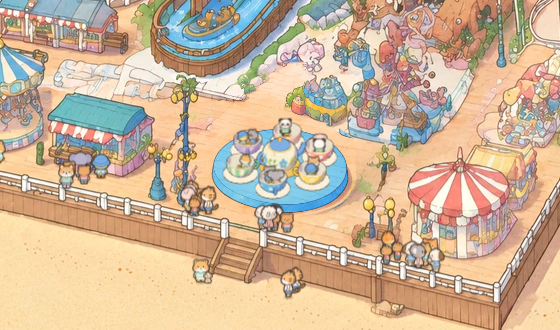

# Twirlin' Teacups: the first ride that spins about an upright axis

View: **http://ran:5178/?layers=teacups** (with the crowd), `&crowd=0` for the ride alone, `&t=30` for a frozen
frame. One cycle is 77 s: loading 10 s, start-up 5 s, ride 55 s, slow-down 7 s.

`shots/monitor_2560_t30.png`: a 2560 × 1440 window at 1:1. `shots/cycle_strip.png` shows six moments of a cycle
(3, 7.5, 13, 30, 60, 74 s), `shots/loading_strip.png` the loading pause, and `shots/cup_spin_strip.png` one cup over
1.5 s, its handle going round as it orbits.

## What I studied

**The painted ride** (`gen/park/world_v2_hd.png`; gridded crops with `tools/hd_grid.py`, then pixel profiles):
- A round blue turntable drum: top centre (3210, 1560) park px, top radius 101.
  - The blue spans x 3108.8–3311.2 and y 1503.2–1626.8.
  - The drum side is about 10 px tall.
- On it, the image model drew a jumble rather than a clear teacup ride: a pink pig-faced cup, a tall blue cup, a
  cluster of yellow and orange cups on a white base, a green cup and a column in the middle. None of it is coherent
  enough to set spinning as it is.
- Nothing painted stands in front of the ride. The rail and two lamps are outside its box, and the rides behind it
  sit higher on the screen. So no cut-outs are needed: everything the ride draws is in front.
- **The drum's ellipse is 0.56 as tall as wide, not the park camera's 0.48** (sin 28.7°). The painting's ellipses
  vary from ride to ride, so the pitch has to be measured per ride. Yaw doesn't matter for a ride that spins about an
  upright axis: everything on it is rotationally symmetric, so yaw only shifts the phase. Only the hub and the pitch
  have to match.

**Ride #1, the coaster** (`rides/coaster/RESULTS.md`): its sprite-on-a-track method suits a path, not rotation.
Its clock handling (integrate a cycle once, sample it) and `park_patch.py` carry over.

**The bakeoff** (`tests/swings-three`, `tests/swings-rive`):
- For parts seen from many angles, live three.js beat pre-rendered views in Rive. Rive stuttered on view swaps, was
  10× larger and had a slot system for depth order.
- three.js shaded with a toon shader (two tones, tinted outlines) came close to the style frames. It still read as
  cleaner than the painting.

## The approach, and what I rejected

**Chosen: a small three.js scene over the erased drum, wrapped in painted textures, with the crowd's sprites as
riders.**
- **Plate:** the painted cups erased to an empty drum, generated and pasted back as a patch.
- **3D, for the parts that turn:**
  - six lathe-turned cups on saucers, each with a handle, a centre post and a wheel;
  - a teapot in the middle on a gold plinth.
  Rotation about two axes (the platform and each cup's own spin) is free in 3D, at any angle and any speed. The
  depth buffer gives correct depth order between cups, the teapot and the riders with no bookkeeping.
- **The painting's look:**
  - the same toon idea as swings-three: a two-tone light with a plum-tinted shade, inverted-hull outlines tinted to
    each colour, and a little paper grain;
  - painted surface patterns: a pattern sheet generated in the painting's style (dots, daisies, stars, stripes,
    hearts, scallops and a flower band for the pot), wrapped round each cup. This is what moves the cups from
    "computer toy" towards "painted toy": the patterns come from the image model, not from shader maths.
- **Riders:** the crowd's own animal sprites (`tests/park-crowd/atlas.png`) on camera-facing cards placed at seats in
  the cups.
  - Each rider faces its cup's wheel, so its view (front, side or back, mirrored) follows the cup's heading in the
    world.
  - The cup's front wall hides the legs through the depth test.

**Rejected:**
- **Multi-view cup sprites (8+ headings), generated or painted.** A cup spinning at up to 0.86 turns a second while
  orbiting needs 32+ headings to avoid the stutter the bakeoff measured in Rive. The image model doesn't keep a cup
  consistent across views (the characters test's sheets needed fixes even at 3 views). And the depth order of six
  cups plus riders would have to be sorted by hand.
- **Rive.** Same stutter on view swaps, and fixed depth slots.
- **Animating the painted pixels.** The painted cups are drawn from one direction and are a jumble. Rotating pixels
  only works for things that turn in the picture plane (a wheel), not about an upright axis.
- **Matching the park camera exactly (yaw 24.1°, pitch 28.7°).** Its pitch draws the drum's top 0.48 tall; the
  painting draws it 0.56. A camera fitted to the painted drum fits; the park camera would leave the cups floating off
  it.

## The steps (the recipe)

1. **Measure the platform.** Gridded HD crops (`tools/hd_grid.py`), then pixel profiles of the platform's colour
   (blue minus red > 40):
   - hub = the top ellipse's centre;
   - top radius = half the width;
   - pitch = asin(top ellipse height / width).
   Check by drawing the projected circle over the painting (`tools/compose_plate.py --circle CX,CY,R`).
2. **Erase.**
   - Crop with `park_patch.py crop 3000 1380 3420 1660` (3:2, 420 park px wide, so the edit comes back at 3.6×
     the painting's density).
   - Edit with `prompts/erase_v1.txt` (n = 2): "remove all of its cups, the white base and the centre column...
     leave its round blue platform completely empty".
   - Pick the take whose drum keeps the painted drum's outline.
   - `paste` with a polygon that covers everything that sticks up from the drum. Its bottom edge is the drum's
     front rim ellipse plus 5 px, so the old rim can't show under the new one (`gen/erase_poly_v2.json`).
   - Check `*_check.png`, then the composite at native resolution.
3. **Patterns.**
   - `prompts/textures_v1.txt` asks for a sheet of seven flat pattern bands in the style frame's look (ref:
     `gen/style_frame/v1_1.png`).
   - `tools/build_textures.py` finds the bands by their white gaps and packs them into `textures.webp`
     (1024 × 2048, eight 1024 × 256 slots). Each slot takes 45% of a band's width, so a cup shows a few big pattern
     repeats instead of many tiny ones.
4. **The scene** (`layer.js`):
   - **Camera:** orthographic, pitch asin(0.56), framed so world (0, 0, 0) is the hub and 1 unit = 1 park px.
     Rendered into a canvas over the ride's box only (260 × 222 park px, at most 1.5 device px per park px).
   - **Cups:** lathe profiles, up the outside to the rim and down the inside. The pattern band covers the outside;
     the inside is cream.
   - **Wrap seam:** the band's seam sits under the handle, so the band doesn't have to tile.
   - **Outlines:** inverted hulls 0.85 park px thick, tinted to each part's colour mixed with the ink `#2c201b`.
   - **Shadows:** soft contact shadows under each cup and the pot.
5. **Riders.**
   - Two seats per cup, filled with one or two animals (now and then a cub), picked from the crowd's atlas by a
     seeded random per cycle.
   - Cards are re-placed every frame: the seat's world position, moved so the sprite's feet anchor sits on it.
   - View from the seat's heading in the world: the platform angle + the cup angle + the seat angle.
   - Size: the crowd's 38, × 0.72.
6. **Motion.**
   - One cycle's angles are integrated once at mount (120 steps a second) and then sampled by clock time, so `&t=` is
     exact and the cycle wraps with no jump.
   - The platform turns at 1/9 turn a second at full speed.
   - Each cup spins 0.32–0.86 turns a second (seeded per cup), about a third of them the other way, with a slow
     wobble in speed. That reads as riders turning the wheel.
   - All speeds follow one envelope: 0 while loading, an eased start-up, full speed, an eased slow-down.
7. **Loading.** Last cycle's riders duck into their cups (2–4 s), and the new riders rise (6–8 s). The cards are
   clipped where they meet the cup, so nobody slides through a wall.
8. **Verify.**
   - Frozen frames through the cycle, crops at native resolution and ×3.
   - The monitor size.
   - A frozen-frame repeat, and the draw cost (numbers below).

## Prompts and iterations

| Prompt | Images | Result |
|---|---|---|
| `erase_v1.txt` (ref: `gen/erase_in.png`, the HD crop) | 2 | Both emptied the drum cleanly and rebuilt the deck and the rides behind. **v1_1 used.** Its drum keeps the painted drum's size and place: shift 0, colour offset (0, −3, 0). v1_0 rejected (`shots/plate_v1_0_rejected.png`): its drum came back smaller and shifted (4, 24) HD px, so the old rim showed under it, and it kept an orange object behind. |
| `textures_v1.txt` (ref: `gen/style_frame/v1_1.png`) | 1 | All seven bands came back flat, evenly spaced and on style, on the first try (`shots/textures_sheet.png`). Used. |

3 images in all, gpt-image-2.5, 3840 × 2560, quality high.

## Measurements

| What | Value |
|---|---|
| Drum (painting) | top centre (3210, 1560), top radius 101, top ellipse ratio 0.56; side about 10 px |
| Cups | 6 on a 63 px orbit; cup radius 20.5, height 22; saucer radius 26; teapot radius 26, 46 tall |
| Motion | platform 1/9 turn/s; cups 0.32–0.86 turns/s, mixed directions. Largest step at 60 fps: cup centres 0.73 px, handle tip under 2 px. Continuous through the cycle's wrap, by construction. |
| Cost | 0.82–0.90 ms a frame (headless, software WebGL, about 58 fps); 89 draw calls, 33k triangles, one canvas of 260 × 222 park px |
| Download | `plate.webp` 300 KB, `textures.webp` 172 KB, `layer.js` 20 KB. three.js 0.170.0 comes from the CDN by the same URL as the page's import map, so it is one module, shared with any other 3D layer. |
| Frozen frame | two captures of `&t=41.37` are pixel-identical over the ride |
| Patch | seam invisible at native resolution and at ×3 (`shots/patch_edges_native_x3.png`); no ghost of the old cups |

## What failed, and the fixes

| Problem | Fix |
|---|---|
| The first mask stopped 7 px above the drum's front rim. The erased drum's rim and the old one didn't coincide, so a sliver of the old rim showed (`gen/plate_v1_1_check.png`). | Mask to the front rim ellipse + 5 px, with the top radius at 111 (`erase_poly_v2.json`) |
| Erase take v1_0: drum smaller and shifted, an object left behind | Took v1_1. Always generate two and pick the one whose platform matches the painted outline. |
| Riders stood up out of the cups like walkers (0.82 × crowd size, seat 8.6 above the floor) | 0.72 ×, seat lowered to 6.6 |
| A sinking rider's card reached below the cup and showed on the drum | The card is cut at the line its feet had when seated (`uCut`), so the part that has "gone into the cup" disappears |
| Copying `park_patch.py` into this folder broke its repo-root lookup | The copy computes the root three folders up (the only change in `tools/park_patch.py` here) |

## Open problems

- **Rider views switch in steps.** Front, side or back (mirrored), as the crowd uses. At full spin a rider changes
  view about every 0.3–0.6 s. At screen size it reads as the animals turning, but up close it's a pop. More views
  (a ¾ pair) or 3D riders would smooth it.
- **No sitting pose.** Riders are standing frames with their legs hidden by the cup. A "seated in a cup, waving" pose
  per species would help.
- **The cups are cleaner than the painting**, the bakeoff's lesson again. The painted patterns, tinted outlines, grain
  and plum shade bring them close; side by side with the painted rides around, they're still a little smoother and
  their outlines lighter than the riders' ink.
- **The ride is a clean teacup ride, not what the painting drew.** The image model's jumble (a pig-faced cup, a tall
  blue cup) is gone. This is closer to a real teacup ride, but it's a design change, not a reproduction.
- **The erase also repainted a little behind the ride:** a pink figure and the left edge of the ride behind,
  continued by the edit as deck, bushes and that ride's body. It looks continuous at native resolution.
- **No time of day:** no lights at night. The page doesn't pass a time look to ride layers yet.
- **No queue or gate.** Riders don't come from the crowd; the crowd doesn't queue here.
- **One WebGL context per 3D ride.** Browsers allow about 16, and each costs memory. With the crowd and more 3D rides
  (swings, carousels) a shared renderer is needed (below).

## Proposed changes to the layer contract (`index.html`)

- **One shared three.js renderer for every 3D ride.** For example `ctx.three()` returning `{ THREE, renderer,
  render(scene, camera, rect) }`: one canvas and one context, a scissored viewport per ride. The bakeoff already
  recommended "one WebGL canvas" for all 3D parts. This layer's scene and camera are self-contained, so moving it over
  is a few lines.
- **`ctx.time`** (the time-of-day look) for ride lights.
- **`mount` may return `{ ready }`.** This layer awaits its own assets in `mount`, so the page's ready flag already
  covers it.

## Tools (all in `rides/teacups/tools/`; no shared tool was changed)

| Tool | What it does |
|---|---|
| `park_patch.py` | A copy of `tools/park_patch.py` from before the wheel agent's `--match` and `--changed` options, with only its repo-root lookup fixed for this folder. Used for `crop` and `paste`. |
| `hd_grid.py` | Gridded crops of the HD painting, labelled in park px, any zoom |
| `compose_plate.py` | The painting with a plate patch laid over it, gridded, with projected ground circles: measure the platform and check the erase |
| `build_textures.py` | Pattern sheet → texture atlas (`textures.webp`/`.json`) |

## What transfers to the carousels and other spinning rides

1. **Measure each platform's ellipse.** Pitch = asin(height / width), and ignore yaw. The painting is not one camera.
2. **Erase with a polygon** made of the painted outline on top and the platform's front rim ellipse + 5 px below.
   Prompt for "the platform completely empty", generate two, pick the one whose platform matches the painted outline.
3. **Turning parts as three.js lathes** (cups, a carousel's canopy, drum and poles; a swing ride's column and roof)
   with the toon shader and inverted-hull outlines, wrapped in **pattern bands generated in the painting's style**.
   One sheet can serve several rides: generate stripes and gores for canopies next.
4. **Riders from the crowd atlas** on camera-facing cards, view from their heading in the world. A carousel's riders
   sit on horses that rise and fall on their poles: card + horse in the same group.
5. **Motion:** integrate one cycle of a speed envelope once, sample it by clock time.
6. **A canopy may stay painted.** For a carousel whose painted canopy is good, erase only what's under it, cut the
   canopy out of the painting with `park_patch.py cut`, and lay it over the 3D layer in the `front` slot. Only the
   horses and poles then need building, and the canopy keeps the painting's own pixels.
