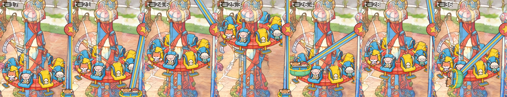
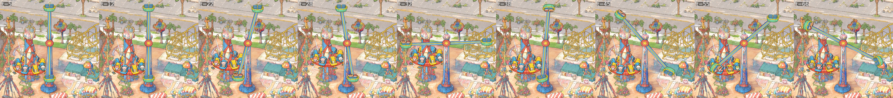

# The entrance thrill rides: a part that moves along or around a fixed structure

View: `http://ran:5178/?layers=thrill` (add `&crowd=0` for the rides alone, `&t=25.3` for the drop at the top of its
shot, `&t=34.2` for the Typhoon looping). The layer is not in `index.html`'s default ride list yet.

| Ride | Built | What moves |
|---|---|---|
| **Double Shot** (drop tower) | yes | A ring of eight seats rides the painted tower: a long wait at the bottom, a slow hoist, a held breath, a sudden shot to the top, bounces on the air springs, a gentle let-down. |
| **Typhoon** (looping arm) | yes | A long beam turns about an axle under the tower's crown, with a two-seat car at each end that spins on its own. It loads each car at the bottom, swings up like a pendulum, loops, slows, loops the other way, and stops. |
| **Shockwave** (disc on a half-pipe) | no | The painting doesn't draw it recognisably: only a faint, pale ghost of a curved rail (park px x 965-1010, y 910-1100) beside the drop tower. Animating it would mean painting a whole ride in. |

Both rides carry the crowd's animals (`rides/RIDERS.md`); without the crowd they pick their own riders.



`shots/strip_drop.png`, left to right: t = 17 resting, 21 hoisted, 24.6 the shot, 25.3 at the top, 26.4 falling, 28
bouncing, 36 being let down.



`shots/strip_typhoon.png`, left to right: t = 5 loading car 0, 12 loading car 1, 22 and 28 swinging, 32 over the top,
38, 45 and 55 looping, 66 settling.

## What I studied

The HD painting around park px (850-1450, 700-1300) has four tall painted towers in a row, plus the Pirate Ship to the
west and the Undertow's yellow track to the east:

| Tower | Where (park px) | What the painting draws | Used as |
|---|---|---|---|
| Sword-topped red tower | x 900-960 | A tall ornament over the Pirate Ship's frame | left alone (the pirate agent's area) |
| Bulb-crowned column with red X-straps | x 1018-1096, crown y 866-930, base y 1100-1160 | A plain column, no seats on it | **Double Shot**: the seat ring is added |
| Thin tower with a crossing arm | x 1130-1180, base y 1140-1205 | A long red arm crossing diagonally, pink, yellow and golden pods on it and on short beams, all smeared together | **Typhoon**: the arm and pods are erased, the arm rebuilt |
| Multicoloured tower | x 1190-1245, top y 820-880 | Unidentifiable | left alone |

The official map puts Typhoon and Double Shot side by side at 27 % across, which matches the middle pair.

## The approach, per ride, and what I rejected

**Double Shot: a generated sprite sliding along the painted structure.** The tower stays exactly as painted. A seat ring
(`ring_back.webp` and `ring_front.webp`) slides up and down it. The ring is split in two along the top arc of its hole:
draw the back half, then the column's own pixels (`occ_dropcolumn.webp`), then the front half with its riders. The ring
then wraps the column at every height.

Rejected:
- Moving the painting's pixels: there's no painted ring to move. The cream band at y 1000 is part of the column's
  design.
- three.js: a vertical slide of a fixed-view object is exact as a 2D translation.

**Typhoon: plate the moving parts out, rebuild them flat, turn them in the plane facing the camera.** The painted arm
and pods are erased with a plate (`plate_typhoon.webp`), which leaves a plain tower. The beam and cars are generated
face-on and drawn under one 2D transform, `translate(axle) · scale(1, cos 28.7°)`. That is exactly how a wheel in a
vertical plane facing the camera projects: horizontal lengths kept, vertical lengths × 0.877. A car's own spin turns
about the same axis as the arm, so it's an in-plane rotation and also exact. The arm is mounted on the tower's near
face, so it's always in front of its own tower, and no occluder is needed between them.

Rejected:
- Rotating the painted arm's pixels: the painted arm and pods are one tangle that can't be separated.
- three.js: everything moves in one plane, so 2D is exact and costs about 0.1 ms a frame.
- A plane tilted away from the camera: more depth as the cars swing toward you, but the beam would need splitting into
  near and far halves around the tower, plus a tower cut-out between them. That's an upgrade for later.

**Shockwave: not built** (see above).

## The recipe

1. **Look.**
   - `rides/wheel/tools/grid_view.py X0 Y0 X1 Y1 OUT --zoom Z --step 5|10 [--patch PLATE]` draws gridded HD views for
     tracing.
   - Decide what's structure (stays painted) and what really moves (is redrawn).
2. **The plate, only where the painting draws the moving part** (the Typhoon):
   1. `tools/park_patch.py crop 940 880 1440 1213.33 gen/plate_typhoon2_in.png`. The crop must hold the whole
      structure, crown to base: see "What failed".
   2. Edit it with `prompts/plate_typhoon_v2.txt`: name the one tower; remove the arm, pods and beams; "keep the tower
      standing exactly where it is, from its top ornament down to its round blue base"; paint what's behind; keep
      every other tower. `--n 2`; take 1 used.
   3. `park_patch.py paste gen/plate_typhoon_v2_1.png 940 880 1440 1213.33 plate_typhoon --poly
      gen/plate_typhoon_allow.json --changed 28 --grow 7 --feather 6 --match`. The allowed polygon is a hard limit that
      keeps the neighbouring towers' pixels.
3. **The moving parts, one sheet, flat magenta, no riders** (`prompts/parts_v1.txt`, the HD crop `gen/ref_towers.png`
   as reference). Spell out the geometry the code relies on:
   - a seat ring with an empty hole where the tower passes, about four times wider than tall;
   - a perfectly horizontal, symmetric beam with the hub disc at its exact centre and a cap at each end;
   - an open two-seat car seen from the front with a lap bar.
4. **Build** (`tools/build_parts.py`):
   - Key the magenta: alpha from the distance to the border's median colour, colours un-mixed from it.
   - Split the sheet into objects by connected components, taking the ring and car from take 0 and the beam from take 1.
   - Split the ring along its hole's top arc. Front seat backs rise into the hole, so the arc can't be found from the
     hole's own pixels. It's measured instead from the back band's red rows and fitted as a half-ellipse with b/a =
     0.45 (the camera gives 0.48), then lowered 14 px so the band's own outline stays with the back half.
   - Write `parts.json` (sizes and anchors in sprite px) and the sprites, resampled to 2.5 px per park px.
5. **Cut-outs** (`tools/cut_occluders.py`): the painting with the plate composited over it, inside polygons traced on a
   5 px HD grid:
   - the drop tower's column and crown;
   - the Typhoon's tower and base: it's nearer, so it covers the ring's right tip;
   - the flower bush in front of the drop tower, which covers the bottom of both rides.
6. **The layer** (`layer.js`): one canvas over park px (895-1415, 725-1240), back to front:
   1. ring back;
   2. column;
   3. ring front and its riders;
   4. Typhoon tower;
   5. beam;
   6. each car: car, riders, then the car again clipped below the lap bar's top, so the riders show only from the
      chest up;
   7. bush.
7. **Motion**, from the master clock:
   - **Drop:** closed form, piecewise over a 46 s cycle:
     - 18 s at the bottom (riders swap);
     - hoisted to 0.22 of the travel in 4 s;
     - 2.5 s held, with a faint 9 Hz shiver;
     - shot to the top in 0.9 s, cubic ease-out, so it starts at full speed;
     - bounces: `0.42 + 0.58·e^(−s/1.6)·cos(2πs/2.0)` for 7 s;
     - let down over 7.6 s.
   - **Typhoon:** integrated once at mount into a 60 Hz table over its 68.65 s cycle.
     - Segments: load car 0 (7 s); half a turn (3.5 s); load car 1 (7 s); three pendulum swings growing to 92°
       (15.6 s); loop at 1.9 rad/s, about a loop every 3.3 s (16 s); slow (3 s); reverse (3 s); hold; stop (5 s).
     - The hold's length is solved so the arm lands exactly on a multiple of 2π with car 0 at the bottom.
     - The cars spin at 1.5 and −1.15 rad/s with a slow wobble. Their remainder is spread over the final stop, so both
       are upright at every loading stop.
8. **Riders** (`rides/RIDERS.md`):
   - `loads(t0, t1)` is closed form from the two cycles.
   - Every frame asks `ctx.riders(ctx.name, key, t)` and falls back to its own picks (hashed by cycle) when that returns
     null.
   - Riders fade in for 0.5 s as they board and out as they get off.
   - The drop ring's riders use the atlas's sitting pose on the four front seats. Car riders use the standing pose,
     cut at the lap bar.

## Riders block (for the crowd)

```js
riders: {
  gate: [1096, 1213], exit: [1122, 1246],            // Double Shot, in front of the bush
  queue: [[1096,1213],[1080,1229],[1062,1232],[1044,1232],[1026,1231],[1008,1230]],
  loads(t0, t1),                                     // every key below, sorted by t
  more: [{ gate: [1196, 1198], exit: [1108, 1222],   // Typhoon, right of its base
           queue: [[1196,1198],[1214,1190],[1232,1183],[1250,1176],[1268,1170],[1286,1165]],
           keys: ["typhoon:car0", "typhoon:car1"] }],
  keys: ["doubleshot:ring"],                         // which keys the top-level gate serves
}
```

| Key | Seats | Loads at | Gets off (`until`) |
|---|---|---|---|
| `doubleshot:ring` | 8 (the four front seats are drawn; the back four sit behind the column) | 46n + 3.5 | 46(n+1) + 1.0 |
| `typhoon:car0` | 2 | P·n + 3.0, with P = 68.6529 | P(n+1) + 0.5 |
| `typhoon:car1` | 2 | P·n + 13.5 | P(n+1) + 11.0 |

Queue notes:
- The Double Shot's queue is short (6 slots, 18 px apart). The space between the bush, the lamps and the Pirate Ship
  allows no more.
- Every slot's feet are at y ≤ 1232, so nobody stands on a lamp head (the lamp heads are at y 1235-1260).
- The Typhoon's queue runs up the pale paving towards the Undertow.

## Measurements

- **Period wrap:** the arm's angle is continuous (4π → 0), and both cars are upright at both loading stops
  (`window.__thrill`).
- **Fastest frame-to-frame step at 60 fps:**
  - a Typhoon car centre: 8.5 park px, at the start of the loops;
  - the drop ring: 4.9 park px, during the shot.
  Nothing jumps.
- **Repeatability:** two captures of the frozen frame `&t=40` are pixel-identical over the rides' box.
- **Drawing:** 0.1 ms a frame (headless, 2D canvas, 1512 and 3840 windows).
- **Download:**
  - sprites 0.33 MB, cut-outs 0.28 MB, plate 0.31 MB;
  - the riders come from the crowd's atlas, already loaded.
- **Full page:** the console stays clean with the coaster, wheel and teacups layers, the crowd and this layer together
  (`shots/page_2560_all_layers_t27.webp`).

## How the plate held up

- **The first erase failed.** `plate_typhoon_v1` used a tight 260 × 173 crop around the tower's lower half. Both takes
  rebuilt the tower as a short stub on its base, because the crop didn't show where the tower ended.
- **The second worked.** `plate_typhoon_v2` used a 500 × 333 crop with the whole tower and its neighbours, a prompt
  naming the one tower, and "keep it standing exactly where it is". Take 1 has a clean, full-height column with its
  crown.
- **Paste:** shift (8, 0) HD px, removed. Colour offset (2.5, 2.4, 4.0). `--match` blurred σ 1.1 HD px; contrast
  gains (0.91, 1.06, 1.02).
- **At 3× native** (`shots/plate_typhoon_3x.png`, the painting left and the plate right):
  - no trace of the arm or the pods;
  - the deck, the grass and the neighbouring towers continue unbroken;
  - no seam at the allowed polygon.
- **Lost:** a small painted cream pedestal right of the tower, which was inside the allowed area.

## Prompts and images

All are gpt-image-2.5 at 3840 × 2560, quality high: **6 images**.

| Prompt | Images | Result |
|---|---|---|
| `parts_v1.txt` | 2 | Both clean on flat magenta. Ring and car from take 0 (rounder ring, visible hole); beam from take 1 (cleaner, symmetric). No second round needed. |
| `plate_typhoon_v1.txt` | 2 | Rejected: the tight crop made the tower a stub (see above). |
| `plate_typhoon_v2.txt` | 2 | Both usable. Take 1 used: its crown is fuller and its column closer to the original's width. |

## What failed, and the fixes

| Problem | Fix |
|---|---|
| The tight plate crop gave a stub tower. | Crop the whole structure and say which object stays and where. |
| Finding the ring's hole from its transparent pixels failed: front seat backs fill most of the hole, and only 6 columns showed it. | Measure the back band's inner edge from its red rows and fit the arc. |
| The ring's front half drew the band's thin inner outline across the column. | Lower the split by 14 px. |
| The first column polygon was loose, so a stripe of deck cut the back seats beside the column. | Trace the column's edges on a 5 px HD grid. |
| The first motion was too fast (3 rad/s, cars spinning at 2.3 rad/s). | Slowed to 1.9 rad/s, about a loop every 3.3 s, which is closer to footage of ARM Screamers; car spin 1.5 and −1.15 rad/s. |
| Sprites at sheet resolution (2.1 MB). | Resampled to 2.5 px per park px (0.33 MB) with no visible change. |

## Open problems

- **Shockwave isn't built.** It needs a plate that paints the half-pipe and disc into the painting first.
- **Car riders are standing sprites cut at the lap bar.** The ring's riders sit, but nobody reacts: no arms up, no
  swinging legs.
- **The cars' upright correction is large.** The leftover spin (−2.2 and +2.5 rad) is spread over the 5 s final stop,
  so the cars visibly turn about 140° extra while they settle. Choosing spin rates that land on whole turns would remove
  it.
- **The Typhoon turns in the plane facing the camera.** The real arm's plane is fixed in the world. A tilted plane would
  add depth (see "rejected").
- **The Typhoon's reach** (x 909-1397, y 731-1180) passes over the drop tower (correct: it's nearer), the mystery tower
  and the Undertow's track. Its lowest left position comes within about 30 px of the Pirate Ship's frame top (about y
  1080 at x 930). If `rides/pirate` draws there, the ship (nearer, base y about 1290) should be drawn after this
  layer. That needs a layer order rule in `index.html`.
- **Night lights:** none yet.

## Proposed changes to the layer contract (`index.html`)

- Add `"thrill"` to `RIDES`.
- Give each layer a depth key (for example `mount` returns `{ depth: baseY }`) and stack the ride canvases by it, so
  nearer rides draw over farther ones whatever order they load in.
- `riders.more` as above: extra gates with their own queue, exit and the keys they serve; the top-level `keys` names
  the main gate's keys.

## Files

- `layer.js`; `parts.json`; `ring_back.webp`, `ring_front.webp`, `arm.webp`, `car.webp`; `occluders.json` and
  `occ_dropcolumn.webp`, `occ_typhoontower.webp`, `occ_bush.webp`; `plate_typhoon.webp` and `.json`.
- `tools/`: `build_parts.py` (key, split and anchor the sprites, split the ring) and `cut_occluders.py` (cut-outs from
  the painting with the plate composited, a variant of `park_patch.py cut`). The shared tools were used unchanged:
  `tools/park_patch.py crop` and `paste`, `tools/shyfai_image.py`, `rides/wheel/tools/grid_view.py`.
- `prompts/`, `gen/`, `shots/`. `gen/` is 67 MB of raw 4K images and request records; whether they go into git is the
  parent's call.

## For the next "moving along or around a fixed structure" ride

1. Keep the structure painted. Plate out only what the painting draws of the moving part, with a crop that holds the
   whole structure.
2. Generate the moving part alone on flat magenta. Describe the geometry the code will use: holes, a centred hub, a
   symmetric beam, a face-on view.
3. **A part that wraps around the structure** (a drop ring, a tower ride's cabin, the Sky Glider's chairs round a
   pylon): split it into back and front at the structure's silhouette, and draw the structure's own pixels between
   them.
4. **A part that turns in a vertical plane** (arms, pendulums, the Pirate Ship): use `scale(1, cos pitch)` about the
   axle when the plane faces the camera, or `camera.planeAffine(u, v)` for any other plane. Anything spinning on the
   same axis is a plain in-plane rotation.
5. **Motion:** closed form where a ride is a fixed program. A table integrated at mount where speed profiles chain,
   with the last hold solved so every loading stop lands exactly.
