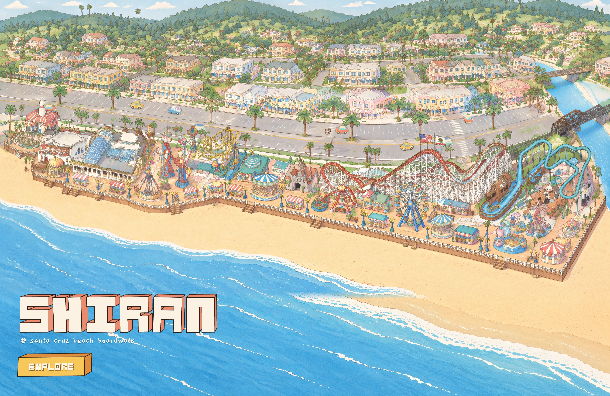

# Traffic: toy cars on Beach Street

View: **http://ran:5178/?layers=traffic** (with everything else), `&crowd=0` for the street alone, `&t=36` for a frozen
frame. Debug: `&probe=4558:van,2108:beetle` parks still cars at loop positions instead of the simulation.

`shots/page_1512x982@2.webp`, `shots/page_2560x1440@1.webp` (traffic only) and `shots/page_2560x1440@1_all.webp`
(every layer) are real window sizes at t = 36 s.

## What it does

- **Four car designs:** a coral hatchback, a butter beetle, a mint surf van and a blue pickup with a beach umbrella.
  Each is a pastel toy car drawn in the painting's style.
- **Driving:**
  - Cars come in from the west edge, drive Beach Street east and take a U-turn at the river end.
  - The U-turn runs past the end of the median, where the north half of the street ends at a plaza. The cars then
    drive back west and off screen.
  - Seven at most at once on the street, plus parked ones; at least 91 px apart centre to centre (a car is 74).
- **Following and turning:**
  - Cars follow each other with the intelligent driver model: gaps, gentle braking, no bunching.
  - Cars slow to about 35 px/s for the turn.
  - Each picks the nearest of 32 headings from its direction on the ground. The turn shows the cars swinging round
    through rear, side and front views.
- **Crosswalks:**
  - Every 30–60 s, one to three animals from the crowd's cast cross at one of four crosswalks.
  - Cars that can stop comfortably wait at the line; a car already committed goes through.
  - In 10 simulated minutes: 45 crossings (`shots/crosswalks.webp`).
- **Parking:**
  - About 30% of westbound cars take a free stall they pass on the north side. They turn in nose first and stay
    35–110 s.
  - They back out only when the lane is clear, then drive on.
  - Four stalls start taken. In 10 minutes: 13 parks, 10 departures.
- **Behind things:**
  - Cars pass behind palms, the bowling pin, the flags, the kiddie rides' towers, the coaster's crest and the railway
    bridge. Each of these is a cut-out of the painting's own pixels, sorted with the cars by where each meets the
    ground.
  - Cars pass in front of the palms north of them (the strips and sheets below).
- **The painting's own cars are gone.** They had come out as lumpy blobs. 27 erase boxes in three local repaints
  (`patch_R*.webp`) leave empty asphalt with the stall lines running through.
- **Deterministic:** a fixed-step simulation from 150 s before the clock's zero, so `&t=` always gives the same frame.

## Choice of technique

**Chosen: Meshy 3D models of painted turnarounds, rendered at the painting's own camera to 32-heading sprites.**

- **Why 3D:**
  - Beach Street curves, and the U-turn and the stalls need every heading.
  - Hand-drawn or generated sheets give at most 4–8 views. Those views don't match each other exactly (the
    characters test found mirrored and mismatched cells), and a heading between two views pops.
  - A model renders any number of headings that match by construction, at exactly the painting's yaw 24.1° and pitch
    28.7°. The renderer checks its projection against `base/camera.js` (equal to 15 digits).
- **Why the result doesn't look like a render:**
  1. The model is built from the painting's style: gpt-image-2.5 draws a 2 × 2 turnaround of each car (front, side,
     back, three-quarter) with the painted street cars and the coaster train as references. Meshy multi-image-to-3d
     is told to keep those colours (`image_enhancement` off, `remove_lighting` on).
  2. The texture is drawn mostly flat (65% emissive): the painting has one soft shade tone, not lighting.
  3. Each sprite gets the painting's treatment:
     - a soft contact shadow;
     - a fitted desaturation and gamma that bring the render's paint colours onto the painted sheet's;
     - a 3×3 median to calm the baked texture;
     - a warm-ink outline 0.8 px wide.
  At real size it sits with the painting's own cars (`shots/compare_real_size_x3.png`: two painted cars on the left,
  ours on the right).
- **The characters test's lesson** (a realistic Meshy figure read as small dark soldiers): it was the model's
  proportions and dark colours, not 3D itself. Starting from a turnaround already in our style avoided that.

**Rejected:**
- **Generated multi-heading sheets, no 3D.** 8 views at most per call, and the views drift in shape and colour. The
  U-turn and the stalls would pop between views. Cheaper (1 image per car, no credits), but worse exactly where the
  road curves.
- **three.js live.** It would match headings perfectly, but adds a WebGL scene for a few 2D sprites. The baked
  sprites carry the style treatment (outline, colour fit), which a live scene would have to redo in a shader.

## Steps (the recipe for any vehicle)

1. **Study the roads** (`tools/road_masks.py`, `tests/park-crowd/tools/grid_crops.py`):
   - masks of the yellow centre line and the grey asphalt;
   - 2× gridded crops along the street.
   Beach Street here: north sidewalk, angled stalls, westbound carriageway, a palm median, eastbound carriageway, the
   south kerb, then the park.
2. **Lanes** (`tools/make_lanes.py` → `lanes.json`):
   - The kerb, median, yellow and south-kerb lines are read off the crops; the yellow line is refined on its mask.
   - Wheel lines: eastbound runs 38 px below the yellow line, westbound through the painted cars' own wheels.
   - One loop is resampled every 1 px, so an index is an arc length. The U-turn is a Catmull-Rom spline through
     points on the asphalt.
   - Stall spurs branch off the westbound side, and the crosswalks have stop points.
   - `lanes_check.webp` shows them all.
3. **Erase the painted cars** (`prompts/erase_cars.txt`):
   - `tools/park_patch.py crop` for three 1200 × 800 regions;
   - one shyfai edit each;
   - `paste --poly` with erase boxes (`gen/erase/R*_poly.json`), `--feather 3 --match`.
   Only the boxes are replaced, so palms and the median stay the painting's own pixels. Checked box by box
   (`shots/erase_boxes_check.webp`).
4. **Car art:**
   - `prompts/car_<name>.txt` makes a 2 × 2 turnaround sheet per car (`shots/turnarounds.webp`).
   - `tools/split_sheet.py` cuts the four views.
   - `tools/meshy_body.py` and `~/3d_director/qingming/tools/meshy_task.py multi-image-to-3d` build the model:
     Meshy 7.1, 2k texture, remeshed to 12k triangles, GLB.
5. **Render** (`tools/render_cars.html/.js/.mjs`, headless Chrome):
   - 32 headings at the park camera, 4 px per park px, car length 80 ground units.
   - `flip=1`, because Meshy's forward axis is −X; the long axis is found by PCA.
   - Heading k drives θ = k × 11.25° on the ground, 0 = east, 90 = south (`shots/headings_hatchback.png`).
6. **Sprites** (`tools/build_sprites.py`):
   - the colour fit against the sheet's four main colours, then the median, outline and downscale to 2 px per park
     px;
   - packed into `sprites.webp` (1.05 MB, all four cars × 32 headings); the lossless master is `gen/sprites.png`.
7. **Cut-outs** (`tools/occluders.py`, the reusable builder; `tools/make_occluders.py` is this layer's use of it):
   - **Reach:** boxes swept along every car path, a car's height (50 px) above it and 22 px below.
   - **Candidates:** inside the reach, and down to 200 px below it so trunks are seen to their feet, every pixel that
     is not road palette (asphalt, lane paint, kerb white, cool shadows) and not pale sidewalk.
   - **Objects:** 8-connected components of the candidates.
   - **Ink:** of each object, only what is within 6 px of its ink outline, or enclosed by it, is kept. Ink is found at
     HD as pixels much darker than their neighbourhood, because at park px the outlines blur to mid-tones.
   - **Foot:** the lowest pixel of a trunk column (a vertical run ≥ 12 px). A crown chunk without its own trunk uses
     the nearest trunk's foot.
   - **Hidden feet:** a trunk whose lowest pixel sits on a hand-placed object (the flags) is moved down to the next
     ground line (the median), since that object hides its real foot.
   - **Chunks:** wide objects are cut into 160 px chunks, each drawn only when a car is under it.
   - **By hand:** the white flags, the white bowling pin and the bridge truss on green-tinted asphalt; the palette
     test can't see these.
   - Output: `occ.webp` + `occ.json` (106 pieces, 660 KB). The layer draws cars, walkers and pieces in one list sorted
     by ground y.
8. **The layer** (`layer.js`): the simulation described above, one canvas over the street band (0–3840 × 440–1150),
   drawn at up to 2 device px per park px.

## Verification

| Check | Result |
|---|---|
| Lane centre | Eastbound vs the carriageway's centre ((yellow + kerb) / 2): **median −1.8 px, worst −8.0 px** (at x 2430, where the coaster's crest crowds the lane). A car is 74 px long, a lane about 60 px wide. |
| On the asphalt | Share of a car's ground footprint on road palette, every 4 px of the loop: **median 0.97, p5 0.75**, worst 0.33 at (3358, 838) in the U-turn's approach. There the asphalt is tinted green, and `shots/turn_proof.png` shows the car on the road. Stall paths: worst 0.74. |
| Behind and in front | Every place a car passes a cut-out: 107 crossings, captured in the real page with probe vans (`shots/crossings_0..5.webp`), all checked by eye. Frame strips at 2 px per park px (`shots/strips_palms.webp`): behind the median palm hidden by the flags; behind the tall north-kerb palm; in front of a median palm with kerb palms over it; behind a kerb palm; behind the west kerb row. |
| Worst sort case | The palm whose foot the US flag hides (x 2646). Its visible foot (y 866) was 1 px above a westbound car (867), so the car would have drawn over the trunk. Fixed by the hidden-foot rule (foot 907, on the median). After it, the closest call is 7 px (a kerb palm by the bowling alley, correct both ways). |
| Motion | No overlaps on the loop in 10 simulated minutes (closest centres 91 px). Headings change one step at a time through the turn (`shots/turn_proof.png`). |
| Cost | Draw 0.03 ms per frame, simulation 0.001 ms per 1/30 s step (headless, software canvas). One canvas. |
| Download | sprites 1.05 MB, cut-outs 0.66 MB, erase patches 1.0 MB, lanes 0.15 MB: about 2.9 MB. |
| Page | Console clean, with the traffic layer alone and with every layer. |

## Images and credits

| What | Images / credits | Notes |
|---|---|---|
| Car turnarounds (`prompts/car_*.txt`, refs: style frame v1_1, the painted street cars, the coaster train) | 4 images | All four were clean on the first try: consistent 2 × 2 views, no text |
| Car erase (`prompts/erase_cars.txt`) | 3 images | One per region, all usable |
| Meshy multi-image-to-3d | **120 credits** (4 × 30) | Balance 1100 → 980 |

All images: gpt-image-2.5, 3840 × 2560, quality high. Total 7 images, 120 credits.

## What failed, and the fixes

| Problem | Fix |
|---|---|
| A single colour gain from the render to the sheet washed cream parts to white | Fit desaturation + gamma instead; then fit on the four main colours, not the most common one (the van's mint vs cream) |
| First cut-outs: one component spanned the whole street (thin lines join everything) and the bowling pin read as asphalt | Ground-contact sorting per object with chunks; the pin, flags and bridge by hand |
| A car drawn over the bowling pin | The pin's polygon as a hand-placed object in front of every car |
| Lane paint and a faded arrow joined to palms streaked over cars | Keep only pixels near an object's ink |
| Palm trunks cut into slices | Ink at park px was too light (outlines blur to 130–170); ink is now found at HD as relatively dark pixels |
| A median palm drawn behind westbound cars (its foot hidden by the flag) | The hidden-foot rule |
| The U-turn first ran through the plaza at the street's north-east end (no asphalt) | Rerouted past the median's end, joining the westbound lane at x 3290 |
| An erase box clipped a palm's frond; a bush was left in the lane | Boxes split around the palm; the bush added to the boxes, re-pasted from the same edit |
| Yellow ride track counted as lane paint in the classifier | Yellow counts as road only within 18 px of the traced centre line |

## Open problems

- **Our cars are cleaner and brighter than the painting's.** At real size they read as part of the same world, but up
  close the painting's cars are scratchier. A lighter outline or a little paper grain on the sprites would close the
  gap. That belongs to the shared finishing pass.
- **No lane changes and no left turns into the lots on the south side**, only the stalls on the north side. The
  painting's parking lots north of the street (behind the shops) aren't driven.
- **Walkers on the crosswalks** use the crowd's atlas at size 38, so they look large next to the cars. That matches
  the crowd, though, and the real animals are as tall as a car.
- **The cut-out builder is heuristic.** Its thresholds are tuned on this street: ink drop 32, run 12 px, ink reach
  6 px. The hand-placed list covers white or green-tinted objects the palette test misses. A new street should be
  checked with `tools/crossings.py` + `tools/probe_sheet.mjs` + `tools/tile_sheet.py` in the same way.
- **Parked cars at stall 5 sit next to the crosswalk at x 2875.** A car waiting there overlaps the parked one in
  projection, which is correct depth but busy. Dropping that stall would calm it.
- **`gen/` is 221 MB** (GLBs, Meshy textures, HD edits and renders). Keep it out of git apart from the request records;
  the GLBs are needed only to re-render.
- The page's ready flag doesn't wait for this layer's images. Captures used a 2–3 s wait.

## What transfers to other vehicles

- **Any vehicle seen from many headings:** bumper cars, kiddie car rides, the Sky Glider's chairs, the train on the
  trestle. The pipeline is: a turnaround in the painting's style, then Meshy multi-image-to-3d (30 credits), then
  `render_cars.*` at the park camera with 32 headings, then `build_sprites.py`. The renderer takes any GLB. Chairs or
  cars that hang (Sky Glider) need a pendulum offset, not a heading.
- **Paths:** `make_lanes.py` patterns (lines read off the painting, a 1 px loop, spurs with branch points). A ride's
  closed track (bumper-car floor, kiddie ride circle) is simpler: one loop.
- **Cut-outs:** `tools/occluders.py` works for any mover. Give it the movers' paths (or the crowd's walk network), a
  body height, and any hand-placed objects; it returns pieces with sortY that a layer interleaves by ground y. The
  crowd could use it directly with height = the animal's size.
- **Checks:** `crossings.py`, `probe_sheet.mjs` and `tile_sheet.py` capture every place a mover meets an object in the
  real page; `strips.mjs` makes frame strips; `measure.py` gives the footprint-on-road and lane-centre numbers.
- **Erasing painted clutter** with `park_patch.py paste --poly` boxes works well on flat ground (asphalt, stalls).
  Keep boxes off neighbouring palms.

## Files

| File | What |
|---|---|
| `layer.js` | The layer: simulation, sprites by heading, sorted drawing with cut-outs and crossing animals |
| `lanes.json` | Loop, stalls, crosswalks, traced lines |
| `sprites.webp/.json` | 4 cars × 32 headings, 2 px per park px |
| `occ.webp/.json` | Front cut-outs with sortY |
| `patches.json`, `patch_R1..R3.webp/.json` | The car-erase repaints, laid in the plate slot |
| `prompts/` | Car turnarounds, the erase prompt, batch files |
| `tools/` | `road_masks.py`, `make_lanes.py`, `split_sheet.py`, `meshy_body.py`, `render_cars.*`, `build_sprites.py`, `occluders.py` (reusable), `make_occluders.py`, `crossings.py`, `probe_sheet.mjs`, `tile_sheet.py`, `strips.mjs`, `proof.py`, `measure.py`, `erase_check.py`, `shots.mjs` |
| `gen/` | Turnarounds, Meshy models and request records, renders, erase inputs and edits, check images |
| `shots/` | The pictures referenced above |

No shared tools were changed. Every tool is inside `rides/traffic/tools/`; `occluders.py` is ready to lift into
`tools/`.
