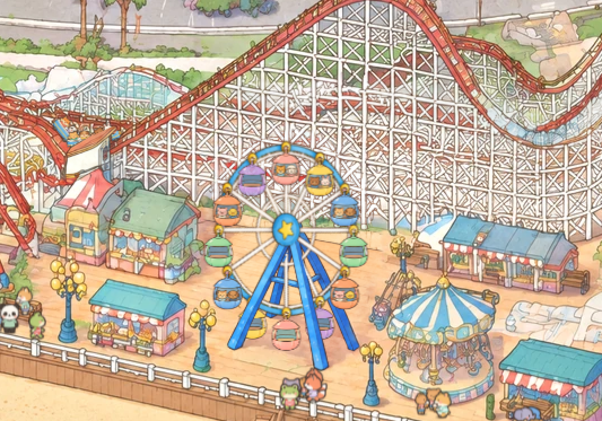

# The Dream Wheel: the second moving ride, and the recipe for spinning rides

View: **http://ran:5178/?layers=wheel** (with the crowd), `&crowd=0` for the wheel alone. Frozen frames:
`&t=38.3` is a loading stop with riders getting in, `&t=20` is the turn. One cycle is 57 s.



`shots/monitor_2560_x2.png` is a 2560 × 1440 window enlarged 2×. `shots/laptop_1512_x3.png` is a 1512 × 945 window
enlarged 3×. `shots/wheel_1to1_x3.png` is the wheel at 1 CSS px per park px, enlarged 3×.

## What it does

- **The turn.** From rest the wheel makes one slow turn plus one cabin (390°): 12°/s, with 3 s cosine ramps to start
  and stop.
- **Loading.** Then three loading stops: dwell 4.5 s, step one cabin (30° in 4 s, an S-curve), dwell, step, dwell.
  It turns clockwise, as on the real ride.
- **Stops.** At each stop the cabin at the bottom is serviced:
  - riders fade out (0.9–1.4 s into the stop);
  - new riders fade in (2.4–2.9 s), or nobody, with a 70% chance of a full cabin;
  - the cabin dips 1.4 px and rocks as they step in.

  `shots/strip_turn_and_stop.png`, left to right: turning (t = 20), stopped with a full peach cabin at the bottom,
  riders gone, new riders in, the bounce, stepping to the next cabin.
- **Cabins** hang straight down from the wheel's knobs and sway like pendulums, driven by their hanger's
  acceleration:
  - up to 2.3° while turning;
  - up to 4.4° at starts and stops;
  - up to 3.2° from boarding.
- **Riders** are painted into the cabins: 6 colours, each drawn empty and with two animal passengers.
- **Draw order:** the front A-frame legs cover the wheel and the cabins, and the hub with its star sits on the legs'
  apex, as in the painting. The back legs and the crossbar are behind the wheel.

## What I studied

**The painted wheel** (`gen/park/world_v2_hd.png`, gridded HD crops; `tools/grid_view.py`):

- **Size and shape:**
  - the cabin ring is about 232 × 290 park px, an upright ellipse taller than wide;
  - 12 cabins (40–45 px);
  - a blue hub with a yellow star at about (2582, 1313).
- **The frame.** Two blue A-frames, a front pair and a back pair, with a crossbar on the back pair. Their tops
  disappear behind the hub star.
- **Draw order in the painting:**
  1. back legs;
  2. rim and spokes;
  3. cabins;
  4. front legs;
  5. hub star.
- **Behind the wheel:** the coaster's white lattice with red track, the grass strip and the low wall behind the
  deck, and the deck planks.
- **Neighbours:**
  - a green stall at x < 2468;
  - lamps at (2470–2505, 1415–1500) and (2690–2720, 1440–1500);
  - a small swing ride at x > 2695.

**The geometry problem.** No vertical wheel under this camera (yaw 24.1°, pitch 28.7°) is taller than wide: face-on
it projects to 0.91 × 0.90 and tilts 11° like the rail. The painted wheel is painter's licence, as
`tests/wheel-rive/RESULTS.md` also found. I matched the painting, not the camera: the wheel is drawn as an upright
ellipse (knob ring 90 × 110 park px), with its hub on the front A-frame's axle cap. Cabins hang straight down either
way.

**The bakeoff's Rive wheel** (`tests/wheel-rive/RESULTS.md`): exact projection, upright cabins, 60 KB, cheap. But it
was all vector art, cleaner and flatter than the painting: the bakeoff's main complaint about live layers.

## The approach, and what I rejected

**Chosen: a generated sprite wheel in the painting's style, rotated on a 2D canvas, over a plate that erases the
painted wheel; cabins as upright sprites; the front legs laid back over them from the plate's own pixels.**

**Rejected:**
- **Rotating the painting's own rim and spokes.** The cabins cover most of the rim, so the turning parts can't be
  lifted out clean. Rotating the region would turn the cabins and legs too.
- **Rive.** It's vector art, so it reads cleaner than the painting (the bakeoff verdict). It also needs the plate
  and the leg cut-out anyway.
- **three.js.** A planar wheel is exactly a 2D affine, so 3D adds a model, a renderer and the bakeoff's
  computer-made look for nothing.

The sprite wheel's fine detail at display size measures between the painting's stalls and its lattice (high-pass
variance 780 against 653 and 1492). So no softening pass was needed. Its fills are a little flatter and more
saturated than the painting's. The shared finishing pass, when it exists, is the place to tune that.

## The steps (the recipe)

1. **Look.** `tools/grid_view.py X0 Y0 X1 Y1 OUT --zoom --step [--patch rides/wheel/plate]` draws a gridded HD view,
   optionally with a plate laid over the painting, for measuring by eye.
2. **The plate (erase the moving parts).**
   1. `tools/park_patch.py crop 2335 1160 2845 1500 gen/plate_in.png` cuts a 3:2 HD region.
   2. Edit it with `prompts/plate_v1.txt` (`tools/shyfai_image.py`, defaults, `--ref gen/plate_in.png --n 2`). The
      prompt: remove the rim, spokes, hub and all cabins; keep the blue A-frame with a short axle; paint what is
      behind (lattice, grass, wall, deck); nothing new.
   3. Paste it back:
      ```
      park_patch.py paste gen/plate_v1_0.png 2335 1160 2845 1500 plate --poly gen/plate_allow.json \
        --changed 28 --grow 7 --feather 6 --match
      ```
      This keeps only what the edit changed, inside a hand-drawn allowed area that stays clear of the stall, the
      lamps and the swing ride.
   4. Check `shots/plate_check.png` (before | after, the mask outlined).
   5. In the layer, call `ctx.addPatch(url("plate.webp"), plate.rect)`.
3. **The art.**
   - `prompts/wheel_v1.txt`: only the turning part, face-on, a perfect circle, 12 spokes, 12 yellow knobs, a blue
     hub with a star, on flat pure green (#00FF00).
   - `prompts/cabins_v1.txt`: a 4 × 3 sheet of identical cabins, 6 colours each empty and with two animal
     passengers, on flat pure magenta (#FF00FF).
   - Both use the HD crop of the painted wheel (`gen/ref_wheel.png`) as reference, and the cabins also
     `tests/characters/gen/ref_chars.png`.
   - The flat key colours matter: a white background can't be keyed out of the gaps between white spokes.
4. **Build** (`tools/build_wheel.py`):
   - **Keying:** alpha from the distance to the border's median colour, and colours un-mixed from it.
   - **The wheel:** the knob circle is fitted through the 12 yellow knob centroids (radii within 3.2 px, angles
     within 0.3° of 30° steps). It's cut square on that centre, and the hub disc is cut out separately.
   - **The cabins:** cells found by connected components, anchored at the hanger ring, scaled to a 38 px body, and
     the empty/full pair colour-matched.
   - **The front legs:** the plate's own pixels, row by row: the blue run containing each leg's centreline,
     clamped to the leg's width (the crossbar behind joins the run), plus its dark outline.
   - It writes `wheel.webp`, `hub.webp`, `cabins.webp`, `legs.webp` and `wheel.json`.
5. **The layer** (`layer.js`):
   - **Motion:** in closed form from the master clock. Stop angles are multiples of 30° and the cycle advances 450°,
     so a cabin is exactly at the bottom at every stop and the pattern repeats every 4 cycles.
   - **Riders:** each cabin's state is decided only at its own service (a hash of the cycle and the stop), looked up
     backwards from the current time.
   - **Sway:** simulated once at mount over those 4 cycles (30 s warm-up, 120 Hz) and looked up per frame. It's
     continuous across the wrap; the largest per-frame change is 0.33°.
   - **Drawing:** one canvas over the wheel box gets the wheel (`translate(hub) · scale(90/r, 110/r) · rotate(angle)`)
     and the cabins, sorted top to bottom. On top of it go the legs ``, then a small hub canvas with the same
     transform.
6. **Verify.** Frames at 1 CSS px per park px (a 3840 × 2560 window at `--scale 1`), the stop strip, 2560 and 1512
   windows, and `window.__wheel` checks of the angle steps, rider fades and sway range (numbers below).

## Measurements

| What | Value |
|---|---|
| Motion | largest step 0.25°/frame at 60 fps (15°/s peak, mid-step), no jump at cycle or period wraps |
| Rider fades | at most 0.05 per frame |
| Sway | ≤ 2.3° turning, ≤ 4.4° at starts and stops, ≤ 3.2° boarding; ≤ 0.33° per frame |
| Frozen frame | two captures of `&t=38.8`: identical pixels over the wheel |
| Cost | draw 0.12–0.18 ms/frame headless (software canvas); sway table 58 ms once at mount, headless |
| Download | 0.99 MB: plate 388 KB, wheel 440 KB → WebP, cabins, legs 48 KB, hub, JSON |
| Plate | colour offset removed (−2.9, −0.8, +0.6), shift (4, 0) HD px, look match: blur σ 1.1 HD px, gains 1.03 / 1.09 / 1.03 |

## How the plate held up (the first real test of `park_patch.py paste`)

| Try | Result | Fix (in `tools/park_patch.py`) |
|---|---|---|
| Ellipse mask, feather 5 | A visible **window** in the lattice: the edit came back crisper and bolder than the painting around it. | `--match`: soften the edit to the painting's sharpness and match each channel's spread, both measured in a ring just outside the mask (σ 1.1 HD px). |
| Same, plus `--match` | Lattice seam gone. A **faint arc** remained: the hand-drawn ellipse cut through a cabin's outline, which the feather half-kept. | `--changed T`: keep only what the edit actually changed (blurred difference above T levels) inside the polygon. The patch then follows the erased object's own outline. |
| `--changed` with an ellipse plus a box | It grabbed the neighbours: the stall and a lamp were redrawn in the edit, so they "changed" too. | The polygon is now a hard limit, shaped around the stall, the lamps and the swing ride (`gen/plate_allow.json`). `--grow` applies before the cut, so it can't push past it. |
| Final | At full resolution: no ghost of the old wheel, no seam in the lattice, deck or wall. Everything outside the mask is the painting's own pixels. Inside it, the A-frame is the edit's redraw: same place, 4 HD px shift removed. | |

`gen/plate_mask.json` is the first, hand-drawn ellipse, kept for the record.

## Prompts and images

| Prompt | Images | Result |
|---|---|---|
| `plate_v1.txt` | 2 | Both erased the wheel cleanly and rebuilt the lattice, grass, wall and deck. **v1_0 used.** v1_1's axle reads less like a hub cap. |
| `wheel_v1.txt` | 2 | Both are clean 12-spoke wheels on flat green. **v1_0 used**: its thicker rim band reads better small. |
| `cabins_v1.txt` | 2 | Both laid out exactly as asked. **v1_0 used** (open windows; v1_1 has glazed ones). Its peach pair didn't match: the empty one was redder. The build moves the empty cabin's body colour onto the full one's (+19, +34, +11). |

**6 images in total**, all gpt-image-2.5 at 3840 × 2560, quality high, each prompt used once. No iterations were
needed on the art. The work went into the plate's paste.

## Open problems

- **Smaller than the painted wheel.** The knob ring is 180 × 220 against the painted cabin ring's 232 × 290. Cabins
  at the sides stack with about 5 px between them, and the stall and lamps leave no room. A bigger wheel needs a
  smaller cabin or fewer cabins.
- **The upright ellipse isn't the camera's projection.** It matches the painting, but nothing else in the scene
  uses it. Anything that should line up with the wheel in 3D (lights, a queue gate) has to use `wheel.json`, not
  `camera.planeAffine`.
- **Fixed riders.** Each colour has one pair of passengers, so the same two animals reappear in every cabin of that
  colour. No animals walk to or from the wheel. That needs a queue place at the gate in `tests/park-crowd`
  (`make_walk.mjs`), which I wasn't allowed to change; the gate is at about (2588, 1475), the bottom cabin.
- **No lights or night look yet.** The Rive test had bulbs on a separate layer, and the same split would work here.
- **The page's ready flag doesn't wait for ride layers** (as the coaster noted). Captures need `--wait 2500`.
- **`gen/` is 46 MB** of raw 4K inputs and outputs, like the coaster's. Decide whether that goes into git.

## Proposed changes to the layer contract (`index.html`)

- Same as the coaster's: `ctx.canvas(slot, { rect })` for small canvases, and `mount` may return `{ ready }`. This
  layer also builds its own canvases and relies on the `rides` slot stacking in append order: canvas, legs ``,
  hub canvas.
- `ctx.addPatch` worked as is.

## Tools

- `tools/park_patch.py` (shared), new options on `paste`:
  - `--match`: soften to the painting's sharpness and match each channel's spread, measured in the ring outside
    the mask;
  - `--changed T`: keep only what the edit changed, inside the polygon;
  - `--grow` with `--changed` now grows before the cut, so the polygon stays a hard limit.
- `rides/wheel/tools/build_wheel.py`: ride-specific. Its keying, knob-circle fit, cabin-sheet split and
  run-per-row leg extraction are what the next spinning rides can lift into `tools/`.
- `rides/wheel/tools/grid_view.py`: gridded HD views with a plate laid over. It's general, and could move to
  `tools/`.

## For the next rides

- **Carousels (two on the promenade: about (1670, 1260) and (2785, 1490)).** The same recipe with a different
  motion:
  - plate out the canopy's moving parts and the horses;
  - a canopy sprite that doesn't rotate visibly (stripes can scroll a little);
  - horses as upright sprites on an ellipse in the ground plane;
  - use `camera.planeAffine` with the ground-plane axes, which is honest there;
  - horses bob up and down; sort front and back halves around the centre pole.
- **Teacups.** Cups on a turntable: upright cup sprites on two nested ellipses, each spinning by swapping a few
  views. Or the bakeoff's 3D with the finishing pass, if the views need to turn smoothly.
- **Lessons:**
  1. Background colour for keying: flat green or magenta, never white, whenever the art has enclosed gaps.
  2. Paste with `--changed` inside a hard allowed area, and `--match`.
  3. Look at the check image at full resolution before anything else.
  4. Pick motion constants so that every stop lands a cabin exactly at the bottom and the pattern repeats; then
     everything (riders, sway) can be computed or tabulated from the clock.
