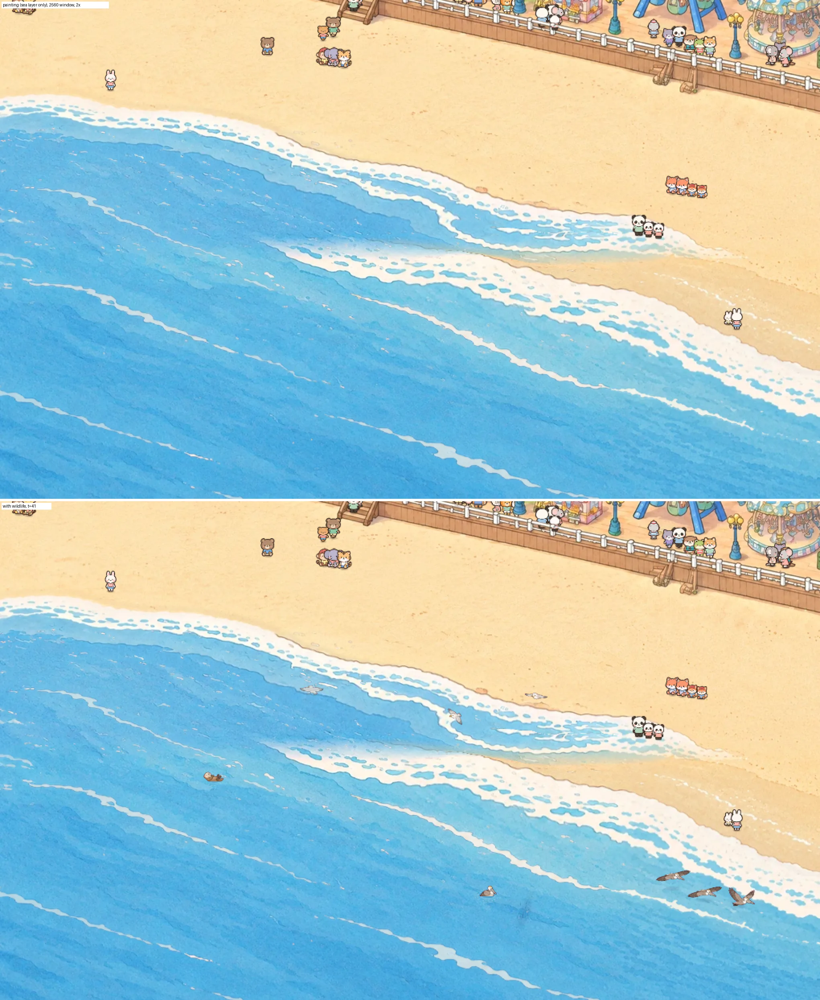
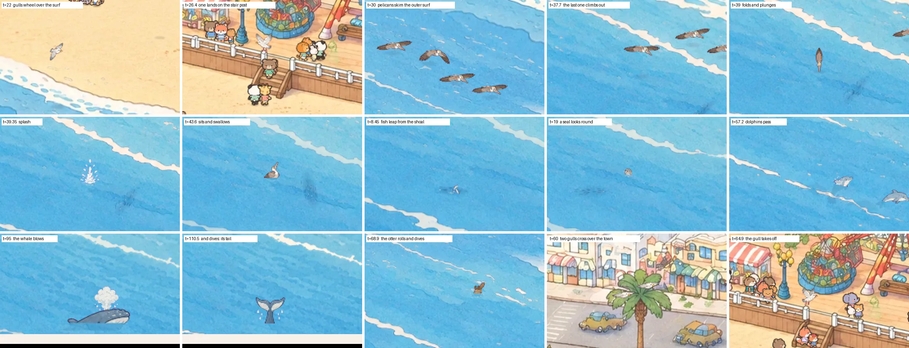
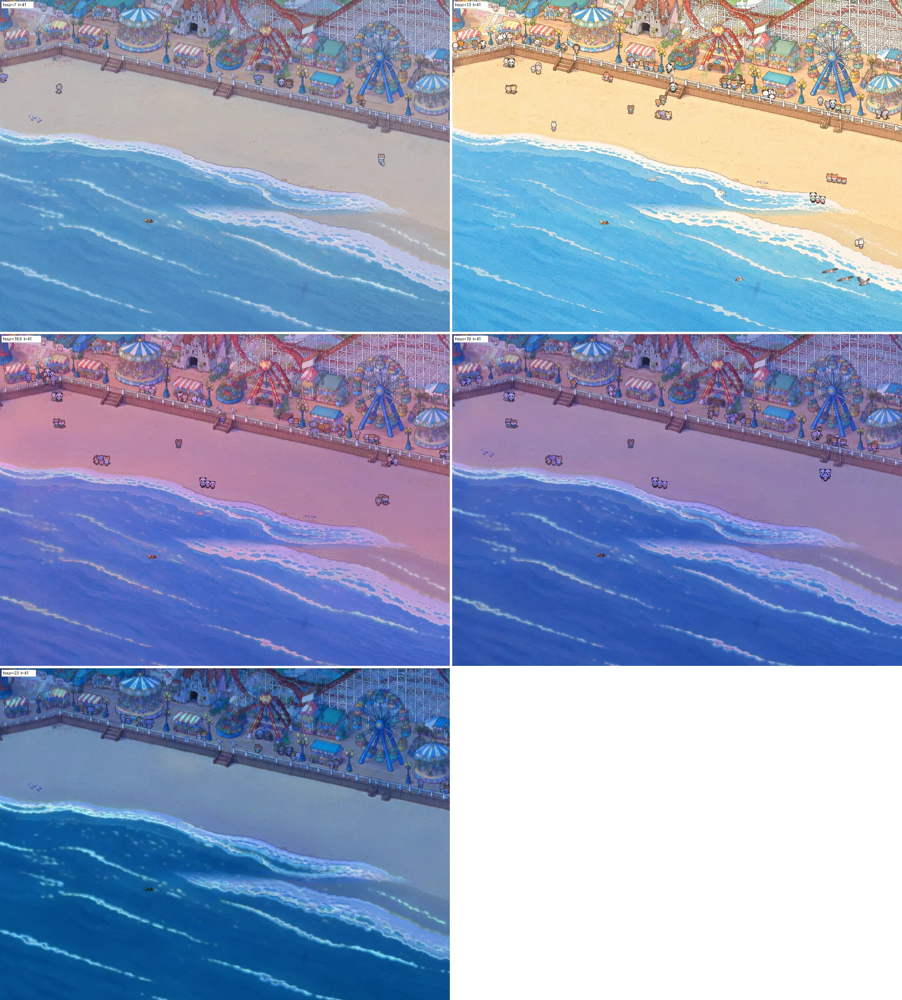

# Wildlife: sea birds and sea animals that make the picture breathe

View: **http://ran:5178/?layers=sea,wildlife** (with the crowd). Add `&crowd=0` for the animals alone, `&t=41` to
freeze a moment, `&wl=gulls,lander,pelicans,pair,otter,fish,seal,dolphins,whale` for only some of them, `&wlBoxes=1`
to outline the canvases, `&wlDensity=` to force the canvas density. Not in the page's `RIDES` list yet.

Shots (all from `tools/shots.py`):
- `shots/monitor_2560_t41.webp`: the whole 2560 x 1440 window at t = 41, with the crowd and the sea;
- `shots/monitor_2560_x2.webp`: the middle of that window enlarged 2x, painting (sea layer only) above, live below;
- `shots/painting_vs_live_1to1_x3.webp`: six moments at 1 CSS px per park px, enlarged 3x, painting beside live;
- `shots/strip_moments_2560_x2.webp`: fifteen moments at monitor size, enlarged 2x (below);
- `shots/window_shapes_t57.webp`: 2560 x 1440, 1920 x 1080, 1512 x 982 and 3440 x 1440 with the title;
- `shots/finish_raw_vs_shipped_x3.webp`: raw keyed sprites against the finished ones.

## What it does

Calm and occasional. Always there:
- **Three gulls wheel** (each in its own small canvas) over the beach and the surf in loose overlapping circles (16-23.5 s a turn, 80-135 high),
  gliding, banking, flapping two to four beats now and then; the flock's middle drifts along the shore between
  (1960, 1800) and (2900, 2120) over 280 s. Each casts a faint soft shadow straight down, offset by its height.
- **A sea otter** floats on its back at about (1700, 1945), bobbing on the swell: eats a clam (26 s), grooms (12 s),
  naps slowly turning (26 s), rolls over, swims, dives with a ring and drops, comes up 10 s later a little away,
  turns onto its back again. 100 s cycle.
- **A shoal of fish** as a flickering dark-blue cloud just under the surface around (2150, 2190), drifting; its 26
  fish wobble and now and then flash silver.

Now and then (every time from the page's clock, so `&t=` freezes it):
- **A gull lands on the stair post** on the rail at (1975, 1389): comes in from over the sea (13 s), lands, stands
  38 s (turns round twice, calls twice), crouches, takes off over the park to the top right. 84 s cycle.
- **Brown pelicans** (four or five) skim the outer surf in a line along the whole coast, about 50 s a pass, every
  125 s, alternating directions at random; the leader flaps three slow beats every 6.5 s and the beat passes down the
  line; they rise and fall with the swell. In about two passes of three **the last one dives**: climbs out over the
  sea, tips over, plunges (cut at the surface), a column of spray, a crown and rings, sits on the water 7 s and
  swallows, patters off and flies after the others.
- **Fish leap** from the shoal, one to three at a time, every 21 s, with a small splash out and in and a ring.
- **A harbor seal** (seven times in ten) **or a sea lion** pops its head up at one of three spots, looks round
  (front, side, nose up; the sea lion barks), sinks again, 11.5 s every 50 s.
- **A pod of two to four dolphins** passes along the outer water between (1600, 2040) and (2990, 2362), 25 s, every
  118 s: each arcs out every 2.7 s (rise, top, dive poses, cut at the surface, splashes out and in, a ring), and
  between arcs shows as a faint dark shape under the water.
- **A humpback** far out at about (2560, 2340), every 172 s: blows and surfaces, blows again with a higher back,
  raises its tail and slips under, leaving a flat calm patch that fades.
- **Two gulls cross high over the town** (every 96 s, 30 s across), flapping more than the wheeling ones.

Reduced motion (`prefers-reduced-motion`): one still moment with only resting animals: the gull on its post and the
otter.

## Time of day

The park follows the visitor's clock (`base/sky.js`: `ctx.sky`, else `getSky()`; `&hour=` fixes it). The layer reads
`dark` (0 day .. 1 night), `sun.alt` and `sun.morning` every frame and redraws when the hour changes, even with a
frozen `&t=`.

| Animal | Day | Dusk / dawn | Night |
|---|---|---|---|
| Gulls (the three wheeling, the lander) | as above | one by one, as `dark` passes 0.36, 0.50, 0.56 and 0.64 (about half an hour around sunset with the real clock), each flies 7 s to its roost and lands: the two stair posts (1975, 1389) and (2028, 1400), the sand at (1262, 1558) and (1286, 1566) next to the beach layer's gulls; at dawn the reverse, a take-off into its day flight | asleep on the roosts, hunkered down (the standing sprite squashed to 0.86), all facing the same way, none flying |
| Gull pair over the town | by day | gone above `dark` 0.25 | none |
| Pelicans | every pass in the morning (sun under 30 deg) and the golden hour (under 16 deg), about one pass in two at midday | none once the sun is under 1 deg | none |
| Fish leaps | by day | none above `dark` 0.4 | none (the shoal's shadow stays; the grade hides it) |
| Dolphins, whale | as above | | about a third of the passes (hashed per pass) |
| Otter | its 100 s cycle | a 2.5 s cross-fade to or from its night pose | asleep on its back, still, barely drifting |
| Seal / sea lion | any hour | | |

Each switch has a small hysteresis (0.03 of `dark`), so a clock sitting on a threshold doesn't flicker. The roost
state is the only state in the layer; it starts settled at mount (no flights on load).

`shots/hours_2560.webp`: 07:00, 13:00, 18:30, 19:00, 23:00 at `&t=41` with `layers=sky,sea,wildlife` (a 2560 window,
1:1). With today's real sun (late October: sunrise about 07:30, sunset about 18:15), 07:00 is still before dawn and
19:00 is already night, so 18:30 shows the dusk roosting part-way (two gulls in, two still flying). `&sun=story` gives
the storybook day (sunrise 06:30, sunset 18:59). `shots/night_roosts_1to1_x3.webp`: the sleepers at 23:00 at 1:1, 3x.

## What I studied

- **The painting** (`gen/park/world_v2_hd.png`, gridded with `rides/wheel/tools/grid_view.py`): the open water's
  crest lines and foam band, to put every animal on clear water between crest lines (otter between the first two,
  the shoal between the second and third, the dolphins' track and the seal spots measured the same way); the
  waterline and open-water edge per column from `rides/sea/masks.png`; the rail's stair post cap (1970-1981,
  top 1388), the lamps.
- **`rides/sea`**: waves at 8.5 s, ripple strokes drifting shoreward on 9-14 s loops. Floating animals bob 0.75 px
  on an 8.5 s swell whose phase runs towards the shore, so neighbours rise in turn as the painted ripples do.
- **The camera** (`base/camera.js`, yaw 24.1, pitch 28.7): flying birds are placed by ground point and height
  (`toPixel([x, h, z])`), their shadow at the ground point; rings on the water are ground circles (height = width x
  sin 28.7). The heading in the camera's ground frame is `atan2(vy / sin(pitch), vx)` of the ground track's screen
  velocity: side view within 35 degrees of across, three-quarter towards or away beyond, mirrored for leftward,
  with a 0.2 s cross-fade at each boundary.
- **The title** (`site/title/title.js`): its blocks, line and button in park px at the four window shapes. A test
  over 600 s of the clock (`window.__wildlife`) found no bird ever within 30 px of the blocks, note or button at any
  of 2560 x 1440, 1920 x 1080, 1512 x 982 or 3440 x 1440; the sea canvas starts at x 1440, right of all of them.
  The pelicans' path rises towards the beach on the left so the line passes above the name.
- **What each window shows** (cover fit): park y 476-2084 at 3440 x 1440, 200-2360 at 16:9, 33-2527 on the
  MacBook. The otter, seals, shoal and the dolphins' west half are inside even the ultrawide band; the whale is not.
- **`rides/beach`** (in progress): its swimmers are at y 1700-1812, its standing gulls on the sand, a kite at
  x 3664. Nothing here goes there; my gulls are the same design as its gulls (its gull row was a reference).
- **Recipes**: `rides/pirate` and `rides/wheel` (sprites on flat magenta, keyed by distance to the border colour,
  un-mixed), the crowd's density rule (`tests/park-crowd/crowd.js`).

## Approach, and what I rejected

**Chosen:** generated sprite sheets (birds in wing poses and views, sea animals in poses, splashes) keyed and
finished to the painting's look, moved in closed form from the clock on 2D canvases. Water lines are clips: a body
under the surface is cut there, and what is under shows as a faint dark-blue silhouette of the same shape.

**Canvases.** Sea life: one canvas over its stretch of water, park 1440-3060 x 1840-2440, in the `rides` slot.
Birds: the brief asked for one canvas per slot, but the birds range over the whole coast (the pelicans fly corner to
corner along a diagonal), so one box over them would be most of the painting: 12.6 MP at 1.5 device px per park px,
35 MP at 2.5. Instead each group (each of the four gulls, the pelicans, the diver, the pair) has a small canvas of
fixed size that travels with it: 7 canvases, about 0.8 MP together at 1.5 (2.2 MP at 2.5). One canvas per gull
also lets each fly off to its own roost at dusk. They are re-placed only when what they draw
nears their edge (a style change every few tenths of a second at most) and hidden when empty. All canvases run at
the screen's density kept between 1.5 and 2.5 device px per park px. No allocation per frame (sprite names are
whole strings, no closures or literals in the draw path).

**Rejected:**
- **Gliding gulls as the sheet drew them**: the side and towards-us glides show the wings almost edge-on, and at
  monitor size they read as grey dashes. Circling gulls use the banked pose for a side-on glide (the camera sees the
  tops of the tilted wings) and flap a little more; straight flyers keep the plain glides.
- **Sprite ripple rings**: the sheets drew them three times wider than tall (a ground circle here is 2.1 : 1) and
  scaling a ring thickens its line. Rings are drawn: the painting's foam colour, broken into short strokes, over a
  thin blue line, as the painted crests are.
- **The submerged parts as the sprite at low alpha**: it reads as a pale washed-out rectangle. A silhouette in dark
  water blue is what the eye takes for "under the water".
- **One canvas over all the birds**: above.
- **The whale's left-facing sprites unflipped**: they swam backwards and blew from the tail; the code mirrors them.

## Rebuild, step by step

1. **References** (no third-party images): `gen/style_frame/v1_1.png`; `gen/ref_beach.png` (painting, park
   950-1850 x 1200-1800, HD, shrunk to 1800 wide); `gen/ref_water.png` (painting, park 1450-2050 x 1780-2180, HD);
   `gen/ref_gulls_beach.png` (the gull row of `rides/beach/gen/smalls_v1_0.png`, so the two layers' gulls match).
2. **Generate**: `python3 -I tools/shyfai_image.py --batch rides/wildlife/prompts/round1.jsonl --jobs 2`
   (defaults: gpt-image-2.5, 3840 x 2560, quality high, n = 2 each). Prompts: `prompts/gulls_v1.txt` (5 x 4: side,
   towards and away flap cycles, banking, landing, standing, calling, take-off), `pelicans_v1.txt` (5 x 3: side flap
   cycle, the dive, sitting, swallowing, take-off), `sea_v1.txt` (5 x 4: otter, seal and sea lion heads cut at the
   water, fish, splashes), `whales_v1.txt` (4 x 3: dolphin arc poses, whale back, hump, fluke, spout, splashes).
3. **Pick takes**: `gulls_v1_0`, `pelicans_v1_1` (its first row has four birds, so sprites are indexed by order in
   their row, not by a grid), `sea_v1_0` (rounder sea otters than v1_1), `whales_v1_1` (a clean spout).
4. **Build**: `uv run -q --no-project --with pillow --with numpy --with scipy python -I
   rides/wildlife/tools/build_atlas.py [--sheet]`: key, split each row into its big pieces left to right (loose
   droplets join the nearest; foam rows by a fixed grid), one scale per family (gull wingspan 42, pelican 62, otter
   38, dolphin 60 park px; per-use scales in the layer for fish, heads and the whale), anchors (body middle by deep
   erosion for flyers; feet, waterline cut or base otherwise), the finish below, shelf-pack into `atlas.webp` (3 px
   per park px, lossy q 90 with lossless alpha, 221 KB) and `atlas.json`.
5. **The finish** (`finish()`): ink lines move 32% towards a darker shade of the fill they border (softer, tinted
   outlines, still dark enough to read small); whites are pulled 60% towards the painting's own white (its foam
   measures 245, 240, 233; the sheets' whites were yellower, 244, 236, 222); saturation x 0.86, brightness x 0.975;
   the painting's own grain (a high-pass of flat sand at park 1400-1700 x 1440-1560, resampled to atlas density)
   over everything at 3.5%. Shot: `shots/finish_raw_vs_shipped_x3.webp`.
6. **Layer**: `layer.js`, positions in its header constants, all measured on the painting.
7. **Check**: `uv run -q --no-project --with pillow --with numpy python -I rides/wildlife/tools/shots.py`
   (`hours` for the time-of-day sheet).

## Measurements

| What | Value |
|---|---|
| Title | no bird within 30 px of the title's blocks, note or button at 2560 x 1440, 1920 x 1080, 1512 x 982, 3440 x 1440, over 600 s of clock |
| Boxes | no travelling box ever clips its group over 400 s |
| Frozen frame | two captures of `&t=39.3`: identical except the title's own wobble (not clock-driven) |
| Cost | `frame()` 1.0-1.5 ms in headless Chrome (software canvas), all groups; backing stores 3.1 MP at density 1.5 |
| Motion | gulls about 0.8 px a frame, pelicans 1.5, the crossing pair 2; wing poses 90 ms each |
| Download | `atlas.webp` 221 KB, `atlas.json` 6 KB, `layer.js` about 40 KB |
| Console | clean with the sea and the crowd |

## Image generations

**8 images**, all gpt-image-2.5 at 3840 x 2560, quality high: four prompts, n = 2 each, one round, no retries.
All eight takes were usable; four are used (above).

## Open

- **Not in `RIDES`** (yours to add). Order: if `beach` mounts after `wildlife`, its canvas sits over the sea
  canvas; they don't overlap in content, so either order works.
- **The whale is at the bottom edge** on 16:9 windows (cut by the edge at y 2360) and not seen at all on 3440 x
  1440; it shows whole only on 3:2-ish screens (MacBook). Moving it up means into the dolphins' and shoal's water;
  or leave it as a MacBook bonus.
- **The upper-left sea** (above the title, seen at every window shape) has only the passing pelicans; a seal spot
  there would liven it, at the cost of activity near the name.
- **Gliding gulls are small** at monitor size: 28 CSS px across at 2560, but only 7-10 px tall in glide. A sheet of
  glides drawn from this camera's 30 degrees above (wing tops foreshortened, not edge-on) would read better; one
  more generation (2 images).
- **The beach layer's gulls** stand on the sand; if it also flies gulls, keep one owner of flying gulls (these).
- **Bird shadows** land on the sand plane even over the boardwalk (the lander's approach and departure cross it);
  they fade out above 100-150 height so the mismatch is faint.
- **Raw sheets** in `gen/` (32 MB of 4K PNGs) follow the repo-size question in NEXT_SESSION.md.
- Real-GPU frame cost not measured (headless is software).
- **Sleeping gulls are the standing sprite squashed**, not a head-tucked pose (none in the sheet); fine at this size
  under the night grade, a dedicated pose would be one more generation.
- **The otter isn't wrapped in kelp** at night (no kelp art); it sleeps still on its back.
- **With a frozen `&t=`**, a gull caught by an hour change waits at the start of its roost flight (the flight is
  timed on the page's clock); the live page plays it.
- The sand roosts sit beside the beach layer's standing gulls; if that layer moves its gulls, move these with them.

## Files

All in `rides/wildlife/`: `layer.js`, `atlas.webp`, `atlas.json`, `RESULTS.md`, `prompts/` (four prompts and the
batch), `gen/` (references, the eight sheets, their request records, `atlas_sheet.png`), `tools/build_atlas.py`,
`tools/shots.py`, `shots/`. No shared file was edited.
