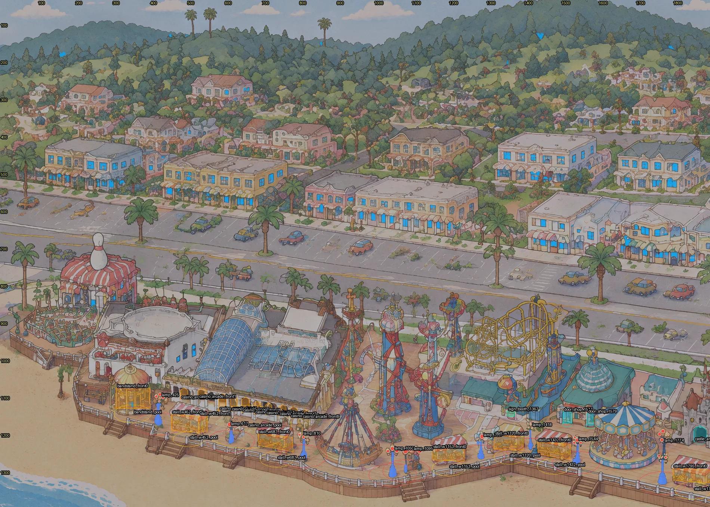

# West and east inventory

The centre piece's method (`RESULTS.md`), run over the rest of the park: West is park x 0-1900 and East is x 3000-3840,
both over the full height. Files:
- `lights_west.json` + `masks_west.png` and `lights_east.json` + `masks_east.png`. They use the `rides/lights/lights.json`
  format (`piece`: west/east; `atlas.file` names the piece's own atlas, so the merge has to repack or offset `atlas`).
- Contact sheets: `shots/inventory_west.webp` and `shots/inventory_east.webp`. Masks are filled by kind, lamp posts are
  blue, polygons are outlined and pools are drawn as ground ellipses.

## Counts

| Kind | West | East | Notes |
|---|---|---|---|
| Globe lamps (promenade) | 9 | 4 | Every one checked by eye on gridded crops. Head box round the globes; foot = bottom of the post's base. Globe and post masks are cut from the painting. |
| Stall fronts (`stall` polygons) | 18: 6 stalls (7 polys), Casino arcade (10 arches), bandstand (1) | 2 (red-white tent, yellow booth) | The arcade arches and the bandstand glass are lit through their own painted goods, like a stall front. |
| Stall pools (`spill`) | 8 | 2 | |
| Windows | 160: 152 town (`home`/`shop`) + 8 park buildings (bowling, Casino, bandstand; group `stall`, field `bldg`) | 24 town | |
| Doors | 3: castle arch (`ride`), two shop doors at x 1506-1587 (`stall`) | 0 | |
| Signs | 1: pink booth sign (1357, 1142) | 0 | |

Lamps on the strip: 9 west + 4 centre + 4 east = **17**. `tests/park-crowd/walk.json` lists 16 and misses
`lamp_617` (head (618, 1184), foot (618, 1228)).

## Precision and recall (by eye)

| Finder | Region | Found | Precision | Recall |
|---|---|---|---|---|
| `detect_lamps.py` (`work/lamps_park.json`) | West | 18 candidates | 7/18 = 39% (two hits are the two tiers of `lamp_1774`) | 6/9. It misses the orange globes of `lamp_425`, the pink-yellow globes of `lamp_1095` and the pale globes of `lamp_1287`. |
| | East | 7 candidates | 1/7 = 14% (kiddie rides and teacups fool it) | 1/4. It misses `lamp_3027`, `lamp_3344` and `lamp_3375`. |
| `detect_windows.py` (ink-enclosed glass) | West town (y 40-740) | 92 | 79/92 = 86% (6 car windows, 7 foliage or bush hits) | about 26% alone |
| | West park buildings (y 740-1250) | 18 | 8/18 = 44% | low: the Casino's tall windows and the bowling door only |
| | East town (y 0-760) | 26 | 8/26 = 31% (13 on the bridge rails and trestle, 5 trees and bushes) | about 8% alone |
| | East park (y 760-1500) | 17 | 0/17 (ride parts, flume tubes) | none kept |
| Blue-pane blob finder (new, scratch) | West town | 155 | 137/155 = 88% (12 car windows, 6 foliage); 64 duplicate the ink finder | adds 73 |
| | East town | 44 | 21/44 = 48%; 5 duplicates | adds 16 |
| | Park buildings (both) | 128 | 0 kept (glass roof panes, rides, stalls) | none kept |
| **Kept windows** | West town | 152 | all checked on gridded tiles | about 50% (152 of ~300 panes by a rough count) |
| | East town | 24 | | about 23% (24 of ~105) |

Hand items are right by construction: the stall fronts, the arcade, the bandstand, the doors and the sign. The pane
finders still miss these kinds:
- pale glass with white frames on the hill houses;
- the pink building at x 3080-3330, y 560-700 (east): only 6 panes found;
- the hill villas east of x 3200.

Panes that are never found stay dark, which is fine when only some windows are lit. The blue-pane finder exists
because the ink finder treats dark-blue glass (value < 0.62) as ink, so it misses the panes the town paints darkest.

## Not recorded (on purpose)

- **Moving rides:** the pirate ship, Typhoon/Double Shot, west carousel, teacups, flume.
- **Painted kiddie rides** east of x 3200. They have no painted bulbs, and the centre's invented rim ring was not
  repeated.
- **Beach Street lamps:** the street-lights agent is adding them.
- **Car windows:** removed by a road-band rule and the eye check.
- **The bridges and the river:** neither the road bridge nor the rail trestle has a painted fixture.
- **The parking lots:** no painted lamp posts.

## Open

- **Window recall:** about 50% west and 23% east. Seeds (`region_at`) for the empty buildings would raise it. The
  candidates are the pink building (east), the hill villas, the big house at x 1050-1250, y 380-450, and the Casino's
  upper floor.
- **Flume mill house** (x 3050-3220, y 1130-1330) windows and lantern: left to the flume layer, as `RESULTS.md` plans.
- **Static dark-ride fronts inside the flume box:** the skull mountain's cave mouths and the arched doorways at
  x 3665-3700, y 1285-1330. They are not recorded; a candidate for `door` polygons once someone confirms they are not
  part of the flume layer.
- **Cocoanut Grove glass roof** (x 520-900, y 860-1080): a soft interior glow would read well. It isn't a window mask
  (too big for the atlas) and needs a decision.
- **Bowling building:** the pin and the striped roof sign are not lit. Only its door and two windows are recorded.
- **Stall and arcade polygons:** traced to ±5 px. Lamp heads were cut with a widened hue range (down to h 20) where
  the globes are orange or pale. Check `lamp_425`, `lamp_1095` and `lamp_1287` on the night render.
- **The build script and the finder:** they are in the agent's scratch, not the tree. Copy them to
  `tests/night-lights/tools/` if they should be kept.

## Rebuild

The build and check scripts are in `tests/night-lights/tools/` (`build_we.py`, `blobwin.py`, `check_we.py`, `wincheck.py`); their working files are in `tests/night-lights/gen/we/` (raw, outside git, backed up to D:). Run `build_we.py west|east tests/night-lights/gen/we` from the repo root.
