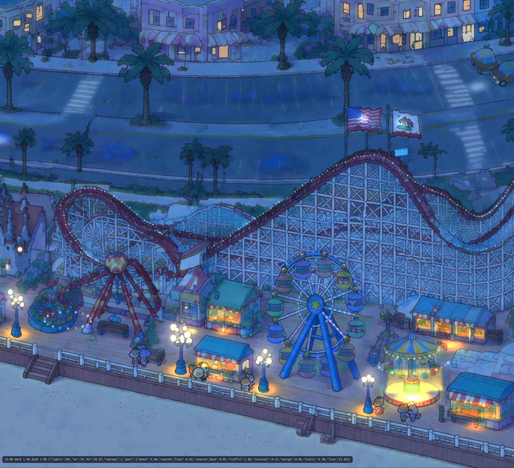
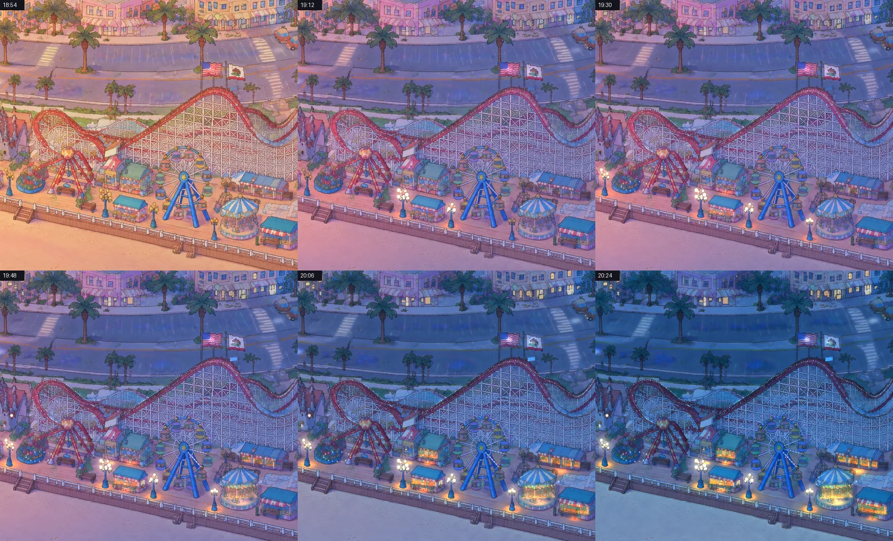
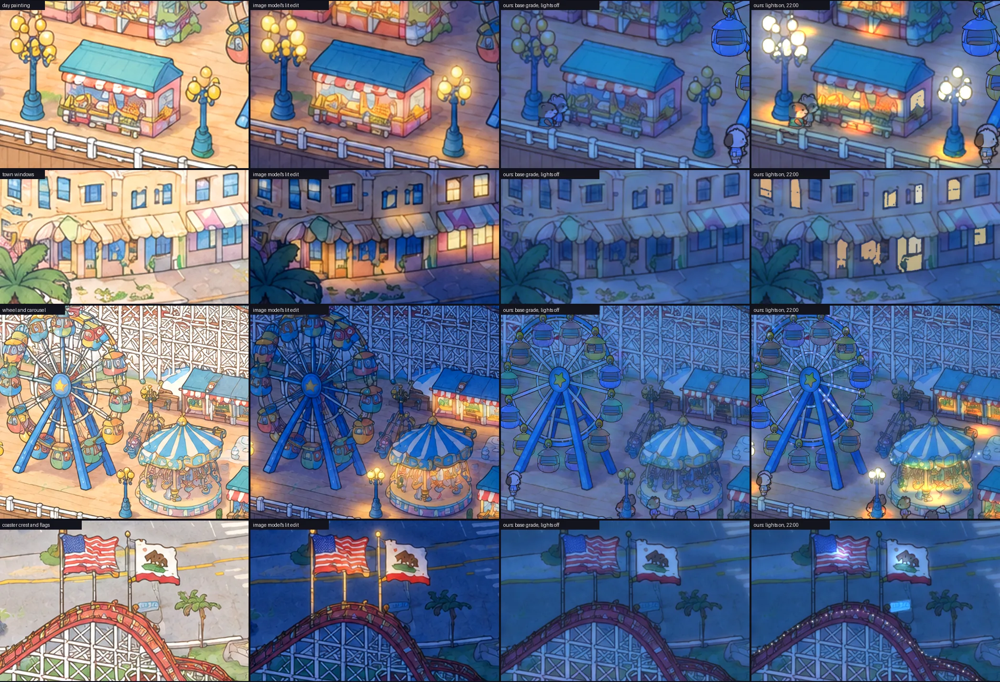

# Night lights: every light in the park, where it is and when it turns on

**On the park page: `rides/lights/layer.js`** (section "On the main page" below). Test page with the look agent's
draft grade: **http://ran:5178/tests/night-lights/?hour=22** (the slice park px (1900, 650)-(3000, 1650), drawn over
the look agent's night grade). Other views: `?hour=19.5`, `?demo=18.6-21.2&secs=40` (dusk in 40 s: watch the wave),
`?lights=0` (the base alone), `?view=park`, `?base=grade|model`, `?crowd=0`, `?layers=` (no live rides), `&panel`
(stats), `&t=` (frozen ride clock).



## Recommendation

**An inventory of the painting's real fixtures drives a procedural renderer that relights the painting's own
pixels.** Every light is a record in `lights.json`, measured on our painting: what it is, where its source and its
pool are, its shape cut from the painting, its depth, and the group that switches it. Nothing is invented. A lamp
lights only where a lamp is painted, and a window only where a pane is painted.

The image model is not used to place or paint the lights. Its lit edit of the slice (2 generations used of the ~6 budget) served
three purposes:
- a check for fixtures I had missed;
- a look target (colours, pool sizes, how warm the stalls get);
- a test of how far the bakeoff's method can be trusted.

It mostly obeyed "light only what is painted", but it still lit a ride's pole top as a lamp and lit whole shop
facades rather than windows, and it chose its own random half of the windows to light. A per-slice lit edit is not
needed to ship.

Rejected:
- **The bakeoff's extracted emission per slice** (lit edit minus its lights-off twin). It gives a painted look, but
  the model decides where the lights are, it costs 2 edits per piece, it leaves leaks along the lattice and the
  outlines, and its lights have no ids, so there is nothing to switch one by one. Its strong point, rich lit stall
  interiors, comes for free here: a gain lights the painted goods through their own colours.
- **Detection alone.** On this painting it is not precise enough (numbers below).
- **A generated glow sprite sheet.** The soft washes are procedural: an uneven outline, a faint wash edge and paper
  grain. They read as painted at this size.

## The inventory (slice): `lights.json`, `masks.png` (24 KB each)

Built by `tools/build_lights.py` from detectors, hand measurements on gridded crops (`tools/crops.py`) and the rides'
own geometry. 69 records:

| Kind | Count | Where it comes from | Slot |
|---|---|---|---|
| Globe lamps (yellow globes on blue posts) | 4 | `detect_lamps.py`, checked by eye; globe and post masks cut from the painting; foot = bottom of the post's base | lights (globes, halo) + pool (light on the planks) |
| Stall fronts (counter and goods) | 7 polygons over 5 stalls | hand-traced | pool (gain through their own colours) |
| Stall pools on the deck | 5 | hand-placed | pool |
| Stall side windows | 2 | seeded fill (ink-enclosed region) | lights (flat warm shape) |
| Town windows | 40: 19 from the detector, 21 from seeds; 24 upper floors ("home"), 16 shop fronts ("shop") | `detect_windows.py` plus seeds | lights |
| Coaster sign, fun-house door, castle lantern | 3 | hand | pool / lights |
| Flag floods | 2 | hand | pool |
| Bulb strings | 321 bulbs: Giant Dipper track 207 in front + 81 behind the lattice (from `rides/coaster/track.json`, top edge of the painted band, every 7 px); east carousel valance 15; kiddie tub rim 18 | ride geometry | coaster: its own lights canvas; others: lights |
| Live: Dream Wheel LEDs | 156 (48 rim, 84 spoke, 24 inner ring), turning with the wheel | `rides/wheel/wheel.json` and `window.__wheel` | its own lights canvas |
| Live: car head lights, tail lights, road wash | 5 per moving car | `window.__traffic` | its own lights canvas |

Each record has a `z` (the ground y it stands on) for a future shared depth sort, and a seed for its variety. Checks:
`shots/inventory_park.webp` and `shots/inventory_town.webp` (masks filled by kind, polygons, bulbs, pools as ground
ellipses), `shots/lamp_candidates.webp` (the lamp detector's contact sheet).

### Precision and recall (by eye, on this slice)

| Detector | Found | Precision | Recall | After the eye check |
|---|---|---|---|---|
| Globe lamps (yellow cluster + blue post below): strip y 600-2000 | 42 candidates, 12 lamps | 29% (slice: 4 of 17) | slice 4/4; the strip about 12 of 18 (missed 6 of the 16 lamps that `tests/park-crowd/walk.json` lists) | 4/4 in the slice. The wheel's cabins and A-frame, the Fireball, carousel roofs and kiddie rides fool it. |
| Town windows (ink-enclosed glass): town band y 650-830 | 26 | 73% (rejected 7: car windows, foliage, a sky patch) | about 19 of ~60 panes, 32%; the pink buildings' pale glass is missed | 40 of ~60 (67%) with 26 seeds; 5 seeds failed. Panes that are never detected just stay dark, which is fine when only some windows are lit. |
| The model's lit edit | lit 45 of my 69 records | invented 1 lamp (the pole top at (2729, 1324)) and lit facades and the rail glow | lit about half the windows, a different half; missed the sign and the castle door | not used to ship |

Hand items (stalls, signs, doors, flags, rims) are right by construction. I compared them with the model's edit
and found one miss: a stall cut by the slice's left edge (x < 1915).

## Rendering (`lights.js`)

The base grades everything (painting, rides, crowd) with two overlay canvases (tests/night-park). Over that:

1. **pool**, two canvases at 1 px per 2 park px, redrawn only when a light changes level:
   - a **warm filter** (`mix-blend-mode: multiply`, ≤ 1) takes the night's blue out where light falls;
   - a **gain** (`color-dodge`, each channel s = 1 − 1/G, capped at G = 5) brightens it.

   Together they relight the planks, a stall's goods, a flag, and any animal or car standing in the pool, each by its
   own colours. The bear by the lamp in `shots/board_closeups.webp` is warmed without being covered. Light added alone
   turned the blue-graded planks mauve, not amber: a light needs a multiply and an add. A lamp's own painted post is
   masked out of its warm filter, because blue under a warm filter turns green.
2. **lights**: three kinds of canvas.
   - A normal-blend **steady** canvas for lit windows. They are flat warm shapes painted over their panes, with a
     faint bloom; the glazing bars are ink, outside the mask, so they stay. With `plus-lighter`, pale graded glass
     went white rather than yellow.
   - A `plus-lighter` **live** canvas, redrawn every frame while lights are on: the globes (their painted shapes lit),
     a close bloom on each globe, a wide halo, and bulb strings with their patterns.
   - One `plus-lighter` canvas per **live layer**, over that layer's rect.
3. **Occlusion of point lights is a lookup, not a composite.**
   - A layer's static occluders (the wheel's front legs and hub, the coaster's station, Fireball hub and lattice) are
     alpha masks, sampled at each light's point.
   - Moving ones (a cabin in front of the rim, a train over the bulbs) the layer reports as `vis`.

   Cutting whole canvases with `destination-out` cost 7-13 ms a provider in software; the lookup costs under 1 ms.

Cost in headless Chrome (software canvas, so relative numbers only) is about 6 ms a frame for the slice. The live
providers take 0.6-1 ms each, the twinkle canvas 1.8 ms, and the pool and steady canvases cost nothing per frame once
drawn. At midday nothing is drawn. For the whole park (about 2,000 windows, 3,000 visible bulbs, 40 lamps, ride LEDs),
put the live canvas in WebGL2: one instanced draw, with patterns computed in the shader from per-instance
(kind, seed, index) data. The pool canvases stay 2D and redraw on change.

## Behaviour (`behaviour.js`)

Every rule is closed-form in the hour (so `&hour=`, a frozen clock and the live clock agree), with a per-light seed:

| Group | Lights | Rule |
|---|---|---|
| photocell | flag floods, car lights, future street lights | on when `dark` passes 0.35 (±0.06 per sensor), off at dawn |
| promenade | globe lamps | **the wave**: a sweep from the Giant Dipper's station (x 2300) out along the strip both ways, over dusk (progress from `dark`/dusk 0.45 → 1); a brief stutter while each one switches on; on all night; off in reverse at dawn |
| ride | Dipper bulbs, wheel LEDs, carousel and kiddie bulbs, sign, door, lantern | with the wave, a little after the lamps; off at closing, from 22:45 over 25 minutes (the Boardwalk switches lights off around 22:45 and it takes 20-30 minutes) |
| stall | stall fronts, their windows and pools | each keeper at a random point of the wave; off with closing |
| home | upper-floor town windows | random evening on-time (sunset −0.6 h .. +2.4 h), off 21:24-01:36; 30% stay dark; 5% on all night; 15% back on before sunrise; 8% of the lit ones are a TV (cool flicker). About 50% lit at 22:00, 7% at 02:00. |
| shop | street-level shop windows | on at dusk, off 21:00-23:00, 15% stay dark |

The patterns follow the research report (sources in the agent notes):
- **Giant Dipper.** 3,150 bulbs, "chaser lights that go along the outline of the structure chasing the train". Here:
  a 3-phase chase at 8 steps/s in the direction of travel, plus a bright packet riding with each train. The bulbs
  under a car are hidden. The trains themselves carry no lights, as on the real ride.
- **Dream Wheel.** A Chance Century Wheel with "more than 3,000 multicoloured lights". Its permit rules out red
  light (migrating birds), so the palette is blue, cyan, teal, green, violet and white. Five 12-second programs,
  cross-faded: rim chase, spoke sweep, whole-wheel colour fade, a red-free rainbow turning round the wheel, sparkle.
- **Carousel.** A marquee chase on the east carousel's valance at 6 steps/s.
- **Kiddie ride.** A two-phase blink.
- **Lamps.** Steady, with a 3% shimmer.
- **Lantern.** A candle-like flicker.
- **Cars.** Head lights on the side facing the viewer, tail lights brighter while braking, a wash on the asphalt
  ahead; parked cars dark.

The switch-on wave, 18:54 to 20:24 (`shots/board_wave.webp`): golden with nothing lit; the first lamps at the
Dipper; most of the slice lit; full night with windows coming on.



Close-ups (`shots/board_closeups.webp`): the day painting, the model's lit edit, our base with lights off, and our
lights at 22:00, for lamps and stalls, town windows, the wheel and carousel, and the coaster crest and flags.



`shots/slice_19.5.webp` is 19:30: rose dusk, lamps and some stalls on, windows starting. `shots/slice_22.webp` is
22:00 and `shots/slice_22_off.webp` is 22:00 with the lights off.

## The contract for live layers

A layer adds `lights` to the object its `mount(ctx)` returns. The lights module draws them with the shared look and
the shared switch rules, in a canvas of the layer's own in the `lights` slot:

```js
lights: {
  rect: [x, y, w, h],            // park px the layer's lights can reach (its light canvas covers only this)
  group: "ride",                 // which switch rule: "ride" (park circuit: dusk wave .. closing), "photocell", "always"
  frame(t, out, sky) {           // every frame while its group is on; push lights in park px
    out.push({ x, y, kind: "bulb" | "led" | "lamp" | "head" | "tail" | "beam", colour: "#rrggbb",
               a: 0..1,          // the pattern's level (chase, program, brake light)
               vis: 0..1,        // the layer's own moving occlusion (a cabin in front, a train over the bulb)
               r, bloom,         // optional size (park px) and bloom strength
               dx, dy, len, w }); // "beam" only: direction, length and width of the wash on the ground
  },
  masks: [{ el, rect, alpha }],  // static occluders in front of its lights (images: legs, lattice), sampled per light
  pools: [{ c: [x, y], r, colour }], // optional static light the ride throws on the ground (into the pool canvases)
},
```

- Bulb strings that sit on a painted ride but must hide behind its moving parts belong to the ride. An example is the
  Dipper's track bulbs and its trains: `lights.json` marks them `"layer": "coaster"`, and the static renderer skips
  them when that layer is mounted.
- `adapters.js` implements this block for the wheel, the coaster and the cars from the state those layers already
  expose (`window.__wheel`, `__coaster`, `__traffic`) and their geometry files. Each ride can move its adapter into
  its own `layer.js` as it stands.
- Next layers:
  - **Sea Swings** (`rides/swings`, replacing the painted east carousel): warm bulbs on the canopy rim, steady or a
    slow chase, turning with the canopy. The east carousel's valance bulbs and inner glow in `lights.json` go when it
    lands.
  - **West carousel:** a steady warm glow from its rounding board.
  - **Teacups:** a bulb ring on the drum.
  - **Flume:** the mill house windows and lantern.
  - **Pirate Ship:** deck lanterns.
  - **Thrill:** a fast warm LED show on the Typhoon; the Double Shot dark by permit, at most a dim top marquee.
  - **Beach and wildlife:** none.
- A layer that wants to light itself can call `lights.at(x, y)`, which returns the gain at a ground point. With the
  pool over the live layers, none needs to.

## INTERFACE (lights side; base side in tests/night-park/RESULTS.md, draft 1)

- **Stacking: agreed.** Bottom to top: painting, plate, rides, animals, front | **grade** (base) | **pool** (lights:
  warm multiply + colour-dodge gain) | **lights** (lights + rides' lights: normal-blend windows, plus-lighter
  sources). The grade must stay overlay canvases, not CSS filters on slots. A filter on a slot makes it an isolated
  group, and the pool and plus-lighter canvases would no longer reach what is under them.
- **From the base I need** `ctx.sky.hour`, `ctx.sky.dark` (0..1) and `ctx.sky.sun.{rise, set}`. The test page
  derives them from `base/time.js` until `sky.js` lands.
- **The wave: lights owns it.** I propose the lights module, not the sky, owns switch-on times:
  `ctx.lights.level(group, x)`. A ride's bulbs and the lamps beside it must agree with the park's circuits and its
  22:45 closing, which are not the sky's to know. If the base keeps `sky.wave(x, y)`, it should be this function.
- **Lit/off plate pairs: not needed.** The base asked for a lit night and its lights-off twin per piece, to fit its
  night field and to extract M and E. My lights are procedural, so the base should make its own lights-off night per
  piece; its `night_light.txt` already asks for unlit globes, and the painted globes stay where they are because the
  base grades rather than repaints. My pair for this slice is there if useful: `gen/off_v1_0.png` and
  `gen/lit_v1_0.png`, registered in `gen/reg/*_reg.png`, park rect (1700, 650, 1500, 1000).
- **What I provide:** `lights.json` and `masks.png` (classes: lamp, window, stall, spill, sign, door, lantern, flood,
  bulbs) and `mountLights(ctx)`, which creates the pool and lights canvases. M and E don't exist as textures.
- **Their open point (a), folding the pools into the grade canvases:** no. The pools change with the wave, the stalls
  and closing on their own schedule, so they stay as two low-resolution canvases redrawn on change.
- **Their open point (b), a shared night prompt:** fine by me, as long as the globes stay pale unlit glass.

## The whole park: plan and cost

1. **Lamps, about 1 hour.** Run `detect_lamps.py` over the strip (17 s), check its contact sheet by eye (about 2
   minutes for 42 candidates), and hand-add the misses along the promenade and deck on gridded crops (6 known from
   walk.json). Globe and post masks and feet come out automatically.
2. **Windows, 2-3 hours.** Run `detect_windows.py` over the whole town (rows of buildings from y ≈ 50 to 830 across
   the width: roughly 1,500-2,500 panes), reject false hits on a contact sheet, and add seeds for buildings that come
   out empty.
3. **Hand fixtures, about 2 hours.** About 40 stalls and booths, the arcade fronts (Casino, Neptune's Kingdom),
   signs, doors and the bandstand, as polygons on gridded crops.
4. **Rides, 20-40 minutes each, by the ride agents.** Each ride moves its adapter or writes its `lights` block: about
   5 hours in all.
5. **Renderer to production, about half a day.** Port the live canvas to WebGL2 instancing, mount it in
   `index.html` as a layer, and have the base supply `ctx.sky`.

Image generations: **none required.** Optionally one lit edit per piece (9) as a recall check. Street lights, if
wanted, take 4-5 patch edits.


## On the main page (rides/lights)

The renderer is now a ride layer: `rides/lights/`.

| File | What it is |
|---|---|
| `layer.js` | the layer: `mount(ctx)` returns `update` and `resize` |
| `lights.js` | the renderer |
| `behaviour.js` | the switch rules |
| `adapters.js` | the lights of the live rides |
| `lights.json`, `masks.png` | the merged park inventory (`tests/night-lights/tools/merge.py`) |

It works on today's `index.html` without changes (shots: `shots/main_22_lights.webp`, `shots/main_21_centre.webp`,
with every default layer, console clean). Without the grade, the page shows day colours with the lights on top until
the look agent's overlay lands.

**The RIDES line for `index.html`:**

```js
const RIDES = ["sea", "beach", "wildlife", "traffic", "coaster", "wheel", "swings", "teacups", "flume", "pirate", "carousel", "thrill", "corgi", "sky", "lights"]; // reviewed rides only
```

What `index.html` needs:
1. **Order.** `lights` comes **last**, after the look agent's `sky` layer. It reads the other rides' state
   (`window.__wheel`, `__coaster`, `__traffic`, `__carousel`, `__swings`) at mount, and its canvases must sit above
   the grade.
   - Without `ctx.slots.pool` / `ctx.slots.lights` it appends to `slots.front`, in mount order: grade, then pool,
     then lights. That already works.
   - Cleaner is to give it two slots after `front` in `.world`:
     `<div class="slot" data-slot="pool"></div><div class="slot" data-slot="lights"></div>`. The grade's canvases go
     into `front` or a `grade` slot before them.
2. **The sky.** `ctx.sky` (base/sky.js's object) if the page makes one, so every layer shares the same hour.
   - Without it, the layer makes its own from `base/sky.js` on the visitor's clock (`&clock=local` unless `&hour=` or
     `&clock=` is given).
   - Without `base/sky.js`, it uses `&hour=` or the visitor's clock through `base/time.js`.
3. Nothing else. `&lights=0` turns it off.

Cost:
- **By day** every lights canvas is hidden and `update` returns at once (0 ms, measured at 13:00).
- **At night:**
  - levels are recomputed 10 times a second;
  - the pool and window canvases redraw only when a level changes;
  - the twinkle canvas and the rides' light canvases redraw at 30 fps;
  - the pool canvases are two full-park canvases at 1 px per 2 park px;
  - the rest cover only where their lights are, at screen density (at most 1.5 px per park px).

**The merged park (2026-10-26, evening).** `tools/merge.py` joins the pieces into `rides/lights/lights.json` +
`masks.png`, one atlas of 2048 × 431, 76 KB. A missing piece is skipped, and the first record of an id wins at a seam.

| Piece | Records |
|---|---|
| centre `lights_centre.json` (`tools/build_lights.py`) | 100 |
| west `lights_west.json` (`tools/build_we.py`) | 199 |
| east `lights_east.json` (`tools/build_we.py`) | 32 |
| street lights (`rides/streetlights/lights.json`, 13 poles) | 13 |
| **park** | **344**: 17 promenade lamps, 13 street lights, 259 windows, 27 stall fronts and arcade arches, 15 pools, 2 signs, 4 doors, 2 lanterns, 2 floods, 359 bulbs |

- **Fixes found on the night render** (the `FIXES` table in `merge.py`): `lamp_810`'s mask reached up into the yellow
  sculpture behind it, so it is clipped at y 1197. Lamps 425, 1095 and 1287 (orange, pink and pale globes) light
  correctly (`shots/park_22_west_lamps.webp`).
- **Street lights** are a new kind, `streetlight`:
  - a lens stroke along the LED head's underside, a small bloom and a faint cone down to the pool;
  - the pool has a pale apricot filter. A white gain over blue-graded asphalt only brightened the blue (cyan spots),
    so the filter takes the blue out first.
  - They switch with the photocells at dusk.
- **Rebuild:** after changing any piece, run `build_lights.py` (centre) or `build_we.py west|east`, then `merge.py`.

Whole park on the main page, with every default layer plus streetlights, sky and lights:
- `shots/park_22.webp` (22:00);
- `shots/park_18.6.webp` (18:36, mid-wave);
- `shots/park_19.5.webp` (19:30).

The sky's sun for today sets at 18:18, so 19:30 is already full night (dark 1, progress 1) and looks like 22:00. The
wave runs about 18:00-19:00. That's the sky's clock, and the lights follow it.

**Inventories it loads** (a missing file is skipped; the first record of an id wins):
- `rides/lights/lights.json`: the merged park (above). The centre part covers x 1900-3000, y 0-1700, 100 records. To the slice's records it adds 33
  hill-town windows from the detector and a pink-globe street lamp on the hill street at (2662, 486). The east
  carousel's records are gone: the Sea Swings replaced that carousel, and its lights come from its layer.
- `tests/night-lights/lights_west.json`, `lights_east.json` (the helper agent's; not landed when I stopped).
- `rides/streetlights/lights.json` (Beach Street's new posts; not landed). Format: `lights.json`'s, with
  `atlas.file` relative to the json. A lamp is `{kind: "lamp", group: "photocell", src, ground, globes, mask, post,
  halo, pool}` or, without masks, `{kind: "lantern", group: "photocell", src, core, halo, pool}`.

**Live rides lit** (`adapters.js`, reading each layer's exposed state, read only):

| Ride | Lights |
|---|---|
| Dream Wheel | 156 LEDs, five red-free programs |
| Giant Dipper | 288 chaser bulbs on the whole track, a packet riding with each train, hidden under the cars, behind the station, the Fireball hub and the lattice |
| Cars | head and tail lights and a road wash, over the whole street |
| West carousel | 28 bulbs round its valance, turning with it, front half only; a warm pool |
| Sea Swings | 30 bulbs on the canopy's crown band, turning and lifting with it; a slow chase while it runs, steady while it loads; a pool on its deck |

The user's choices are built in:
- every night is a summer night, lit until 22:45;
- TVs and the switch-on stutter kept;
- all five wheel shows;
- no awning bulbs;
- the pole top stays dark;
- blue gaps between the pools.

## Decisions for the user (decided 2026-10-26)

Decided:
- the visitor's own clock;
- 12-16 painted lamp posts on Beach Street (rides/streetlights);
- every night a summer night until 22:45;
- TVs and the stutter kept;
- all five wheel shows;
- no awning bulbs;
- the pole top dark;
- blue gaps between the pools.

The options as they were put:

1. **Beach Street has no street lights in the painting.** Options:
   - paint about 12-16 slim LED poles into the painting with `park_patch.py` (neutral white, as the city's LED
     retrofit is);
   - light the street without poles (light from nowhere: not recommended);
   - leave the street to the cars and shop fronts, as the prototype does now.
2. **Hours: real or storybook?**
   - Real: summer rides until about 22:00, lights out from 22:45; October weekends only, closing at 19:00-20:00; rides
     dark on off-season weekdays.
   - Storybook (the prototype): every evening is a summer evening, lit until 22:45.
3. **How warm?** The model's edit is warmer: the deck glows amber between the lamps. Ours keeps blue gaps between the
   pools. One number (`GAIN`) sets it.
4. **Bulb strings on stall awnings** (real game booths often have them; the painting doesn't draw them): add them or
   leave them out (not added).
5. **Dream Wheel:** keep all five red-free programs cycling, or pick some? Should the cabins get interior lights?
6. **The pole top at (2729, 1324):** a lamp or not? The model lit it; I left it dark.
7. **Small touches:** keep the flickering blue TV windows and the stutter of lamps as they switch on?

## Open (not done)

- Merged: west, east and the street lights (above).
- The `streetlights` layer failed on the main page in one run, before its `streetlights.json` was written. It works
  now.
- Window recall west about 50%, east about 23% (INVENTORY_WE.md). Seeds for the empty buildings would raise it.
- Other live rides: teacups, flume, pirate, thrill. The contract is above; the adapters are 20-40 lines each.
- Not yet tried over `rides/sky` on the main page.

- Not yet run over the look agent's final `sky.js` and grade. The prototype uses its draft fields from
  `tests/night-park/gen/fields`, blended by the bakeoff's hour weights.
- Behaviour at dawn (the reverse wave, early-riser windows) is written but not shot.
- The east carousel's lights belong to the Sea Swings once that layer lands.
- Smaller items not done:
  - the pink stall cut by the slice's left edge;
  - lamp pools spilling over the wall onto the sand;
  - the Fireball and the little blue ride (no evidence for their lights);
  - lighthouses (the Santa Cruz Light flashes white every 5 s, the harbour light green every 4 s), if any view shows
    them.
- Detector quality: lamps by template matching (precision 29% now) and the pale windows on pink buildings.
- The WebGL2 port and a real-GPU frame budget.

## Files

- `rides/lights/`:
  - `layer.js`, `lights.js` (renderer), `behaviour.js` (switch rules), `adapters.js` (live-layer lights);
  - `lights.json`, `masks.png` (the centre's inventory, built by `tools/build_lights.py`)
- here: `index.html` (test page, the same renderer over the look agent's draft grade), `base.js` (base stand-in)
- `tools/`:
  - `build_lights.py` (the inventory: hand list plus detectors);
  - `detect_lamps.py`, `detect_windows.py`;
  - `crops.py` (gridded HD crops);
  - `check.py` (inventory overlay);
  - `board.py`, `shots.sh`
- `prompts/`, `gen/`:
  - `lit_v1` and `off_v1` (gpt-image-2.5, 3840 x 2560, high, 2 generations);
  - `reg/` (registered to the day painting);
  - `extract/` (the bakeoff's light extraction of the pair, for comparison)
- `shots/`, `work/` (scratch)
