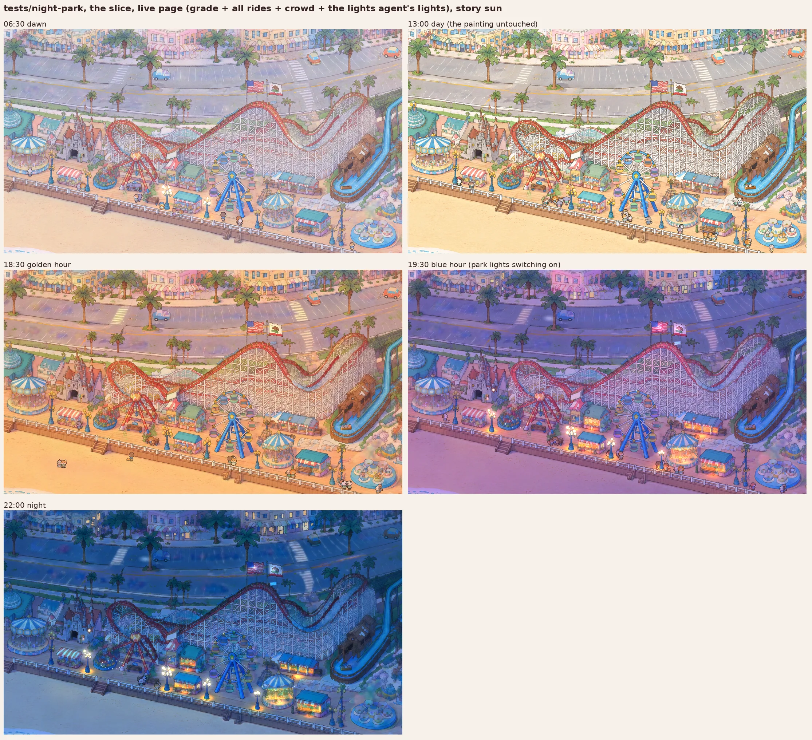
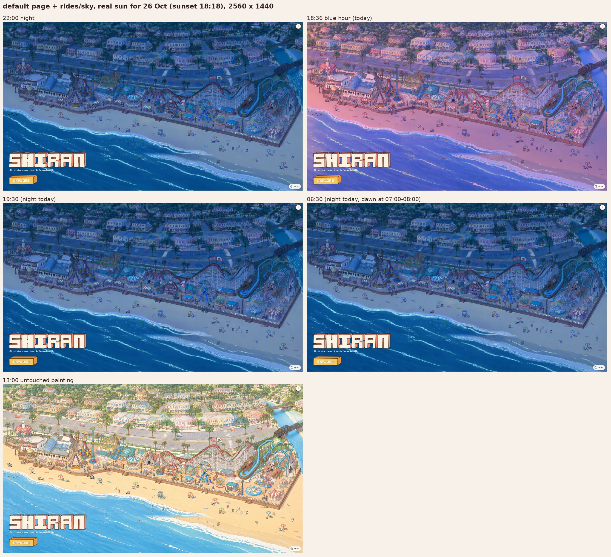

# Time of day for the whole park: the look

The layer for the main page is `rides/sky/` with `base/sky.js` (update below). The test page,
`http://ran:5178/tests/night-park/?hour=22`, is the slice prototype on the story sun; `&view=park` shows the whole
park, and `h` shows the numbers.



## Update: built for the whole park (the user's decisions applied)

The user's choices:
- **Clock:** the visitor's own clock.
- **Sun:** the real sun, Santa Cruz's for the date, at the visitor's local hour.
- **Night palette:** the deep-blue night.
- **Control:** the sun/moon badge at the bottom right.

What is built:

| Piece | Where | What |
|---|---|---|
| The sky API | `base/sky.js` | The clock and sun for every layer: `getSky()` (one per page) or `ctx.sky`. Gives `hour`, `sun { alt, rise, set, morning }`, `keys`, `dark` 0-1, `progress` / `dusk` (switch-on), `wave(x, y)`, `set(h)`, `follow()`, `play(rate)`, `onChange(fn)`, `keysAtHour(h)` and `tick()`. Defaults: the visitor's clock and the real sun. `&hour=` fixes the hour, `&clock=santacruz`, `&sun=story`, `&date=` |
| The layer | `rides/sky/layer.js` | The grade (multiply then screen, over everything), the badge (tap to open a day strip, drag to scrub, `play`, `now`; `&badge=0` hides it) and the `grade` / `pool` / `lights` slots after `front` if the page has none |
| The fields | `rides/sky/fields/` | `{dawn,golden,dusk,night}_{A,B}.webp` + `fields.json`: 880 KB for all four times, every screen width; a visit loads only its hour's keys, the rest when idle |

How the fields were made: 36 piece relights (9 tiles of `gen/park/tiles_v2/grid.json` x 4 times, gpt-image-2.5,
3840 x 2560, high, all first takes) plus the 4 whole-park keys. Each piece is registered (all or nearly all 345 tiles
confident; raw shift 0.2-2 park px, about 0.1 after the warp), fitted, harmonised to its key, merged with a 96 px
feather, and smoothed on flat ground (`tools/build_park.sh`). The night also takes the lights agent's lights-off plate
of the slice, as agreed.

**Seams, all 12 overlaps** (`tools/seam_all.py`, `gen/fields/seams.json`):

| Time | Raw pieces, mean dE | Harmonised, mean dE | Worst harmonised overlap |
|---|---|---|---|
| night | 6.4 | 4.2 | 7.4 |
| blue hour | 13.8 | 5.0 | 6.6 |
| golden | 10.8 | 5.8 | 8.0 |
| dawn | 5.7 | 3.2 | 4.3 |

What remains is object-level, inside the feather.

Generations for this step: 36. In all: 45, plus the lights agent's.

**Today's times** (26 October, real sun): sunrise 07:25, sunset 18:18.

| Look | Hours |
|---|---|
| Golden hour | about 17:25-18:15 |
| Blue hour | about 18:30-18:55 |
| Night | from about 19:15 |
| Dawn | 07:00-08:00 |

So 19:30 and 06:30 are night today. The checks below add 18:36, today's blue hour. In June the same looks come about
2 hours later in the evening.

### Exact lines to wire it into index.html (for the coordinator; I didn't edit index.html)

1. Slots, after `<div class="slot" data-slot="front"></div>`:
   ```html
   <div class="slot" data-slot="grade"></div>
   <div class="slot" data-slot="pool"></div>
   <div class="slot" data-slot="lights"></div>
   ```
   (`rides/sky` creates them if they're missing, but in the HTML the order is fixed and visible.)
2. Imports: `import { getSky } from "./base/sky.js";`
3. After `const clock = createClock();`: `const sky = getSky({ params });`
4. In `ctx`: `park, W, H, camera: createCamera(park), clock, params, slots, sky,`
5. `RIDES`: add `"sky"` (anywhere: the grade sits in its own slot above `front`; put `"lights"` after it once
   rides/lights ships).
6. First line of `frame()`: `sky.tick();` (`rides/sky` ticks it too; a second call in the same frame does nothing).
7. The crowd follows the sky:
   - in `index.html`: `crowd = await mountCrowd(document.getElementById("animals"), { params, clock, rides: riderBlocks, occluders, hour: () => sky.hour });`
   - in `tests/park-crowd/crowd.js`, line 171: `hour: typeof hour === "function" ? hour : () => Number(params.get("hour") ?? hour),`
8. The night crowd (thin to about a quarter after the rides close at 22:45, a handful by 3:00): in
   `tests/characters/sim.js`, replace `DENSITY` with
   `const DENSITY = [[0, 0.15], [3, 0.04], [5.5, 0.04], [6.5, 0.28], [9, 0.32], [11, 0.95], [13, 1], [16, 1], [18, 0.85], [19.3, 0.7], [20.5, 0.55], [22.75, 0.45], [23.25, 0.25], [24, 0.15]];`
   This makes the crowd 0.45 of the day crowd at closing, a quarter by 23:15 and 5 animals of 120 at 3:00. The beach
   layer (`rides/beach`) still shows sunbathers and towels at night; its owner should key them to `sky.dark`.
9. The header comment: `&hour=` defaults to the visitor's clock now, not 13.

Until it's wired, the default page can be checked with
`?layers=sea,beach,wildlife,traffic,coaster,wheel,swings,teacups,flume,pirate,carousel,thrill,corgi,sky&hour=22`.

**For rides/lights** (the lights agent): `base/sky.js` is live with the agreed names (`hour`, `dark`, `dusk`,
`sun.rise`, `sun.set`). Mount after `sky`, and use `slots.pool` and `slots.lights`. The fields are in
`rides/sky/fields/`; the `gen/fields/` files go out of git.

### Checks on the default page



- **Setup:** `shots/board_main.webp` (2560 x 1440) and `shots/board_mac.webp` (1512 x 982): the default page with the
  reviewed rides plus `sky`, frozen clock, console clean at every hour.
- **13:00 is the untouched painting.** The grade slot is hidden in full day. Against the same page without `sky`, the
  only pixels that differ are the title's play-in animation (bottom left) and the animated layers; with the painting
  alone, only the title differs.
- **22:00, 19:30, 06:30** are all full night today (real sun).
- **18:36** is today's blue hour: violet sea, rose sand, a pink town.
- **The badge** sits at the bottom right on both sizes, clear of the title and the corgi "?".
- **Lights aren't in these shots:** rides/lights hasn't shipped yet.

### Open after this step

- Wire the lines above: index.html, crowd.js and sim.js's DENSITY.
- rides/lights on top.
- The beach layer's sunbathers at night.
- Seams: the worst harmonised overlaps (golden r0c0-r0c1, 8.0 dE; night r0c1-r1c1, 7.4 dE) are in the town band;
  look at them at 2.5 px per park px if they show.
- A real-GPU frame-time check with the grade on, on a MacBook and on a 5K screen.
- The fields are first takes. If a time looks off somewhere, re-roll that piece and rerun `tools/build_park.sh`
  (about 1 min per piece).

## Recommendation: relight fields, not relit plates

**Grade the day painting with "relight fields" fitted to painted relit plates, and never swap the painting.**

1. For each key time (dawn, golden hour, blue hour, night with lights off), relight the painting with gpt-image-2.5
   edits, the bakeoff's method: one **whole-park relight** (the colour key: one consistent light across the park)
   plus a relight of each of the **nine pieces** (the detail of the light per object).
2. Register each plate to the day painting (`tests/night/tools/register.py`: pieces at 1 px per park px, the whole
   park at 0.5 px per park px), then fit a **local affine colour map**, a guided filter with the day painting as the
   guide: `relit = day x A(x) + B(x)` per channel, with a 4 park px window, stored at **1 px per 4 park px**
   (960 x 640 for the whole park). The pieces take their low frequencies (blur of 64 park px) from the whole-park key
   and are feathered into it (`tools/build.py merge --base`). Flat ground (street, sand, sea) gets a smoother field
   (`tools/build.py flat`).
3. The page keeps the day painting `` and every live layer exactly as they are and lays **two tiny canvases over
   everything** (`grade.js`): `mix-blend-mode: multiply` with `A / (1 - B)`, then `screen` with `B`, which together
   give `in x A + B`. They blend the key fields by the sun's altitude (`sky.js`) and redraw only when the hour
   changes. The lights draw above the grade.

Why:

- **It looks like our painting at night, and sharper than the plates.** The fit takes only the plate's light; lines,
  texture and every detail stay the day painting's own (2.5 px per park px). The 4K relights redraw small things
  (the wheel's cabins, flags); the field doesn't. On the bakeoff stage the field reproduces the painted night plate to
  2.3 dE (blurred; 64.6 before), and visibly cleaner (`shots/bakeoff_field_night.webp`, `shots/slice_night_closeup.webp`).
- **Registration is exact by construction.** The painting never changes, so the live rides stay on their painted tracks
  at every hour. A full relit plate would need a warp per plate, and its fine detail still doesn't line up (piece
  plate after warp: p90 2 HD px; whole-park plate: only 60 of 2301 tiles even correlate at full detail).
- **Live layers need nothing.** The overlay grades everything under it with the painting's own local transform: rides,
  cars, the crowd, the sea (which redraws the painting's pixels), beach, wildlife, plate patches. The coaster trains,
  the wheel, the cars and the animals in the shots are graded this way, with no change to their code.
- **It costs almost nothing to ship:** about 1 MB for all four key times on every screen width, against 6-17 MB for
  relit plates (table below). At midday the grade is hidden and costs nothing.

## Rejected options

| Option | Why not |
|---|---|
| Relit plates per piece, shipped as paintings (the bakeoff, scaled) | 4 more paintings: +6.3 MB at 2560 px, +16.8 MB at 5120 px; 70 MB of GPU per plate at 5120; the 4K edits redraw fine detail, so cross-fades double thin lines; every plate patch, the sea's copy of the painting and the carousel's unwrap would need night versions too |
| A shader grade of the day painting (base/time.js tint, exposure) | The bakeoff's finding holds: a navy multiply, muddy, nothing like a painted night (`../night/shots/board_hours.png`) |
| Hybrid: painted night for sky / sea / sand, grade for the park | Needs a mask through the busiest seams of the painting (wall, stairs, foam); the field already covers sky, sea and sand at no extra cost |
| The whole-park relight alone as the field | 4 generations for the whole park, seamless, but the model saw the park at 0.4 px per park px and softened small objects: the wheel and the lattice lose contrast (`shots/slice_night_sources.webp`, right). Kept as the colour key and a quick preview |
| Pieces relit alone, no colour key | Neighbouring pieces disagree by 7.6 dE in their overlap (11 dE in the town, which goes bluer in one): a visible hue drift (`shots/seam_night.webp`, top) |
| Colour-matrix field (12 numbers per pixel, WebGL) | Slightly cleaner than the per-channel field (fringes round strong colours), but it can't be shown as a CSS overlay, so every live layer would have to grade itself. Possible later upgrade for the painting only (see Open) |
| A CSS `filter` per live layer | Not spatially varying: a car on the sand and a car under the town would get the same grade |

## How it looks

- **06:30 dawn:** pale rose and lilac, peach sand, morning haze over the town; the last lamps go out.
- **13:00:** the painting untouched (the grade is hidden).
- **18:30 golden hour:** honey and apricot, warm planks, lilac shade, gold on the sea in the park view.
- **19:30 blue hour:** violet and rose, mauve-pink sand; the park's lights come on as a wave, town windows light one by one.
- **22:00 night:** deep blue storybook night, pale lavender-blue sand lighter than the boardwalk, lamps, stalls,
  wheel LEDs and windows from the lights agent.

Close-ups beside the day painting: `shots/closeup_day_night.webp`, `shots/slice_night_closeup.webp` (field vs plate at
2.5 px per park px). The whole park at night: `shots/park_22.webp`. The raw relights: `shots/piece_plates_raw.webp`,
`shots/park_plates_raw.webp`.

Known flaws: a faint fringe of 1-2 field cells round strongly coloured objects (per-channel fit); some leftover
mottling on flat ground in the dawn and golden fields, reduced by `flat`; the dawn plate is a little washed out. All
three are fit and prompt settings, not limits of the method.

## Measurements

| What | Number |
|---|---|
| Field vs painted plate (bakeoff night, CSS field, 4 px window) | 4.5 dE per pixel, 1.9 dE blurred (the rest is detail the edit redrew) |
| Registration, piece relights at 1 px per park px | raw median 0.26-0.73 park px, after warp 0.09-0.10 (all 345 tiles confident) |
| Registration, whole-park relights at 0.5 px per park px | raw median 0.9-2.0 px, after warp 0.19-0.21 px |
| Seam between two pieces relit separately (384 px overlap) | 7.6 dE mean (town 11.1, park 6.4, sand 4.6) |
| Same seam, both harmonised to the whole-park key | 3.7 dE mean (town 4.7, park 4.1, sand 1.8), hidden by a 96 px feather |
| Field compression, WebP q95 at 1/4 park px | 1.5 dE vs lossless; 215-290 KB per key time (A + B) |

## Cost for the whole park

| | Relight fields (recommended) | Relit plates (bakeoff, scaled) |
|---|---|---|
| Generations | 4 whole-park keys (done) + 9 pieces x 3 times (dawn, golden, dusk) = 31, about 37 with retries; the 9 night pieces come from the lights agent's lit/off pairs (18 of theirs) | the same |
| Machine time | about 40 s per 4K edit, 3-4 at once: about 10 min of generation; registration and fitting about 40 s per piece-time on the CPU, about 25 min in all, parallel | the same, plus warping 36 HD plates |
| Shipped bytes | about 1.05 MB for all four key times, same on every screen; a visit loads only the keys of its hour (night: 220 KB) and the rest when idle | +4 paintings: 3.6 MB at 1920, 6.3 MB at 2560, 9.8 MB at 3456, 11.5 MB at 3840, 16.8 MB at 5120 |
| GPU memory | about 25 MB (8 field textures + 2 canvases of 960 x 640), plus one window-sized blend surface while the grade shows (15 MB at 2560 x 1440, 59 MB at 5K) | 70 MB per resident plate at 5120 (two at a time at dusk: 140 MB) |
| Work per frame | the grade redraws two 960 x 640 quads only when the hour moves; the compositor does two extra full-window blend passes while anything below animates; nothing at midday | one full-screen pass of 2-5 texture reads |

Headless Chrome uses software WebGL, so no frame rates are reported. One finding from it: the blend modes make the
browser composite the whole `.world` into one surface. Zoomed in (the slice view), that surface passed the 8192 px
texture limit and the screenshot timed out, so the test page clips the world to the window (`clip-path`). The real
page is cover-fit, so its world is about window size, but check the grade on a 5K screen.

## INTERFACE (agreed with the lights agent, tests/night-lights)

The lights agent's `behaviour.js`, `lights.js` and `adapters.js` already run on this base: the prototype mounts them
over the grade (`&lights=0` turns them off). What each side provides:

**Stacking order** inside `.world`, bottom to top:

| Slot | Owner | What |
|---|---|---|
| painting, `plate`, `rides`, `animals`, `front` | unchanged | drawn in day colours |
| `grade` | base (`grade.js`) | multiply `A / (1 - B)`, then screen `B`: out = in x A + B (sRGB); hidden in full day |
| `pool` | lights | light falling on things, `color-dodge` with s = 1 - 1/G (a gain G >= 1), so planks, goods and any animal or car standing in a pool are lit through their own colours |
| `lights` | lights + rides | sources (globes, bulbs, windows, signs, ride LEDs), `plus-lighter`, never graded. A ride's lights get their own canvas, cut by the ride's occluders |
| title (outside `.world`) | site | not graded |

**The base provides `ctx.sky`** (`sky.js`):
- `hour`: 0-24, continuous. `&hour=` fixes it, and the crowd reads the same parameter.
- `sun`: `{ alt, rise, set, morning }`.
- `keys`: weights `{ day, dawn, golden, dusk, night }`, from the sun's altitude.
- `dark`: 0..1, the one number for "how much should a light show".
- `progress` (also called `dusk`): the park's switch-on progress, 0 to 1 during dusk and back to 0 at dawn.
- `wave(x, y)`: a default sweep out from the Giant Dipper. The lights agent uses its own per-group schedules on top
  (photocell, promenade wave, rides closing at 22:45, stall keepers, home and shop windows).
- `set(h, {tween})`, `follow(mode)` and `onChange(fn)`.

**Fields** for anyone who grades something themselves are in `rides/sky/fields/fields.json` plus `<key>_{A,B}.webp`
(whole park, 960 x 640; graded = day x A + B). The lights agent's stand-in `base.js` still reads the working files in
`gen/fields/`; switch it to `rides/sky/fields/` (or mount after `rides/sky` and read nothing: the grade is already there).

**The lights agent provides back:**
- per piece, a lit night and its lights-off twin (off = an edit of lit), with the piece's park rect;
- the base fits its night field to that **lights-off** plate, so the night base and the extracted pools and sources
  share one colour world. The slice's night here is fitted to their `off_v1` (rect 1700, 650, 1500 x 1000).

**Live layers** do nothing for the grade. A ride's own lights go in `lights`, scaled by `sky.dark` and the wave.

Still open between us: folding the pool into the grade's two canvases (out = (in A + B) G is again in A' + B') to save
one blend pass; and one shared night paragraph in both agents' prompts (`prompts/night_light.txt`) so every piece's
night has the same palette.

## Live layers at night (question 3)

One shared grade, as an overlay, is the answer. The per-pixel field is fitted on the painting under each layer, so a
car on Beach Street gets the street's night and an animal on the sand gets the sand's. Lamp pools from the lights
agent warm whatever walks through them. What it doesn't do:

- **Nothing on a live layer glows by itself.** Ride lights belong in `lights`.
- **A ride that differs from the painting under it is graded with the painting's local map.** The wheel's cabins
  replace the painted wheel; it works because they have similar colours.
- **The crowd reads `&hour=`, not the sky.** It doesn't follow the clock control; it should read `ctx.sky.hour`.

## The clock (question 4): options, for the user

| Option | What a visitor sees | For | Against |
|---|---|---|---|
| A. Fixed 13:00, with a control | always the day painting first | the hero image as designed; the title is designed for the day sea | the time of day exists only for those who find the control |
| **B. The visitor's own clock (recommended), with a control** | the park at their hour: at night they see it lit | personal and alive ("it's night here too"); most visits fall in the day and evening | a visitor at 3:00 sees the park closed and dark (keep a few night-owl animals and the street lights) |
| C. Santa Cruz time now | the park as it is "live" | a true place, a webcam feeling | visitors in Europe or Asia during their day mostly see night |

Which sun goes with it is a second choice:
- **Real sun** (`&sun=real`): Santa Cruz's sun for today's date. Today, 26 October, it sets at 18:18, so 18:30 is
  already blue hour. It matches the visitor's own sky.
- **Story sun** (`&sun=story`, the test page's default): the same late-summer day all year. It rises at 06:30 and sets
  at 18:59, so golden hour is 18:30 and blue hour 19:30, the hours this brief used.

I recommend B with the real sun.

The control: a small badge at the **bottom right**, which is free. The top left is the debug panel, the bottom left
the name and Explore over the sea, and the top right the corgi game's "?". The badge shows a sun or moon and the time.
A tap opens a day strip coloured by the plates, with a knob to drag, `play` (a day in 24 s) and `now` (back to the
clock). The other place would be beside the "?" badge as a pair of round badges.

## Transitions (question 5)

- **Keys follow the sun's altitude**, not fixed hours, so any date and both sun modes work.
  - Evening: day until 14°, golden from 6° to 0°, blue hour from -4° to -7°, night below -12°.
  - Morning: night until -12°, dawn from -1° to 5°, day from 14°.
  - Between keys the fields cross-fade (smoothstep). With the story sun that gives golden 18:15-18:50, golden to blue
    19:00-19:15, blue hour to 19:40, night from 20:00, dawn 06:15-07:10.
  - Golden never fades straight into night: the blue hour sits between them, which avoids the bakeoff's grey-beige
    midpoint.
- **A visitor who just watches sees only the lights.** A cross-fade lasts 15-40 minutes, so a visitor watching for a
  minute sees no change in the grade. During dusk they do see the lights: the park's wave runs about 35 minutes, and
  windows and stalls come on one by one (several a second across the whole park), each with a short flicker.
- **The control shows the change at once.** Dragging is immediate. `now` and `play` run forward through the
  intermediate keys, so night to morning passes through dawn.
- **The grade updates continuously** (every frame the hour moves, cheap), not in the 30 s steps of `base/time.js`.

## Plan for the whole park

1. **Decide the clock and the sun** (user), and whether the whole-park keys' palette is right. They can be
   regenerated, 2 candidates each, and the key picked by eye: it sets the colour of the whole park.
2. **In parallel:**
   - (a) I relight the nine pieces at dawn, golden and dusk: 27 edits, inputs = `gen/park/world_v2_hd.png` cropped to
     `gen/park/tiles_v2/grid.json`'s tiles at 1536 x 1024, with the shared prompts in `prompts/`.
   - (b) The lights agent makes lit and off plates for the nine pieces.
3. **Per piece and time:** `tools/pipeline.sh` (register, fit), then `build.py merge --base park_<time>` (harmonise)
   and `build.py flat` (smooth flat ground). This runs per piece as soon as its plate lands.
4. **Merge** the nine harmonised pieces over the whole-park key with a 96 px feather (`build.py merge`) and export
   `rides/sky/fields/<key>_{A,B}.webp` (done: `tools/build_park.sh`). Check the seams on a board at 2.5 px per park px.
5. **Base change** (a reviewed edit of `index.html`):
   - add the `grade`, `pool` and `lights` slots;
   - mount `sky.js` and `grade.js` as `base/sky.js` and `base/grade.js`;
   - give layers `ctx.sky`, and make the crowd read `ctx.sky.hour`;
   - replace `base/time.js`'s KEYS.
6. The lights agent's layer, then the control (in the site's title style).
7. A real-device check: frame time with the grade on, on a MacBook and on a 5K screen.

Steps 2 and 3 run in parallel per piece. Step 4 needs all nine pieces for a time. Step 5 can start now on the
existing whole-park fields (pieces are refinements).

## Decisions for the user

1. **The clock:** fixed 13:00, the visitor's clock (recommended), or Santa Cruz time.
2. **The sun:** the real sun for the date (recommended; October dusk is about 18:40) or the same storybook summer day
   all year.
3. **Whether there's a control,** and where: the bottom-right badge (recommended) or beside the "?" badge.
4. **The night palette:** the deep blue of the whole-park key (prototype), or my lighter, more pastel piece night
   (`shots/night_sources_compare.webp`, top left).
5. **The night crowd** (with the crowd agent): how many animals after the rides close at 22:45, and at 3:00.

## Open (not done)

- The slice's pieces only. The other eight pieces are still graded by the whole-park key alone, which is softer on small
  objects.
- The colour-matrix upgrade for the painting itself: a WebGL painting canvas pre-compensated for the overlay, which
  removes the fringes. Not built.
- The pool folded into the grade (one blend pass fewer).
- Sky extras: stars in the thin sky strip, and a moon glade or night glints in the sea layer (the sea is graded, but
  it has no moonlight of its own).
- The title over the sea at night (it isn't graded; check it reads well).
- No real-GPU frame-time numbers (headless only).

## Files

- `index.html`: the test page. `sky.js`: the sun, keys, darkness and wave. `grade.js`: the two overlay canvases.
- The shipped fields: `rides/sky/fields/` (`fields.json`, `<key>_{A,B}.webp`); the layer is `rides/sky/layer.js`, the API `base/sky.js`. `site/slice_day.webp`: the HD slice, laid over
  the zoomed slice view only.
- `tools/`:
  - `field.py`: the fit and the sweeps;
  - `build.py`: fit, grade, merge (harmonise) and flat;
  - `pipeline.sh` and `park_fields.sh`: plate to field;
  - `seam_check.py`;
  - `board.py`.
- `prompts/`: the shared light paragraphs and the batch files. `gen/`: the raw 4K relights (`piece_*_v1_0.png`,
  `park_*_v1_0.png`, `left_night_v1_0.png`), registration in `gen/reg/`, fields in `gen/fields/`.
- `shots/`: boards and screenshots.

Generations used: 9 of the 12 (4 whole-park keys, 4 slice-piece times, 1 neighbouring piece at night), all
gpt-image-2.5 at 3840 x 2560, quality high.
