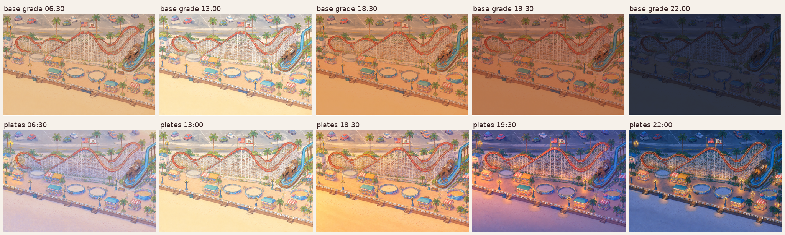

# Night: painted plates and a light wave, instead of a colour grade

View: `http://localhost:5178/base/compose.html?tests=night&grade=off` (follows the clock; add `&time=19.4`
for a fixed hour, or `&dusk=20` to loop 18:12 → 20:36 in 20 s and watch the lights come on).

## What I built

1. **Five relit plates of `base/stage.png`**, each a shyfai edit (`--ref base/stage.png`, 1536 x 1024, n = 2, best one
   kept). Prompts are in `prompts/`, outputs in `gen/`.

   | Plate | Prompt | Kept | What it is |
   |---|---|---|---|
   | golden | `golden_v1.txt` | `golden_v1_0` | Half an hour before sunset: low sun from the lower left, lights off |
   | dusk | `dusk_v1.txt` | `dusk_v1_0` | Blue hour: rose afterglow, violet shade, lights off |
   | night (lit) | `night_v1.txt` | `night_v1_0` | An hour after sunset: every lamp, bulb string, stall, window and coaster light on |
   | night (off) | `night_off_v1.txt` | `night_off_v1_0` | Edit of the lit night: every light switched off, nothing else changed |
   | dawn | `dawn_v1.txt` | `dawn_v1_0` | Just after sunrise: rose and apricot, lilac shade, lights off |

2. **Registration** (`tools/register.py`): tile phase correlation (128 px tiles) on a local-contrast structure map,
   which ignores the relighting. It writes the `|day - plate|` difference (as `gen/stage/diff_*.png`), a structure
   difference, a red/cyan edge overlay and the shift field. Every plate was then resampled onto the day stage along
   a smoothed shift field (`*_reg.png`). All outputs are in `gen/reg/`.

3. **Light extraction** (`tools/extract.py`): it splits the lit night into the lights-off plate A, a warm filter M and
   an emission E, with night = A x M + E in linear light. E is divided into **sources** (bulbs, globes, windows:
   1228 cores, 1021 of them bulb-sized) and **spill** (pools on the planks, the uplit lattice, stall glow). Each
   source gets a wave delay (a sweep along the strip from the Dipper station eastwards, ±0.05 jitter), a twinkle
   phase and a twinkle amount (bulbs 1, lamps 0.35, windows 0), packed into `lights_meta.png`.

4. **`layer.js`**: two WebGL2 canvases.
   - **Water slot, at the bottom**: an opaque plate. It blends day, dawn, golden, dusk and lights-off in linear light
     by hour, multiplies by M and adds the spill, both gated per pixel by the wave. One draw, and only when the hour
     changes.
   - **Lights slot**: the sources, `mix-blend-mode: plus-lighter`, gated by the wave. Each one flickers briefly while
     it switches on and twinkles slightly. One draw per frame while any light is on, none at midday.

   Hours: golden 18:00–18:42, dusk at 19:18, night from 20:24, dawn plate around 06:24–07:12. The dusk wave runs
   18:27 → 19:51. At dawn the lights go off in reverse from 05:36 to 06:42.

5. **Assets** (`plates/`, 2.2 MB in all): six WebP files and one PNG. The day plate is the base's own `stage.png`,
   taken from the browser cache.

## How it looks

| Hour | Look |
|---|---|
| 06:30 (`shots/night_6.5.png`) | Pale rose-lilac morning (dawn plate 0.75, night 0.25). A few lamps at the far left are still on; the rest went off from the east. Soft, slightly washed. |
| 13:00 (`shots/night_13.png`) | The untouched day stage: the shader passes it through and the lights canvas is idle. |
| 18:30 (`shots/night_18.5.png`) | Clean golden hour with honey planks and apricot sand. The first lamps at the far left are just switching on and barely show against daylight, as they should. |
| 19:30 (`shots/night_19.5.png`) | Violet twilight with rose sand. The wave is three-quarters through: the coaster, lamps and stalls glow, while the flume mill house and the bottom-right stall are still dark. |
| 22:00 (`shots/night_22.png`) | The painted night: blue dusk, lavender moonlit sand, warm globes with pools on the planks, bulb strings along the coaster track, the rail, the stairs and the platform fences, glowing stalls. No muddy grade. |

The wave (`shots/board_wave.png`, 18:48 / 19:06 / 19:24 / 19:42) is easy to read. The base grade at the same hours,
for comparison, is in `shots/base_grade_*.png`. `shots/board_detail_22.png` is a close-up at 22:00, grade against
plates.

## Registration

| Plate | Raw median / p90 / max shift (px) | After warp median / p90 / max |
|---|---|---|
| golden_v1_0 | 0.11 / 0.19 / 0.37 | 0.08 / 0.14 / 0.26 |
| dusk_v1_0 | 0.27 / 0.70 / 1.00 | 0.11 / 0.20 / 0.34 |
| night_v1_0 | 1.25 / 1.89 / 2.00 | 0.09 / 0.22 / 0.92 |
| night_off_v1_0 | 0.44 / 0.98 / 1.36 (0.10 against the lit night) | 0.12 / 0.26 / 0.64 |
| dawn_v1_0 | 0.77 / 1.10 / 1.23 | 0.08 / 0.19 / 0.64 |
| night_off_v1_1 (rejected) | 1.72 / 2.16 / 4.23 | 0.25 / 0.75 / 1.96 |
| lightsonly_v1_0 (against the night) | 2.02 / 3.12 / 32.8, half the tiles uncertain | not used |

The edits keep the layout. The error is a smooth stretch rather than noise: the night edit is about 0.2 px off at the
top and 2 px off at the bottom (`gen/reg/night_v1_0_shift.png`). A smooth warp removes it, so the cross-fades show no
double outlines (`shots/board_registration.png`: red/cyan fringes before the warp, white after). The structure
difference shows that the edits added bulbs and redrew the flags, and moved nothing.

## Bench (`&bench=10`, headless Chrome, SwiftShader software GL, 1536 x 1024)

| URL | fps | p50 / p95 ms | long frames | download | draws |
|---|---|---|---|---|---|
| `tests=night&grade=off&time=22` | 59.2 | 16.7 / 16.7 | 1 (133 ms, start-up) | 4.73 MB | 1 per frame |
| `tests=night&grade=off&time=19.4` | 58.7 | 16.7 / 16.8 | 4 (≤ 150 ms, start-up) | 7.37 MB* | 1 per frame |
| `tests=night&grade=off&time=13` | 59.3 | 16.7 / 16.7 | 1 | 7.37 MB* | 0 |
| stage only, base grade, `time=22` | 60.1 | 16.7 / 16.8 | 0 | 2.65 MB | 0 |

\* Measured before a fix: a `crossOrigin` image fetched `stage.png` a second time. After the fix, download is
4.73 MB (re-measured at 22:00); frame times were unchanged.

The plates add 2.08 MB to download. In GPU memory they hold 8 + 2 textures of 1536 x 1024, about 60 MB at RGBA8. The
long frames are texture uploads at mount.

## What worked

- **Painted plates beat a grade by a wide margin.** Night stays a pastel storybook: blue, lavender and warm amber in
  place of a navy multiply, and the light sources are part of the painting.
- **Registration is a solved problem.** gpt-image-2.5 relighting edits stay within 2 px as a smooth field, and a
  tile-shift warp brings them to about 0.1 px.
- **A lights-off edit of the lit night gives a clean light layer.** Both plates share one colour world, so
  on − off isolates the light.
- **A light needs a multiply and an add.** An additive layer alone loses the warmth: the lights turn pink and washed
  out (`shots/split_compare.png`). With a warm filter M plus the emission E, the painting is reproduced exactly.
- **Linear light makes dusk right.** Light added in linear space hardly shows on the golden plate and takes over as
  the plates darken. Added in sRGB, the spill burned orange over the golden plate.
- **A blue-hour plate fixes 19:30.** Golden (apricot) and night (lavender) are near-opposite hues, and any cross-fade
  between them goes grey-beige.
- **The wave works.** Each source's delay comes from a sweep plus jitter, which reads as the park switching on from
  the west. The brief flicker and slow twinkle are cheap: one full-screen pass of two texture reads.

## What didn't

- **Method A, night minus a darkened day** (`gen/extract_a/`). The model's night is not a gain on the day: whites stay
  brighter and the lattice is uplit. So the white car, the flags, street lines and the lattice leak into the
  emission, and the unlit base keeps yellow ghost halos. It is not usable as it stands.
- **A lights-only edit** (`gen/lightsonly_v1_*.png`). It makes a beautiful light map, but it repaints whole objects
  (awnings, the flume chute, platform floors, flags) and sits 1–2 px off. At most it is a mask or a reference, not an
  emission.
- **Leftovers.**
  - Outside the lit area the night base is the lights-off plate, which differs slightly from the lit one (mean 0.034).
    This is invisible on its own.
  - Neighbouring halos meet with a hard edge for a moment when one light is on and the next is still off.
  - The night edit added bulbs that the day painting does not have. Their unlit dots fade in through dusk.
  - In live mode, `time.js` updates every 30 s, so the spill ramps in steps. Each light's switch-on lasts about 2.5
    minutes.
- **Live layers are not lit.** Rides and characters from other tests sit above the plate, so the lamp pools don't
  warm them. With `grade=off`, nothing darkens them at night either.

## What the base should change

1. **Own the plate.** Render the stage as a plate set (day, golden, dusk, night-off, optional dawn, plus warm, spill
   and meta) in one canvas, instead of an `` with a CSS filter. Today this test hides the stage under an opaque
   canvas.
2. **Extend `time.look`** with `plates: {day, dawn, golden, dusk, night}` and `wave` (0..1, the lights' switch-on
   progress), so every slice and every ride layer agrees.
   - Drive the hours from the sun's real times for Santa Cruz. The KEYS are fixed summer hours: on 26 October sunset
     is about 18:15, not 19:30.
3. **Split the lights.**
   - The light's multiply (M) and spill belong under the live layers, in the plate.
   - Only the sources belong in the `lights` slot, with `plus-lighter`.
   - Expose M and spill as a light map, so character and ride shaders can pick up the lamp pools.
4. **Grade live layers lightly, not the stage.** When plates are on, take a per-hour tint for the live slots from the
   plates (mean plate/day per channel), not from hand-set KEYS.
5. **Ship assets as WebP** (the 2.65 MB `stage.png` would be about 0.4 MB) and use compressed GPU textures
   (KTX2/Basis) for the plate set.

## Sky and a moonlit beach

The camera looks down and inland, so this slice has no sky: the street is at the top and sand at the bottom, with no
sea. The sky arrives only as the colour of the light, and the plates carry it: apricot, rose-violet, blue.
`look.sky` is still useful for the water layer (the sea mirrors the sky) and for any page background beyond the
stage.

The night plates read as moonlit without drawing a moon: the sand is a pale lavender-blue, lighter than the
boardwalk, with no cast shadows, as STYLE requires. Slices with sea should get the rest in the water layer:
- a moon glade, a column of short white dash glints that drift slowly;
- the boardwalk's lights mirrored as warm streaks on the wet sand;
- stars only if a future view shows a horizon.

## Does it scale to the whole park?

- **Cost.** Per slice: five edits (about 40–60 s each, n = 2 to choose from), then about 1 minute of registration and
  extraction. That is roughly 10 minutes of machine time and 2 MB of WebP per slice.
- **Registration.** Solid: the warp is automatic, and its statistics give a pass/fail number per plate.
- **Consistency between slices.** This is the real risk. Each slice is relit independently, so night blues, dusk
  violets and the choice of what carries bulbs can differ across seams. Mitigations:
  - relight with the neighbouring slice's finished plate as a second reference ("match the light of image 2");
  - generate with overlapping margins and colour-match the overlap with a smooth gain field;
  - give every slice one shared "light list" prompt;
  - or relight the full 3.2:1 panorama at 4096 px and crop it, at lower detail.
- **The wave across slices.** It must use park coordinates. Store each source's position and jitter, and compute the
  sweep in the shader from a slice offset, rather than baking a per-slice delay.
- **GPU memory.** Keep only visible slices resident.

## Recommendation

Replace the colour grade with painted plates. The minimum set per slice is golden, dusk, a lit night and its
lights-off twin; dawn is optional, and golden plus night at reduced weight can stand in for it. Register them with the
smooth warp. Split the lights into multiply + spill (in the plate, under the characters) and additive sources (in the
lights slot), all in linear light and gated by one wave. Build it into the base as the stage renderer, with
`look.plates` and `look.wave`. Then test seam consistency on two adjacent slices before generating the whole park.

## Files

- `layer.js`: the test layer
- `plates/`: runtime assets and `extract.json`
- `tools/`:
  - `register.py`: registration check and warp
  - `extract.py`: light split and wave metadata
  - `board.py`: contact sheets
- `prompts/`, `gen/`: generation inputs and outputs, registration checks in `gen/reg/`, method A in `gen/extract_a/`,
  the delay map in `gen/checks/wave.png`
- `shots/`: screenshots and boards

Python runs through `uv run --no-project --with pillow --with numpy [--with scipy] python -I tools/...` from this
folder (the system Python has no Pillow).
