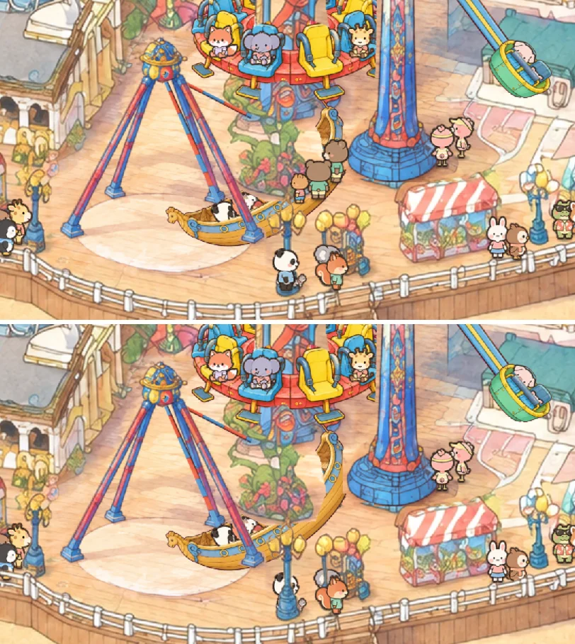

# Depth: the crowd behind rides, lamps, stalls and the rail

View: **http://ran:5178/?t=40** (the Double Shot queue behind the swinging Pirate Ship). `&occ=0` turns the depth
order off (the old look), `&occ=rides` keeps only the rides' occluders. In the console, `__crowd.setOcclusion(false)`
toggles it on the same frame.



`shots/depth_pirate_t40.webp`: the queue for the Double Shot stands behind the ship's plane; before, the bears drew over
the swung bow, now the bow hides them; the panda by the lamp passes behind the pole and the rail.
`shots/depth_typhoon_t128.webp`: a Typhoon car swings in front of its own queue. `shots/depth_rail_t30.webp`: animals
walking by the rail have their legs behind its bars. Each pair is one page load, shot without and with occlusion.

## How it works

- **Contract** (`rides/RIDERS.md` "Depth", `index.html` header): a layer's `mount` returns `occluders`, an array or a
  function of t, of `{ rect, sortY, mask?, matrix?, sortLine?, crop? }`. The page passes them to `mountCrowd`.
- **One draw call still.** `tests/park-crowd/occlusion.js` packs every mask once into one R8 texture (at most 1.5 px per
  park px, still masks clipped to the crowd's band) and builds, each frame, a small table per occluder: the inverse
  transform from canvas px to mask uv, the mask's rect in the texture, its base. `tests/characters/render.js` picks
  per quad (sprite, shadow, leash), on the CPU from a 64 px column grid, up to 4 occluders that overlap it and whose
  base is below the animal's feet, and passes their indices as a vertex attribute; the fragment shader multiplies the
  sprite by (1 - mask) for each. Quads without occluders skip it.
- **The painting's own cut-outs** (`occ.webp` + `occ.json`, 289 pieces, 33 KB): `tools/make_occluders.py` runs the shared
  `tools/occluders.py` (lifted from rides/traffic, whose old copy is now a shim; its output is byte-identical) over
  everywhere an animal can stand (`occ_reach.json`, dumped from the page), on the painting with the ride plates laid
  over it. The deck's own palette (learned under the lanes, warm tans only) is ground; objects need ink outlines; feet
  are taken per vertical run of each column (`find_layered`), so a stall behind a lamp gets its own base, and pieces
  get a fitted sloped base. Left out: every live ride's area (rides give their own), the stairs, the beach wall under
  the rail, the benches, the faded paving by the Typhoon, the east rail. The thrill bush is keyed by hand (its
  polygon cut-out carries deck). Check image: `shots/occ_check.webp` (pieces tinted by base, base lines in white).
- **Lanes clear solid things** (`clearOfCutouts` in `crowd.js`): the lanes ran a few px in front of eyeballed fronts,
  but groups spread up to 9 px behind their lane line and real stall fronts slope, so with depth on, walkers vanished
  into a kiosk. At load, lane nodes and stall, hangout, watch and photo slots move forward to clear wide cut-outs by
  their margin (46 moved, up to 15 px), never past the rail. Thin things (lamps, posts) and the rail may be walked behind.

Rebuild the cut-outs when the network, a queue or a ride area changes:

```
node scripts/drive.mjs "http://localhost:15178/?t=0&occ=0" --actions tests/park-crowd/tools/dump_reach.json | python3 tests/park-crowd/tools/save_reach.py
uv run -q --no-project --with pillow --with numpy --with scipy python -I tests/park-crowd/tools/make_occluders.py
```

## Cost (headless Chrome, software GL: CPU numbers only)

| What | Measured |
|---|---|
| Occluder list per frame (`occlusion.at`, ~320 occluders, ~25 of them moving) | 0.024 ms |
| Crowd draw (CPU) off / on | 0.086 / 0.18 ms per frame (picks + a 15 KB table upload) |
| Mask texture | 2048 x ~1030 R8, 2 MB GPU, packed and uploaded once at load (60-100 ms headless) |
| GPU | only quads with an occluder (~20-80 of ~250) run the test: per fragment up to 4 x (3 texel fetches + 1 sample) |
| Downloads | occ.webp 33 KB + occ.json 30 KB; ride masks reuse images the rides already load |

No readbacks per frame, no per-frame texture uploads of canvases.

## Rejected

- **Per-pixel depth map** (render every occluder's base into a texture each frame, test feet against it): a second
  pass per frame for the moving ones; the per-quad lists are cheaper with this few overlaps.
- **Using ride canvases as masks** (the ship's canvas, the teacups' three.js canvas): a canvas upload per frame.
  Moving rides give a still mask and the matrix they draw with instead.
- **Reusing every ride cut-out as is**: the pirate's lamp crops and the thrill bush polygon carry deck pixels, which cut
  visible holes in animals (seen in the first after-shot); those come from the tight painted set instead.
- **160 px column chunks** (the traffic tool's rule): a lamp in front of a stall in front of a ride shares one foot;
  queues standing between them were hidden.

## Longer term: one shared sorted pass

Masks are exact for "is the animal behind this thing", but the occluding pixels must already be drawn below the crowd.
They can't express: a ride's part that is in front of one animal and behind another in the same place (two depths per
pixel); ride-against-ride order (the thrill bush cut-out draws over the swinging Pirate Ship today); animals in front
of something a ride draws in the `front` slot. A shared pass would need every ride to draw through one renderer as
sorted sprites (the coaster cars, ship, cabins, cups as atlas frames with their own base y), with the crowd's quads in
the same sorted list, one texture array or atlas for all of them, and the three.js teacups baked to sprites or drawn
into the same WebGL context. That is a renderer rewrite for every layer. Worth it only if rides start overlapping
each other more (Sea Swings next to the carousel), or if animals walk among moving rides.

## Open

- The flume's exit leg runs straight from (3040, 1428) to the nearest lane node (2928, 1579), behind and through the
  teal kiosk; with depth on, those walkers now hide behind it. Fix in the riders contract (an `exitPath`, or linking
  the exit to its queue's tail) rather than here.
- The beach, Sea Swings (east carousel) and corgi layers: their areas need to be in the builder's `EXCLUDE`, and their
  queues in the reach (dump again once they are in `RIDES`). The east carousel area is excluded already.
- Teacups cups, the Double Shot ring and the flume logs are not occluders yet (nothing walks behind them).
- The Pirate Ship's riders' heads stick above its mask: an animal right behind them still draws over them.
- `make_walk.mjs` should take the lane clearance in (it is done at load in `crowd.js` so as not to clash with the beach
  agent's edits); the deck behind the stalls and the plaza can now be opened: the cut-outs would need a rebuild.
- The coaster and flume structure pieces sort on their own lower edge (their ground lines are hidden); revisit if
  animals ever reach behind them.
