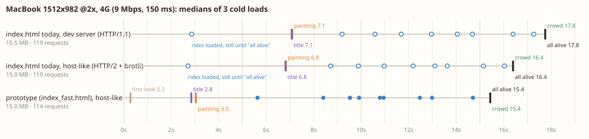

# Loading: how the boardwalk should load and be delivered

How and when the page loads its files and how a host should serve them, so a first visit feels fast at the same
quality. The per-file encodings (webp/avif quality, atlas formats) are `tests/perf/ASSETS.md`'s subject; this report
leaves every shipped pixel as it is and changes only order, timing and delivery.

**Headline (MacBook 1512 x 982 at 2x, 4G 9 Mbps / 150 ms, medians of 3 cold loads):**

| | today (dev server) | prototype, host-like |
|---|---|---|
| first look | 0.2 s, alt text on a cream page | **0.3 s** blurred painting (inlined), **0.7 s** readable 960 preview |
| sharp painting | **7.1 s** | **3.0 s** |
| title plays | **7.1 s** | **2.8 s** |
| first ride moving | **17.8 s** (nothing moves before everything has loaded) | **5.6 s** (sea), coaster 8.4 s |
| everything alive | **17.8 s** | **15.4 s** |
| bytes | 15.50 MB, 119 requests | 14.96 MB, 114 requests |

Phone (4G): painting 7.9 -> 2.2 s, everything 17.7 -> 13.1 s, 15.94 -> 12.40 MB. The big moves come from **order**
(start the painting during parse, keep the rides off the pipe until it is on screen, run the frame loop from the start)
and **placeholders**; delivery (HTTP/2, brotli, caching) adds a little on a first visit and a lot on repeat visits.
"Everything alive" is bound by bytes (15 MB at 9 Mbps = 13.3 s): only the encodings in ASSETS.md move it much further.
Recommended host: **Cloudflare** (section 6). **Applied** to `index.html` on 2026-10-26 (section 0, not committed).




## 0. Applied (2026-10-26, 20:53; not committed)

The user approved the load order; it is now in `index.html`, made with `tools/load_apply.py` against the file as it
was (13 rides in `RIDES`, kept as they are; the title's lines kept as they are; only the import map that feeds the
title changed, to the self-hosted bundle). `tests/perf/index_loading.diff` is that change. Decisions taken: three.js +
gsap self-hosted, phone painting capped at 2x, the 960 preview kept, the title still waits for the sharp painting.
Hosting and the caching scheme are for later; nothing was deployed.

New files: `vendor/vendor.js` (609 KB, 138 KB brotli; `tools/load_vendor.mjs`), `site/park/world_960.webp` (86.5 KB,
made from `gen/park/world_v2_hd.png` at webp q55; ASSETS.md may re-encode it), the placeholder inlined in `index.html`
(64 x 43 webp, 526 bytes; copy in `shots/world_lqip.txt`). `BOXES` knows swings; beach, wildlife and corgi have no
box (they span the park) and count as on screen.

Checked on http://localhost:15178/?t=41:

- **Desktop 2560 x 1440**: all 13 rides and the crowd alive, console clean (no errors, no warnings), no failed
  requests, no CDN requests, painting `world_2560`.
- **Phone 390 x 844 at 3x**: the 9 rides on screen and the crowd alive (sea, beach, wildlife, traffic, coaster,
  wheel, carousel, thrill, corgi); swings, teacups, flume and pirate are off screen and not loaded; painting
  `world_2560` (2x cap); console clean.

**Re-measured once, MacBook 4G**, the live tree (13 rides, 17.2 MB) on a dev-like server (HTTP/1.1, no compression,
so `vendor.js` goes out uncompressed at 609 KB), while another session's builds held the load average at 27-31. Frame
callbacks throttled to 0.2/s in both pages, since today's page draws no frames while it loads:

| | before (index.html at 20:53) | applied |
|---|---|---|
| placeholder / preview | – (alt text) | 0.4 / 1.2 |
| sharp painting | 7.5 | 5.4 |
| title plays | 8.1 | 4.6 |
| first ride moving | 35.9 (sea loaded at 4.6, still) | 8.5 (sea) |
| coaster moving | 35.9 | 12.0 |
| everything alive | 35.9 | 26.7 |
| bytes / requests | 16.8 MB / 146 | 17.2 MB / 140 (+ the preview and the uncompressed bundle) |

These are slower than the prototype runs in section 3 (quieter machine, HTTP/2 + brotli, 9 rides). With frames at
2 a second instead, the applied page's ride mounts crawled (a 9.5 s task): on this saturated CPU, software WebGL
frames compete with mounting. On a real GPU a frame costs a few ms, but **a check on the MacBook with DevTools
throttling is the first open item** (section 11). The painting request now starts at 0.22 s (was 0.6 s).

## 1. How it was measured

- **A frozen copy of the site.** The other sessions kept changing `index.html` and the rides while this ran, so every
  number here comes from a snapshot of the 106 files the page loaded at 19:14 (HEAD `34519fb` plus the working tree:
  9 rides, the crowd, the title), crawled by `tools/load_shiplist.mjs` and served from a scratch folder.
- **Two ways of serving it** (`tools/load_serve.mjs`): *dev-like*, as `tools/serve.py` does (HTTP/1.1, no
  compression, `no-cache`); and *host-like*, as Cloudflare, Vercel or Netlify do (HTTP/2 over TLS, brotli for
  JS/JSON/HTML, long-lived caching).
- **Headless Chrome 155**, a fresh profile per load (cold cache), `Network.emulateNetworkConditions`:
  **4G** = 9 Mbps down, 1.5 Mbps up, 150 ms; **cable** = 50 / 10 Mbps, 30 ms. Screens: **MacBook** 1512 x 982 at 2x,
  **QHD** 2560 x 1440 at 1x, **4K** 3840 x 2160 at 1x, **phone** 390 x 844 at 3x (mobile, touch). Three loads per cell,
  medians (`tools/load_matrix.mjs`).
- **Milestones**, ms from navigation start:
  - *first look*: the first paint of anything of the painting (placeholder, preview or painting; Element Timing);
  - *painting*: the full painting painted (Element Timing on `#painting`; LCP cannot be used, Chrome skips images that
    fill the viewport);
  - *title*: `title.play()` (the title gets `data-shown`);
  - *ride*: its `mount()` resolved (`performance.mark`, added to a copy of `index.html` by `tools/load_instrument.mjs`);
  - *all alive*: after the crowd mounts.
- **Main thread** from a Chrome trace (`tools/load_measure.mjs --trace`): self time of synchronous image decodes
  (`drawImage` / `texImage2D` of an ``), script, layout/paint. **Memory**: every fetched image at width x height
  x 4 bytes (`tools/load_memory.mjs`) and every canvas's backing store.

Caveats, each handled as said:

1. **Headless WebGL is software** (SwiftShader): a frame of the park takes ~120 ms here, a few ms on a real GPU.
   `index.html` starts its frame loop after the last layer, the prototype starts it first, so on headless Chrome the
   prototype's frames would compete with its own loading. Prototype loads use `&loopfps=2` (the layers update twice a
   second) to stand in for a real GPU. Long-task and TBT counts are inflated for every page and are not reported as
   real; trace decode times are real CPU work.
2. **DevTools throttling** adds the 150 ms to every request but not to DNS/TCP/TLS, and splits bandwidth evenly
   between requests (no server priorities). A new origin such as jsDelivr really costs about 3 round trips more
   (~450 ms on 4G) than these numbers show; that only strengthens the self-hosting result.
3. **The machine was busy** (other sessions' encoders and builds: load average 9-20 on 16 cores, once ~110). Loads
   waited for the load average to fall and record it; loads run during the ~110 spike were thrown away and redone.
   Network-bound 4G timings varied by under 4% between the kept runs.

## 2. Today's waterfall

Medians of 3 cold loads (s; MB on the wire; decode = main-thread image decode, ms; images = decoded pixels at 4 bytes
per pixel; canvases = backing stores). *First* is the first paint of anything, which today is only the painting's alt
text on a cream page: the painting itself first appears at *painting*.

| server | screen | net | first | painting | title | all alive | MB | requests | decode ms | images MB | canvases MB |
|---|---|---|---|---|---|---|---|---|---|---|---|
| dev-like | MacBook | 4G | 0.2 (alt text) | **7.1** | **7.1** | **17.8** | 15.50 | 119 | 528 | 195 | 76 |
| dev-like | QHD | 4G | 0.3 | 4.4 | 4.4 | 16.6 | 14.63 | 119 | 420 | 181 | 68 |
| dev-like | 4K | 4G | 0.2 | 8.0 | 8.0 | 17.9 | 15.94 | 119 | 459 | 202 | 87 |
| dev-like | phone | 4G | 0.2 | 7.9 | 7.9 | 17.7 | 15.94 | 119 | 452 | 202 | 87 |
| dev-like | MacBook | cable | 0.1 | 1.5 | 1.5 | 4.5 | 15.50 | 119 | 425 | 195 | 76 |
| dev-like | QHD | cable | 0.1 | 1.0 | 0.9 | 4.4 | 14.63 | 119 | 370 | 181 | 68 |
| dev-like | 4K | cable | 0.1 | 1.7 | 1.7 | 4.7 | 15.94 | 119 | 470 | 202 | 87 |
| dev-like | phone | cable | 0.1 | 1.7 | 1.7 | 4.5 | 15.94 | 119 | 453 | 202 | 87 |
| host-like (h2 + br) | MacBook | 4G | 0.2 | 6.8 | 6.8 | 16.4 | 14.99 | 119 | 458 | 195 | 76 |
| host-like | QHD | 4G | 0.3 | 4.2 | 4.2 | 15.6 | 14.11 | 119 | 421 | 181 | 68 |
| host-like | 4K | 4G | 0.2 | 7.7 | 7.7 | 16.7 | 15.42 | 119 | 485 | 202 | 87 |
| host-like | phone | 4G | 0.2 | 7.7 | 7.7 | 16.8 | 15.42 | 119 | 470 | 202 | 87 |

Per ride on the MacBook, 4G, dev-like (s when `mount()` resolved): sea 2.8, traffic 9.0, coaster 10.4, wheel 11.4,
teacups 12.6, flume 13.7, pirate 14.3, carousel 15.9, thrill 16.8, crowd 17.2. **None of them moves before 17.8 s**:
`index.html` starts its frame loop after the crowd has mounted. Chart: `shots/waterfall_today_macbook_4g.svg`
(phone: `shots/waterfall_today_phone_4g.svg`).

What the waterfall shows:

1. **The painting starts late.** `index.html` picks the painting inside the module script, which runs only after its
   static imports arrive: `crowd.js`, then `sim.js` and `render.js`. The painting request starts at 0.6 s on 4G (three
   round trips) instead of with the HTML.
2. **The painting shares the pipe with 4.5 MB of rides.** The ride loop does not wait for it: the sea (1 MB) starts at
   0.9 s, traffic's sprites, cut-outs and the 3.45 MB crowd atlas at 2.9 s. The 2.44 MB painting (MacBook) takes
   6.3 s to arrive; alone it would take 2.2 s.
3. **The title waits for the painting** (by design: it plays when the painting is decoded), so it lands with it.
4. **Rides load one by one**: `await import()` then `await mount()` per ride; every ride pays its own round trips
   (module, then JSON, then images, then cut-outs), ~1-1.6 s apart on 4G.
5. **Nothing moves until everything has loaded** (point above), while plate patches (the painting with the ride
   erased) appear as soon as each loads: a wheel, ship or cups can be missing from the picture for seconds.
6. **Duplicate requests**: the crowd's `atlas.json` 9 times per load (8 rides + the crowd), `park.json` twice; with
   `no-cache` each is a round trip. A `/favicon.ico` 404 on every visit.
7. **Main thread**: 400-530 ms of synchronous image decodes per load on this desktop CPU (section 4), the largest
   being traffic's sprites (68 ms), the sea's crop of the whole painting (83 ms) and the atlas (27-39 ms per use).
8. **Memory**: ~180-200 MB of decoded images and 68-87 MB of canvases on every screen type. The sea's three
   full-width masks are 60 MB of that; the crowd canvas (5760 x 1680) 37 MB.
9. **The phone loads what the 4K monitor loads** (15.9 MB, the 3840 painting) for a window 31% as wide (section 7).

**Delivery alone** (same page, HTTP/2 + brotli instead of HTTP/1.1 uncompressed) saves 0.5 MB and brings the MacBook
4G load from 7.1 to 6.8 s for the painting and 17.8 to 16.4 s for everything: a real but small gain, because the
page's own order (points 1, 2, 4, 5) dominates.

## 3. The prototype and what each change did

`tests/perf/index_fast.html` is `index.html` with a load order; every change has a URL switch so it can be measured
alone (listed in its header). It runs the same layers and the same crowd unchanged. Served host-like (HTTP/2, brotli).

**All changes together, MacBook, 4G** (medians of 3 loads; today = dev-like / host-like medians of 3):

| | today, dev server | today, host-like | prototype, host-like |
|---|---|---|---|
| first look (placeholder) | 0.2 alt text only | 0.2 alt text only | **0.3** (blurred painting, inlined) |
| readable park (960 preview) | – | – | **0.7** |
| sharp painting | 7.1 | 6.8 | **3.0** |
| title plays | 7.1 | 6.8 | **2.8** |
| first ride moving (sea) | 17.8 | 16.4 | **5.6** |
| coaster moving | 17.8 | 16.4 | 8.4 |
| everything moving (+ crowd) | 17.8 | 16.4 | **15.4** |
| bytes / requests | 15.50 MB / 119 | 14.99 MB / 119 | 14.96 MB / 114 |
| main-thread image decode | 528 ms | 458 ms | 415 ms (unchanged: layers not edited) |

Rides in the prototype move from the moment they mount; today every ride waits for the last one. *All* improves less
than the rest because it is set by the bytes: 15 MB at 9 Mbps is 13.3 s of transfer whatever the order (the
encodings in ASSETS.md are what moves it).

**Phone, 4G** (390 x 844 at 3x; only on-screen rides, painting at most 2x): placeholder 0.2 s, preview 0.7 s, **painting 2.2 s** (today 7.9 dev-like / 7.7 host-like), **title 2.1 s** (7.9), sea moving 4.8 s, coaster 7.7 s, **everything 13.1 s** (17.7), **12.40 MB in 82 requests** (15.94 MB in 119), decoded images 167 MB (202). Median of 2 loads.

**Each change alone.** The cumulative chain (3 loads per step) lost its machine time to other sessions' builds; one
load per step ran before the deadline (MacBook, 4G, host-like, frame loop throttled as in caveat 1):

| step | painting | title | first ride moving | all alive |
|---|---|---|---|---|
| today, host-like (3 loads) | 6.8 | 6.8 | 16.4 (nothing moves earlier) | 16.4 |
| + painting picked during parse, frame loop from the start (`early`) | 5.1 | 5.1 | 2.5 (sea, competing with the painting) | 18.6 |
| + title modules preloaded, rides wait for the painting (`modulepreload`, `gate`; still one by one) | 3.0 | 2.8 | (rides still one by one) | 19.6 |
| all changes (3 loads) | 3.0 | 2.8 | 5.6 | 15.4 |

Starting the painting during parse alone saves 1.7 s; the rest of the 3.8 s comes from keeping the rides off the pipe
until it is on screen (`gate`), which in turn delays the first ride from 2.5 to 5.6 s: the trade the order makes on
purpose (the painting and title first). With rides running before the painting, *all alive* got worse (18.6 s): the
frame loop's work competes with loading. Gating with rides still one by one costs *all alive* (19.6 s); loading them 3 at a time with the layer modules
preloaded (the remaining steps) brings it back to 15.4 s while keeping the painting at 3.0 s.

### Decode: `img.decode()` vs `createImageBitmap` (`decode_bench.html`, `results/decode_bench.json`)

Main-thread ms for the first `drawImage` / `texImage2D` of each image, loaded three ways; x1 = this desktop, x4 =
Chrome's 4x CPU throttle (roughly a mid phone):

| image | px | `` x1 | after `img.decode()` x1 | ImageBitmap x1 | `` x4 | ImageBitmap x4 |
|---|---|---|---|---|---|---|
| crowd atlas.png | 2048 x 2048 | 27 / 39 (2D / GL) | 28 / 33 | 7 / 6 | 106 / 164 | 30 / 29 |
| traffic sprites.webp | 2048 x 2048 | 68 / 73 | 69 / 73 | 7 / 7 | 290 / 311 | 52 / 40 |
| traffic occ.webp | 2048 x 804 | 18 / 21 | 17 / 20 | 3 / 7 | 85 / 97 | 17 / 16 |
| sea clean.webp | 1920 x 686 | 22 / 24 | 23 / 26 | 2 / 2 | 97 / 118 | 10 / 10 |
| wheel plate.webp | 605 x 820 | 8 / 9 | 9 / 9 | 1 / 1 | 40 / 42 | 6 / 6 |
| painting world_2560.webp (the sea's crop) | 2560 x 1706 | 83 / 96 | 82 / 91 | 7 / 6 | 421 / 479 | 51 / 31 |

`img.decode()` changes nothing for canvas and WebGL use (the `&decode=1` switch in the prototype does that; not
worth keeping). `createImageBitmap` moves 85-90% of the cost off the main thread. That is a layer change (L1).

## 4. Ranked by measured effect (MacBook, 4G, sharp painting / title / first ride moving)

1. **Don't let the rides compete with the painting, and start it during parse** (`early` + `gate`): painting
   7.1 -> ~3 s, title with it. The single largest win; it is what makes everything else look fast.
2. **Start the frame loop before the rides**: each ride moves when it is ready instead of all at 17.8 s; first
   ride moving 17.8 -> 5.6 s, coaster 8.4 s.
3. **Inlined placeholder + 960 preview**: something of the painting at 0.3 s and a readable park at
   0.7 s instead of a cream page with alt text for 7 s; costs 0.5 KB in the HTML and 85 KB.
4. **Phones: only rides on screen, painting at most 2x**: phone bytes 15.9 -> 12.4 MB (section 7).
5. **Delivery: HTTP/2 + brotli + immutable caching**: -0.5 MB, all 17.8 -> 16.4 s on today's page; repeat visits
   would fetch only `index.html` (section 6; reasoned, the repeat-visit runs did not get machine time).
6. **Rides 3 at a time + layer modules preloaded** (`conc=3`, `prefetch`): removes the one-by-one round-trip gaps (part of the
   measured total; not measured alone).
7. **Title modules preloaded, three.js + gsap self-hosted in one file** (138 KB brotli instead of 7 CDN requests,
   ~250 KB, and a new connection that DevTools does not even charge for; part of the measured total, not measured alone).
8. **`createImageBitmap` in the layers**: 400-500 ms less main-thread work per load on a desktop, an estimated ~1.5-2 s at phone CPU speed
   (bench above); no effect on network timings.
9. Plates held back until their ride is mounted, alt text hidden, no favicon request, one fetch of shared JSON:
   correctness and tidiness, no measurable time.

## 5. The recommended loading order

0. **HTML** (~5 KB brotli) with the placeholder inlined; a classic script right after `.world` fits the window and
   sets the painting's `src` (`fetchpriority="high"`) before any module loads.
1. **In parallel, small**: the 960 preview (85 KB), the title's modules and `vendor/vendor.js` (modulepreload,
   ~160 KB brotli), the font (17 KB), `park.json`.
2. **The painting** (one width: the smallest that covers the window at min(devicePixelRatio, 2)).
3. **When the painting is decoded**: the title plays; the frame loop is already running.
4. **Rides on screen, 3 at a time**, most wanted first: sea (under the title, the only ride that does not need the
   crowd atlas), coaster, wheel, carousel, teacups, pirate, thrill, flume, traffic (the heaviest, 2.8 MB, last).
   Each ride's plate patches stay hidden until the ride is mounted.
5. **The crowd** after that first wave (it takes their riders and occluders).
6. **Rides off screen** (phones) when a resize brings them on screen.

## 6. Delivery: what a host should do

### What the site ships

The page loads **106 files, 24.8 MB on disk** (all five painting widths are 12.0 MB of that; a visitor fetches one
of them). The repo is 1.5 GB. The list comes from a crawl, not from guessing:

```sh
# the ship list: every file a load requests on each screen type, plus every painting width
node tests/perf/tools/load_shiplist.mjs http://localhost:15178/ --list ship.txt
```

It loads the page in headless Chrome at QHD, MacBook, 4K and phone sizes, keeps every same-origin request, adds all
`site/park/world_*.webp` (resize steps up), and also lists files the loaded JS names but the default page never
requested (URL-parameter variants such as `?sea=a`; none today). The crawl waits for `performance.mark("alive:all")`,
which the recommended `index.html` sets (section 9); for today's page crawl the instrumented copy
(`tools/load_instrument.mjs`).

### Compression

First-party text (16 JS modules, 36 JSON files, the HTML) is 713 KB raw, **212 KB gzip, 152 KB brotli**. JSON gains
the most: `rides/traffic/lanes.json` is 151 KB raw, 49 KB gzip, 24 KB brotli. Images and fonts are already compressed
and must not be recompressed (every host below skips them). Brotli saves ~0.56 MB per visit, about 4% of the bytes:
worth having, but HTTP/2 and caching matter more.

### HTTP/2 and HTTP/3

The dev server speaks HTTP/1.1 (and Python's `http.server` closes the connection after every response). Chrome opens
at most 6 connections per host, so 119 requests queue in rounds; with 150 ms per request that alone stretches the
load. Every host below serves HTTP/2 (one connection, all requests in flight). HTTP/3 (QUIC) mainly helps lossy mobile
links and avoids a TCP+TLS handshake round trip; of the hosts checked only Cloudflare advertises it
(`alt-svc: h3=":443"`).

### Caching: long-lived, content-versioned, no bundler

Default host headers (`public, max-age=0, must-revalidate` + ETag on Cloudflare, Vercel and Netlify) make a repeat
visit ask about every file again: ~120 conditional requests, each a 304 that still costs a round trip, layered behind
the page's own import chains. GitHub Pages sends `max-age=600` on everything and nothing can change it.

The fix is long-lived caching (`max-age=31536000, immutable`) on file names that change when their content changes.
This site needs **no bundler** for that: no shipped file uses an absolute path or `location` (checked), every module
and asset finds its neighbours relative to its own URL (`import.meta.url`, `ctx.dir`), and only `index.html` names
root paths. So `tools/load_dist.mjs` copies the ship list under **one version folder named by a hash of the whole
tree**, `dist/v/<hash>/…`, rewrites `index.html`'s root-relative paths (21 of them) to that folder, and writes the
host's header file:

```
/v/*
  Cache-Control: public, max-age=31536000, immutable
/
  Cache-Control: no-cache
/index.html
  Cache-Control: no-cache
```

`index.html` is always revalidated (one small request); everything else is never asked about again until a deploy
changes some file, which changes the hash. The cost: after a deploy a returning visitor fetches everything again (as
a first visit), even unchanged files. For a personal site deployed now and then that is the right trade; per-file
hashes (each file renamed `name.<hash>.ext`, an import map for modules, a manifest for fetched assets, a one-line
change in every layer's `url()` helper) would keep unchanged files cached across deploys, at the price of touching
every layer. `--keep 1` keeps the previous version folder in the deploy so a page loaded just before a deploy can
still lazy-load its rides.

Tested: the folder built from the snapshot (107 files, 25.5 MB) loads with every request under `/v/<hash>/` except
`/` itself, and no 404 but `/favicon.ico` (fixed in section 9).


### A service worker?

Not needed now. With immutable assets a repeat visit already touches the network once (`index.html`, ~5 KB). A
service worker would save that one round trip (serve the shell from cache, revalidate behind) and could work offline,
but it adds a second cache to get wrong (a stale shell pointing at a removed version folder is the classic bug). Worth
adding later only together with `--keep`, and only if repeat visits on bad networks matter.

### Hosts

| | Cloudflare (Pages or Workers static assets) | Vercel (Hobby) | Netlify (Free) | GitHub Pages |
|---|---|---|---|---|
| Cost / bandwidth | free; static requests unmetered, no bandwidth cap | free, 100 GB/month, non-commercial only | 300 credits/month (bandwidth ~10-20 credits/GB, about 15-30 GB) | free, 100 GB/month soft cap |
| Visits per month at ~15 MB each | unlimited | ~6,500 | ~1,000-2,000 | ~6,500 |
| Compression | brotli/zstd for text, automatic | gzip/brotli for text, automatic | brotli, automatic | **gzip only** (seen: `content-encoding: gzip` with `br` accepted) |
| HTTP/3 | yes | no (not advertised) | no (not advertised) | no |
| Custom headers | `_headers` file (100 rules) | `vercel.json` `headers` | `_headers` file | **none**: `max-age=600` on everything |
| Limits | 20,000 files, 25 MiB per file (free) | 100 MB static upload per deploy (Hobby) | | 1 GB site |
| Private repo | not needed (direct upload) | not needed (CLI deploy) | not needed (CLI deploy) | Pages from a private repo needs GitHub Pro; else a separate public repo |

(Defaults checked against each host's docs and live responses on 2026-10-26: Cloudflare and Vercel/Netlify sites
answered `public, max-age=0, must-revalidate`, GitHub Pages `max-age=600` + gzip.)

**Recommendation: Cloudflare**, deployed by direct upload of `dist/` (no git integration: it would clone the 1.5 GB
repo). It is the only free host with no bandwidth cap, which matters for a 12-15 MB page if a link ever travels; it
compresses, speaks HTTP/3 and honours `_headers`. Vercel is the runner-up (same caching control, but a 100 GB cap and
non-commercial terms). GitHub Pages cannot set cache headers or brotli and would need the repo public.

### Exact steps (not executed; needs a Cloudflare account and `wrangler login` on the user's machine)

```sh
cd ~/boardwalk
# once: the self-hosted three.js + gsap (or keep the CDN: load_apply.py --cdn)
mkdir -p /tmp/vendor-deps && (cd /tmp/vendor-deps && npm i esbuild@0.24.2 three@0.170.0 gsap@3.13.0)
node tests/perf/tools/load_vendor.mjs --deps /tmp/vendor-deps --out vendor/vendor.js
# once per painting change: the inlined placeholder and the 960 px preview (encoding: see ASSETS.md)
uv run --no-project --with pillow python -I tests/perf/tools/load_placeholder.py site/park/world_1920.webp \
    --lqip 64 --lqip-q 70 --preview 960 --out site/park
# every deploy
node tests/perf/tools/load_shiplist.mjs http://localhost:15178/ --list /tmp/ship.txt
node tests/perf/tools/load_dist.mjs --list /tmp/ship.txt --out dist --host cloudflare --keep 1
node tests/perf/tools/load_serve.mjs --root dist --port 18447 --h2 --cert cert.pem --key key.pem --compress --cache immutable &
node tests/perf/tools/load_shiplist.mjs https://localhost:18447/ --root dist     # every request 200, all under /v/<hash>/
npx wrangler pages project create boardwalk            # once
npx wrangler pages deploy dist --project-name boardwalk
# then in the dashboard: Custom domains -> add the user's domain
```

`dist/` belongs in `.gitignore`. The same folder works on Vercel (`--host vercel` writes `vercel.json`;
`npx vercel deploy dist --prod`) and Netlify (`--host netlify`; `npx netlify deploy --dir dist --prod`).

## 7. Phones

A portrait phone (390 x 844 at 3x) shows the painting at scale 0.33: the window is the middle **31% of the park's
width** (park x 1328-2512) at full height. Today it still loads everything the 4K monitor loads, 15.9 MB:

- **The painting picks 3840 (2.87 MB)**: 3840 x 0.33 x 3 = 3798 device px across the whole painting, two thirds of which
  are off screen.
- **All nine rides**, though only six touch the window (sea, traffic, coaster, wheel, carousel, and the thrill rides'
  left edge); pirate, teacups and flume (1.67 MB with their code) are never seen.
- **The crowd canvas** spans the whole park at 1.5 px per park px (5760 x 1680, 37 MB) for a window 1/3 as wide.

What a phone should load, in order:

1. The inlined placeholder and the 960 preview, then the painting at **at most 2x**: `world_2560.webp`, 1.56 MB
   instead of 2.87 MB. On a 3x screen that is 2 device px per painting px instead of 3 (softer only under a loupe at
   arm's length; the user should look on a phone and decide). Sharper and smaller still is **a phone crop**: the
   middle third of the 3840 painting at full resolution is ~0.92 MB (measured: the crop re-encoded at the quality that
   reproduces the shipped 3840 file) and crisp at 3x. It needs one new asset and one change in the sea (its
   `cropPainting` assumes `#painting` is the whole painting; it would read the crop's rect), and the full painting
   loads when the phone turns to landscape.
2. The title (same as desktop: vendor bundle, font).
3. Only the rides on screen, in the same order; the rest load if the window grows (rotation). The `BOXES` table in
   the recommended `index.html` decides; a ride without a box counts as on screen.
4. The crowd after them (its canvas cut to the window: L4).

Measured (4G, prototype with on-screen rides and the 2x cap, against today): painting 2.2 s instead of 7.9 s, everything alive 13.1 s instead of 17.7 s, **12.40 MB in 82 requests instead of 15.94 MB in 119**, decoded images 167 MB instead of 202 MB. The phone crop would take another ~0.64 MB off; L4 would take ~31 MB of canvas off.

## 8. Apply list

Section 9 has the  change; the layer changes follow it.

## 9. Ready to apply

**`index.html`** (applied, section 0): `tests/perf/index_loading.diff` (against `index.html` as it was at 20:53, with
13 rides and the crowd's occluders). Because other sessions keep editing that file, the change is also a script that re-makes
it against whatever `index.html` is by then, and stops if one of its anchors has moved:

```sh
python3 -I tests/perf/tools/load_apply.py index.html /tmp/index_new.html --lqip tests/perf/shots/world_lqip.txt
diff -u index.html /tmp/index_new.html     # review, then: cp /tmp/index_new.html index.html
```

(`--cdn` keeps three.js/gsap on jsDelivr with preconnect + modulepreload; `--no-preview` drops the 960 preview.) It
needs two new files before it is applied: `vendor/vendor.js` (`tools/load_vendor.mjs`) and
`site/park/world_960.webp` (`tools/load_placeholder.py`; its encoding is ASSETS.md's call). What it changes:

1. `<link rel="icon" href="data:,">` (no favicon 404).
2. CSS for the placeholder (`.world > .lqip`, blurred) and `#painting { color: transparent }` (no alt-text flash).
3. Import map to `vendor/vendor.js`, plus `modulepreload` for it, `site/title/title.js` and `glyphs.js`.
4. In `.world`: the placeholder `<div>` (the 64 px painting as a 0.7 KB data URI), ``, and
   `fetchpriority="high"` on `#painting`; a classic script after `.world` that fits the window and picks the painting
   width (at most 2x) during parse (`window.__fit`), and starts the preview.
5. The module: no static `import` of the crowd (loaded when the crowd mounts); `fit()` uses `window.__fit`; the
   title waits for `shown` (the painting's decode), after which the placeholders are removed.
6. The frame loop moved before the rides.
7. The ride loop replaced by the plan of section 5: `ORDER`, `BOXES` (a ride not listed counts as on screen; new
   rides should add their box), `AT_ONCE = 3`, plates hidden until mounted, modulepreload of the first wave, the crowd
   after the first wave with the same riders and occluders, later rides on resize.
8. `performance.mark("alive:<ride>")`, `"alive:crowd"`, `"alive:all"` (for `tools/`; harmless in production).

It was run against the live tree (desktop and phone, unthrottled): no errors, no failed requests; the phone loaded 6
of the 10 rides.

### Changes to the layers and the crowd (instructions; their owners apply them)

**L1. Decode images off the main thread (`createImageBitmap`).** Every layer loads with
`new Image()` + `onload` and then `drawImage` / `texImage2D` / `new THREE.Texture(img)`: the decode runs on the main
thread at that first use (section 4: 400-530 ms per load on this desktop, ~4x that at phone speed). `img.decode()` does
not help (same cost, measured). Add one helper, e.g. `base/load.js`:

```js
// An image decoded off the main thread: drawImage / texImage2D of it then costs no decode.
export async function loadBitmap(url, options) {
  const r = await fetch(url);
  if (!r.ok) throw new Error(`${url}: ${r.status}`);
  return createImageBitmap(await r.blob(), options);
}
```

and use it for every image that is only drawn into a canvas or uploaded (keep `new Image()` for images put in the DOM:
`addPatch` plates and cut-outs). `pixelStorei(UNPACK_PREMULTIPLY_ALPHA_WEBGL / FLIP_Y)` has no effect on an
ImageBitmap, so the options carry it:

| Layer | Images | Options |
|---|---|---|
| coaster, wheel, flume, pirate, thrill, traffic (2D canvas) | sprites, atlas, wheel/hub/cabins, ring/arm/car, ship | none (pirate: `frontImg.naturalWidth` becomes `.width`) |
| tests/characters/render.js (crowd), carousel pack, beach | atlas, horses, surfaces, columns | `{ premultiplyAlpha: "premultiply" }` (they upload with premultiply on) |
| sea | masks, dashpaint, clean, hole, strokes | `{ premultiplyAlpha: "none" }` |
| teacups (three.js) | textures, atlas | `{ imageOrientation: "flipY", premultiplyAlpha: "none" }` and `texture.flipY = false` |

The sea's `cropPainting()` draws the whole painting into a 2D canvas to cut its strip: 83 ms of main-thread decode on
this desktop, 421 ms at 4x CPU. Replace with
`createImageBitmap(painting, rx * kx, ry * ky, rw * kx, rh * ky, { resizeWidth: c.width, resizeHeight: c.height, resizeQuality: "high", premultiplyAlpha: "none" })`
and upload the bitmap. Check each layer against a screenshot of today: colours and alpha edges must match.

**L2. One load per shared file.** Eight layers load the crowd's `atlas.json` and `atlas.png` themselves (`atlas.json`
was fetched 9 times per load; with the default host caching each is a round trip). Give `ctx` a memo and use it:

```js
// index.html, in ctx
shared: (() => { const m = new Map(); return (url, load) => { const k = String(url); if (!m.has(k)) m.set(k, load(k)); return m.get(k); }; })(),
// a layer
const atlasMeta = await ctx.shared(new URL("atlas.json", crowdDir), (u) => fetch(u).then((r) => r.json()));
```

(For the atlas bitmap, key by URL and options: `ctx.shared(url + "#premul", (u) => loadBitmap(url, {...}))`.)

**L3. Cut-outs ready before the first frame.** coaster, flume, wheel (`legs.webp`), pirate (`front.webp`) and thrill
append their painted cut-outs (`occ_*.webp`) as `` without waiting, after their first round of fetches, so the
live ride draws for a moment without what stands in front of it, and the cut-outs' download starts one round trip
late. Start them in the same `Promise.all` as the JSON (their rects are in the JSON, but the image can load first) and
`await im.decode()` before `mount` returns. (The recommended `index.html` already holds back `addPatch` plates until
the ride is mounted.)

**L4. The crowd takes late rides** (`tests/park-crowd/crowd.js`). Rides that come on screen after the crowd has
mounted (a phone turned to landscape) get no queues or depth order today: the crowd builds its walking graph once.
An `addRide(block, occluders)` on the crowd would fix that; until then those rides pick their own riders (the
`ctx.riders` fallback). On narrow screens the crowd canvas could also cover only the window's x-range, at
`min(1.5, scale x devicePixelRatio)` device px per park px: on the phone 5760 x 1680 (37 MB) would become about
1270 x 1110 (5.6 MB).

**L5. For ASSETS.md (encoding, not order):** the crowd atlas (3.45 MB PNG) gates 8 of 9 rides (every ride but the sea needs it
for riders), and is the largest file after the painting; the sea's three full-width masks (`dashpaint`, `hole`,
`strokes`, 3840 x 1373 each) are 60 MB decoded and could be one image with a channel each.

## 10. Decisions for the user

Decided on 2026-10-26 and applied: 2 (self-host), 3 (2x cap), 4 (keep the preview; the title waits for the sharp
painting). Still open: 1 (host), 5 (ride order), 6 (caching scheme).

1. **Host**: Cloudflare (recommended: free with no bandwidth cap, brotli, HTTP/3, `_headers`) or Vercel (100 GB/month,
   non-commercial). Either needs an account the user creates; nothing was deployed or created.
2. **Self-host three.js + gsap** (`vendor/vendor.js`, 609 KB in the repo, rebuilt when a layer uses a new THREE name)
   or keep jsDelivr (`--cdn`). Recommended: self-host (one request on the site's own connection, no third party).
3. **The phone painting**: at most 2x (`world_2560`, 1.56 MB, a little softer on 3x screens; in the diff), a phone crop
   (~0.92 MB and full sharpness, needs a new asset and a small sea change), or as today (2.87 MB).
4. **The 960 preview** (85 KB more for a readable park ~2.3 s before the sharp painting): recommended, but it is a
   softer picture for a moment; `--no-preview` drops it. Whether the **title plays over the preview** (~1 s) rather
   than over the sharp painting (~3 s) is a design call (switch `&titleon=preview` in the prototype; not measured in time).
5. **Ride order**: `ORDER` puts the cars (traffic, the heaviest at 2.8 MB) last; move it up if the cars matter more
   than seconds for the others.
6. **Caching by version folder** (every deploy re-downloads everything for returning visitors; no layer changes) vs
   per-file hashes (unchanged files stay cached; every layer's `url()` helper changes). Recommended: version folder.

## 11. Open (not done in this pass)

- **Check the applied page on a real GPU** (MacBook, DevTools 4G throttling): headless software WebGL plus a busy
  machine made ride mounts crawl while frames ran (section 0).

- **The cumulative chain and leave-one-out runs** (each change alone, 3 loads each) were queued but lost their machine
  time to other sessions' builds (load average up to 110); only single loads per step ran (section 3). The queue is
  `tools/load_matrix.mjs` with the switches listed in `index_fast.html`; rerun on a quiet machine.
- **Repeat visits** under the four caching policies (`tools/load_repeat.mjs`, servers for no-cache, revalidate,
  `max-age=600`, immutable) were not run; the expectation in section 6 (revalidate: ~120 conditional requests; immutable
  version folder: one request) is reasoned, not measured.
- **Phone at 4x CPU** (main thread during load), **cable and other screens for the prototype**, and filmstrips of
  every case were not run (one MacBook 4G filmstrip pair if it finished: `shots/`).
- **Tuning**: `AT_ONCE` (1-3) and the order. With bandwidth shared evenly, the sea (first ride) waits on the coaster's
  and wheel's downloads (the atlas); `AT_ONCE = 1` for the first ride, or the atlas prefetched with the painting, may
  move "first ride moving" earlier.
- **A real GPU**: all timings are headless Chrome with software WebGL; the frame loop was throttled in prototype runs
  to stand in for a GPU. Worth one check on the MacBook with DevTools throttling.
- **HTTP/3 and real connection setup** are not modelled by DevTools throttling.

## 12. Files

| File | What |
|---|---|
| `tests/perf/index_fast.html` | the prototype (URL switches in its header); works at `/tests/perf/index_fast.html` on the dev server |
| `tests/perf/index_loading.diff` | the recommended `index.html` change, against the live file at 20:44 |
| `tests/perf/decode_bench.html` | the decode bench |
| `tests/perf/tools/load_measure.mjs` | one cold load: milestones, requests, trace breakdown, film |
| `tests/perf/tools/load_matrix.mjs` | screens x networks x runs, medians, waits out a busy machine |
| `tests/perf/tools/load_instrument.mjs` | marks added to a copy of `index.html` |
| `tests/perf/tools/load_serve.mjs` | static server: HTTP/1.1 or HTTP/2+TLS, brotli/gzip, cache policies |
| `tests/perf/tools/load_shiplist.mjs` | the ship list from a crawl (and a deploy-folder check with `--prefix`) |
| `tests/perf/tools/load_dist.mjs` | the deploy folder: version folder, rewritten `index.html`, `_headers` / `vercel.json` |
| `tests/perf/tools/load_apply.py` | re-makes the `index.html` change against the current file |
| `tests/perf/tools/load_vendor.mjs` | builds `vendor/vendor.js` |
| `tests/perf/tools/load_placeholder.py` | the inlined placeholder and the preview |
| `tests/perf/tools/load_report.mjs`, `load_memory.mjs`, `load_waterfall.mjs`, `load_compare.mjs`, `load_film.py`, `load_repeat.mjs` | tables, memory, charts, filmstrips, repeat visits |
| `tests/perf/results/*.json` | medians per configuration; `decode_bench.json` |
| `tests/perf/shots/waterfall_*.svg`, `milestones_macbook_4g.svg`, `world_lqip.txt` | charts; the placeholder's data URI |

