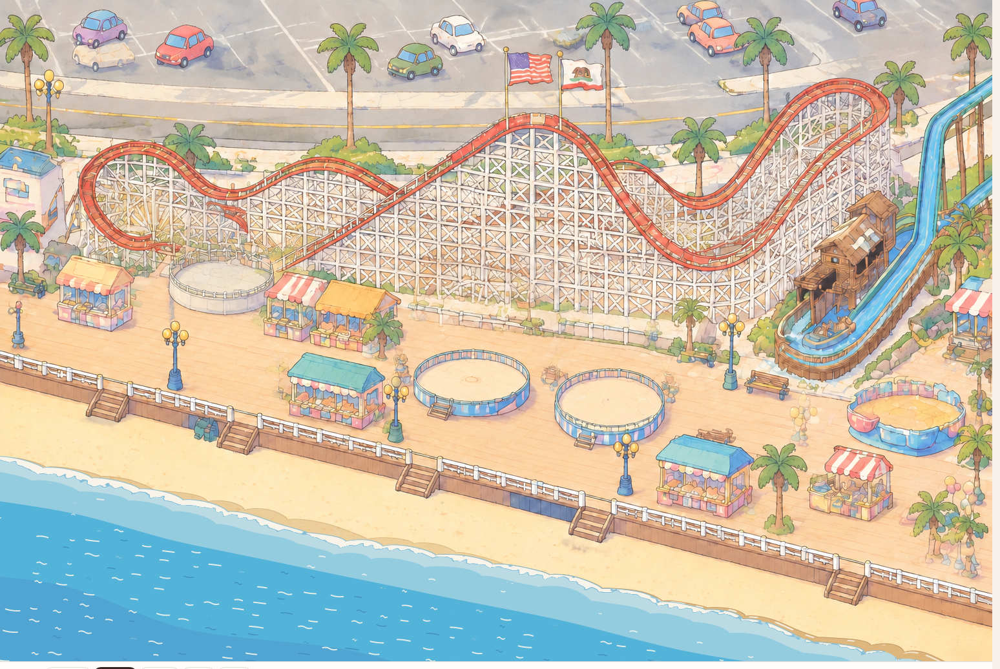
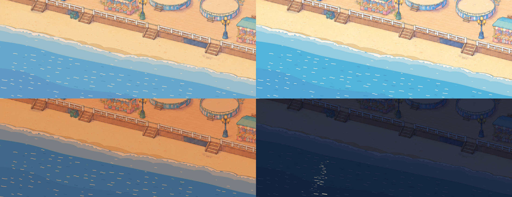

# Water: sea and surf as one WebGL2 shader pass

View: `http://localhost:15178/base/compose.html?tests=water` (add `&time=morning|midday|golden|night`, `&t=12.5` to freeze).

## What I built

| File | What it is |
|---|---|
| `layer.js` | Mounts one 1536 x 1024 WebGL2 canvas in the `water` slot, builds the lookup textures, sets colours from `time.look`, draws one full-screen triangle per frame. Also a small 2D canvas in the `lights` slot for the night moon glitter. |
| `sea.frag` | The fragment shader: the sea, shallows, swash, foam, breakers, wet sand, ripples. |

- **Ground space.** Each pixel is mapped to the ground plane with the camera's inverse (`u` along the shore, `v` across it). The waterline is a line of constant world z, so it runs exactly parallel to the wall rail (slope 0.2145).
- **Placement.** The still-water line sits 205 px below the rail line (`&shore=` to change). Over a full 72 s loop the highest reach (wet sand included) is 155–158 px below the rail at every column. That is 54–58 px below the stair feet at x = 912 and x = 1305, and at peak runup about 110 px of dry sand remains below the wall base. Because the shore is parallel to the wall, the open sea leaves the bottom edge at x ≈ 1280 and the swash at x ≈ 1480, so the far bottom-right is sand only.
- **Painted look.** The water is flat posterised fills with 1 px anti-aliased edges and no gradients or highlights:
  - deep sea, two deeper bands with slow wobbly edges, a light shallows band, and a lighter sheet band behind the foam;
  - white foam with lacy holes, holes and front edge rimmed by a thin blue-grey tinted line;
  - wet sand as a translucent darker tan (the painted sand texture shows through) with a thin darker tide line;
  - short white and dark-blue ripple dashes, some as tildes.
  Colours come from STYLE.md (`#f9f4ea` foam; wet sand measured from v1_1 at about 0.88/0.83/0.80 of dry). See `shots/vs_style_frame.png`.

## Motion

- **Everything is a function of `clock.now()` mod a 72 s loop.** Wave period 8 s (9 waves per loop); ripple lifetimes 6, 8 and 9 s; band wobble at 1–3 cycles per loop. Nothing is random per frame.
- **The loop is seamless.** Measured: the step across the wrap (71.98 to 72.00 s) changes 4,679 px; the neighbouring 0.02 s steps change 4,557–4,768 px. Frames at 0 and 72 s, and at 5 and 149 s, are identical.
- **Swash cycle per wave.** A breaker line forms about 105 ground units out and runs in as a thin segmented white line. At the shore it turns into a bore: a thick lacy foam band that runs up the sand, easing out to its peak. The backwash then accelerates down while the foam thins and breaks up. Stranded foam is left as a broken white line at the high-water mark, and the wet band behind fades out over the next period. The next wave overtakes the retreating backwash. See `shots/phases.png` (one period, 1 s apart), `shots/closeups.png` (3x) and `shots/live_sheet.png` (live clock, 1 s apart).
- **Variation along the shore.** Each wave's runup, cusp lobes, foam segments and timing vary with `u` through value noise keyed by wave index. A slow phase drift along the shore makes the uprush sweep obliquely down the beach. `&shoreu=N` renders another stretch of the same beach: `shots/shore_stretches.png` shows four stretches 1700 units apart at the same moment, all different.

## Time of day

Morning, midday, golden, night (combined with the base grade).

- **Grade compensation.** Taken as is, `look.sea` gets darkened twice: once by its own keyframes and again by the base grade's brightness × tint multiply. At night that made the sea nearly black (`#0b1222`), and golden turned it a muddy slate. I treat `look.sea` as the intended on-screen colour: the layer divides it by the grade's per-channel gain (`tint × exposure`), keeps the hue when clamping to 1, and blends 80% of the way to that (55% at night). Golden then reads as a warm slate-blue sea with gold-tinted ripples. A tint that warm cannot produce a true blue through a multiply.
- **Night.** The night grade caps every colour in the slot at about (0.18, 0.22, 0.34). The sea has to stay well below that or the white foam vanishes, so foam reads only as a faint lighter edge.
- **Moon glitter.** Glinting dashes in a column widening toward the viewer, drawn above the grade in the `lights` slot so they glow, scaled by `look.lights` (on only at full night; `&moon=0` turns it off). See `shots/night_glitter.png`.

## Edges

The canvas is transparent above the reach of the waves, so there is no rectangle. The wet band blends into the painted sand: its alpha fades with time, never as a spatial gradient, and the painted speckles show through it (`shots/edge_5x.png`). The sea runs off the left and bottom edges of the stage, like the painting.

## Performance

All numbers are **headless Chrome with SwiftShader (software WebGL)**. In this WSL2 setup headless Chrome cannot reach the GPU (RTX 4070 SUPER): every ANGLE backend I tried (gl, gl-egl, vulkan, with Mesa d3d12) returned no WebGL. Six other agents shared the 16 cores, with load average 2–80 during runs, so expect ±30%.

`&bench=10`, viewport 1536 x 1068 (world at scale 1), load average about 12:

| Run | fps | p50 ms | p95 ms | max ms | draws |
|---|---|---|---|---|---|
| stage only | 60.1 | 16.7 | 16.8 | 16.8 | – |
| water, midday | 17.9 | 50.0 | 66.7 | 150 | water: 1 |
| water, night (with glitter) | 17.9 | 50.0 | 66.7 | 116.7 | water: 1 |
| water, `&waterscale=0.75` (1152 x 768) | 26.5 | 33.4 | 50.1 | 133.3 | water: 1 |
| earlier runs: morning / golden / `grade=off` | 15.8 / 17.2 / 15.1 | 50–67 | 67–100 | | |

- **Pass cost.** `__water.cost(10)` times the pass alone (N draws, then a `readPixels` sync): **40.5 ms** in SwiftShader, about 49 times a flat-fill pass of the same size.
- **Compositing.** A variant that returned at once still ran at only 28–36 fps headless. About half the frame is software compositing of a full-size canvas in a filtered slot, not shader work.
- **No GPU numbers.** Real-GPU cost was not measured. It is one full-screen triangle, a few texture fetches and mostly short ALU per pixel, so it should be far below 1 ms on a desktop GPU; it needs a check on a mid-range phone.

Optimizations that kept the look (A/B measured in the same load window):

1. Deep-sea pixels skip all wave work; dry sand above the reach returns at once.
2. Three wave instances instead of four, by finishing the wet-sand fade within one period.
3. Polynomial sine and `sqrt` instead of `sin` and `pow` (about 10%).
4. A lookup table (RGBA16F, 2048 x 19), built once in JS, holds every along-shore noise value that depends only on `u` and the wave index. A 2048 x 1 row with the time-varying sea bands is re-uploaded each frame (32 KB). This was the biggest gain, about 30%.
5. The 2D foam-lace noise comes from a tileable 128 x 128 R8 texture, not four hashes.

The first draft benched at 2.7 fps (p50 317 ms) under heavier load; the final shader is about 40 ms per pass.

## What worked

- A single full-screen pass in ground coordinates gives the exact parallel shoreline, correct foreshortening of the swash, and any shore offset or swash size from a URL parameter.
- Flat fills with analytic 1 px edges plus noise-thresholded lace read as painted. A darker tint for the foam rim and the hole edges gives the thin tinted outlines without an extra pass.
- Overlapping per-wave instances (breaker, uprush, backwash, drying mark) make a convincing, readable swash rhythm, and keeping everything periodic in the loop made seamlessness easy to prove.
- Partly compensating the grade fixed the night and golden seas without touching `base/`.

## What didn't, and open problems

- **The grade fights the water.** A multiply tint can't make a warm-hour sea blue, and the night grade leaves almost no headroom for white foam. Glints have to live in `lights`, a second canvas.
- **Breaker lines** in the open water still look a little like smooth blades. They don't curl like the frame's hand-drawn curls; a proper curl shape (a crescent with a hooked end) would be the next refinement.
- **The open sea misses the right 20% of this stage.** That follows from "parallel to the wall" combined with "below the stairs" on a 1024 px tall stage. On the panning full park it would not show.
- **Ripples are placed in stage pixels.** On a panning world they must be keyed to world pixels, and the shore table must cover the visible `u` range. The table is cheap to rebuild, about 40k noise evaluations.
- **No interaction with characters yet.** The frames show foam rings around swimmers and a wet footprint trail; that needs a characters-to-water contract (a few ring positions as uniforms).
- **Not measured on a real GPU.**

## Proposals for `base/`

1. **Say whether `look.sea` and `look.sky` are pre-grade or on-screen colours, and expose the grade gain** (`tint × exposure`, saturation) on the look, so layers can compensate consistently instead of each re-deriving it.
2. **Reconsider grading the `water` slot with the full multiply at night**, or give layers a documented "emissive" path. Foam and moonlight need values above what the grade allows.
3. **A water `ctx` hook** (`waterline(u, t)`), so characters can wade, stand in the swash or leave wet footprints in sync with the waves. The shader's front function is analytic, so a JS twin is easy.

## Recommendation

Keep the sea as **one WebGL2 fragment pass** with this structure: ground-space coordinates, per-wave analytic swash instances, flat posterised fills with analytic edges, and along-shore noise baked into a small lookup table. It matches the style frames, follows the clock seamlessly, varies along the shore, and its cost is one draw. Put night glints in `lights`. Before building more, settle with `base/` how the grade treats layer colours (proposals 1 and 2), because that decides the night and golden looks more than the shader does.

## Parameters and debug hooks

- **URL parameters:**
  - `&shore=205`: px below the rail line;
  - `&swash=85`: runup in ground units;
  - `&shoreu=0`: along-shore offset, to view another stretch;
  - `&waterscale=1`: backing resolution;
  - `&moon=0`: no glitter.
- **Debug hooks:** `window.__water.draw(t)` renders any moment; `window.__water.cost(n)` times the pass against a flat fill.
